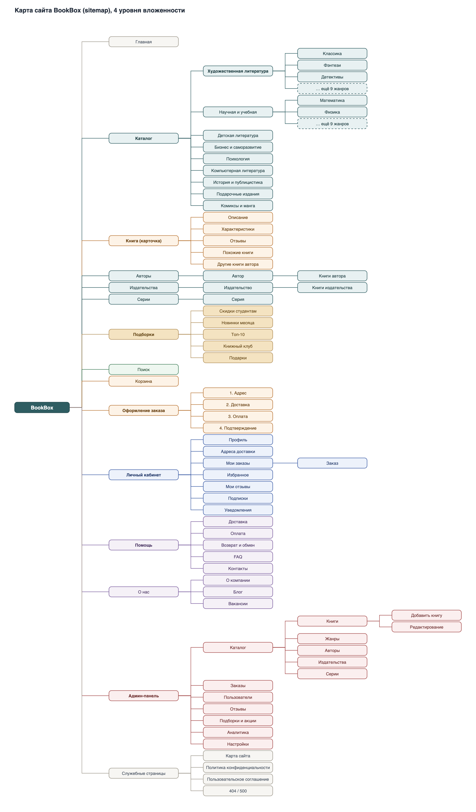
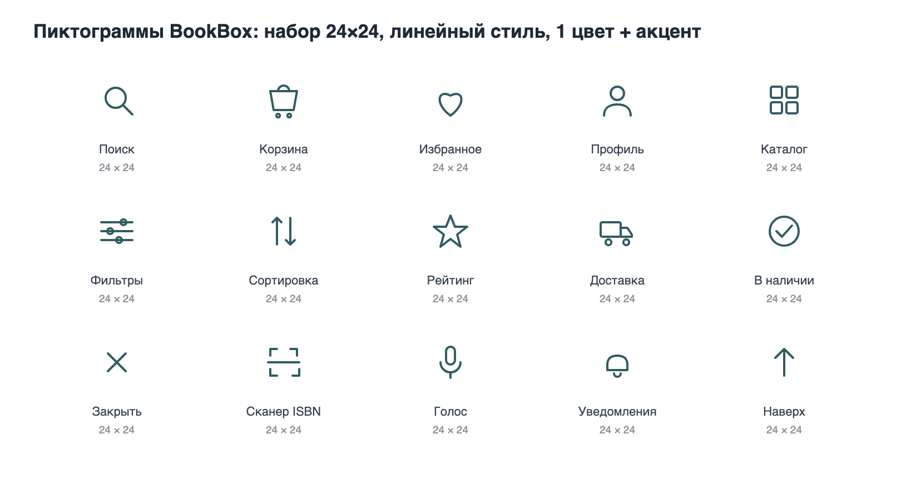
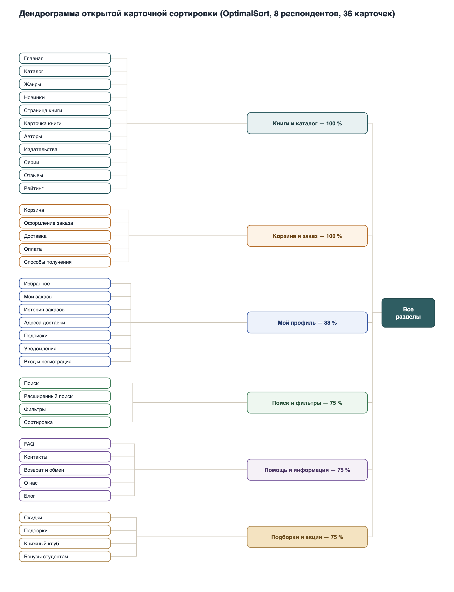
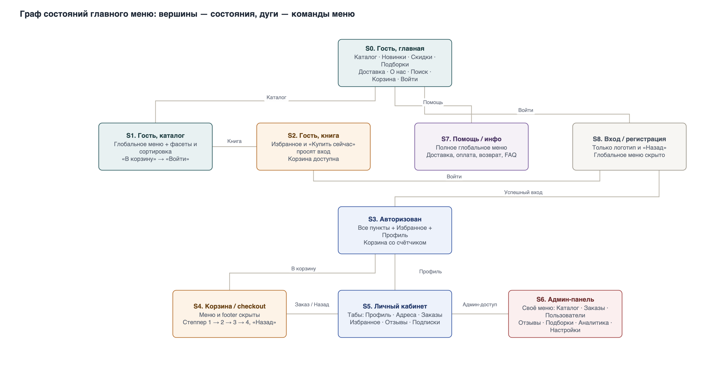
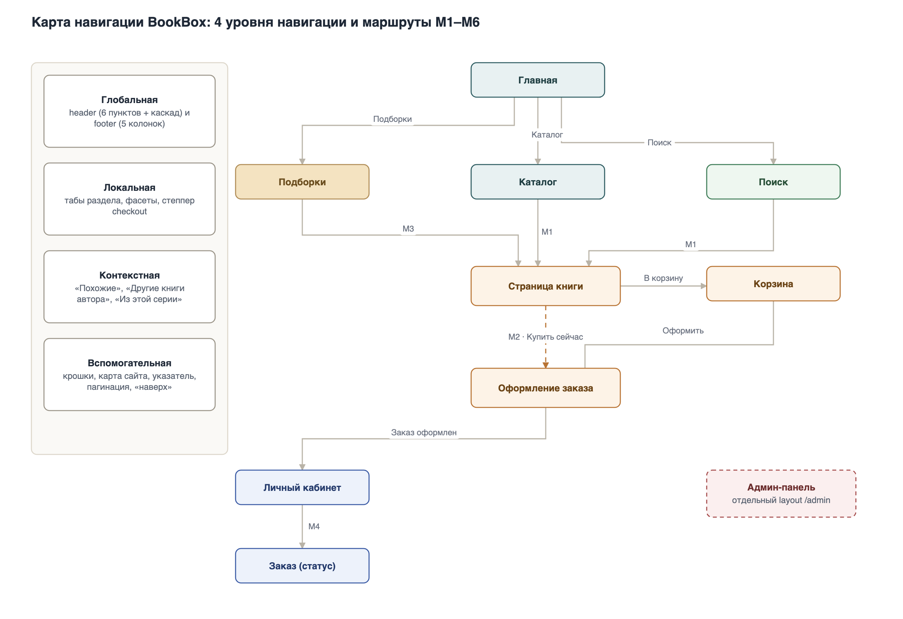
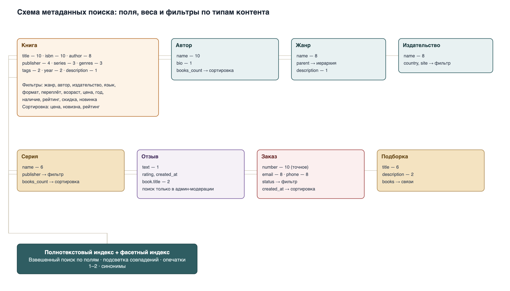

# Лабораторная работа №2

## Проектирование информационной архитектуры и взаимодействия с пользователем

**Тема проекта:** BookBox — онлайн-магазин книг.

**Статус документа:** выполнены этапы 1 и 2 — концептуальное проектирование, информационная архитектура и все схемы ИА. Разделы 7–10 (навигационные модели, CJM, Impact Map, раскадровки, wireframes и дизайн-макеты) выполняются на следующих этапах и будут добавлены в этот же документ.

---

## 1. Цели лабораторной работы

1. Разработать концепцию пользовательского интерфейса BookBox и выполнить этап концептуального проектирования.
2. Спроектировать информационную архитектуру веб-приложения и мобильного приложения: системы организации контента, именования, навигации и поиска.
3. Научиться проектировать макеты разных уровней детализации: эскизы, макеты низкой точности (wireframes) и дизайн-макеты.

**Входные данные:** результаты лабораторной работы №1 — [исследование пользователей и предметной области](lab1.md).

---

# Часть I. Концептуальное проектирование

## 2. Актуализация разделов лабораторной работы №1

### 2.1. Постановка задачи (актуализированная)

**Проблема:** покупка книг офлайн требует времени, ассортимент ограничен, а существующие онлайн-площадки либо не специализируются на книгах (Ozon, Wildberries), либо имеют устаревший интерфейс и слабый поиск (Belkniga.by).

**Решение:** BookBox — специализированный онлайн-магазин книг с продуманным каталогом, фасетным поиском, персональными подборками и доставкой по Беларуси. Продукт существует в двух представлениях:

- **веб-приложение** (`BookBox-Web`) — основная площадка для покупки с ноутбука и планшета;
- **мобильное приложение** (`BookBox-Mobile`) — основной канал для сценариев «в дороге» (64 % мобильного трафика у конкурентов, 75 % респондентов пользуются или хотят пользоваться мобильными приложениями).

Оба представления работают с одним серверным API (`BookBox-Server`), поэтому информационная архитектура проектируется как **единая модель контента с двумя разными формами навигации**.

### 2.2. Целевые пользователи (из ЛР1)

| Роль / персонаж | Приоритет | Ключевая потребность |
|---|---|---|
| Гость | — | Быстро найти книгу и оценить её, не регистрируясь |
| Покупатель (Аня, 20) | Основной | Низкая цена, фильтр по цене, заказ со смартфона между парами |
| Покупатель (Дмитрий, 30) | Ключевой | Минимум шагов, заказ в один клик, подборки, подарок |
| Покупатель (Ольга Петровна, 48) | Дополнительный | Точный расширенный поиск, редкие издания, подписка на новинки |
| Администратор (Сергей, 33) | Вспомогательный | Быстрое управление каталогом и заказами |
| Владелец (Ирина, 41) | Заказчик | Аналитика продаж |
| Курьер (Максим, 23) | Внешний | Чёткие данные заказа |

### 2.3. Что уточнено по сравнению с ЛР1

| Область | Было в ЛР1 | Уточнение в ЛР2 | Причина |
|---|---|---|---|
| Объектная модель | 8 объектов | Добавлены «Позиция заказа», «Платёж», «Адрес доставки», «Уведомление», «Подборка», «Промокод» | Объекты, с которыми пользователь реально взаимодействует в интерфейсе (см. п. 5) |
| Роли | Гость, Покупатель, Администратор | Добавлена техническая роль «Курьер» (без клиентского интерфейса BookBox) | Сценарий доставки из ЛР1 |
| Каталог | «поиск, фильтры» | Введена двухуровневая таксономия жанров + фасеты (п. 6.1) | Каталог в тысячи книг требует управляемой классификации |
| Навигация | не детализирована | Спроектированы 4 уровня навигации и граф состояний меню (п. 6.3) | Требование ЛР2 |
| Мобильное приложение | «адаптивность» | Отдельная навигационная схема (нижний tab bar), штрихкод, офлайн-избранное (п. 6.3.8) | Разные форм-факторы |

### 2.4. Стратегия дизайна (актуализация)

Стратегия из ЛР1 (разд. 13) сохраняется. Ниже — только изменения, вызванные переходом к проектированию информационной архитектуры.

| Аспект | В ЛР1 | Уточнение в ЛР2 |
|---|---|---|
| Видение продукта | онлайн-магазин книг с каталогом и доставкой | специализированный книжный: каталог → фасетный поиск → быстрый checkout; приоритет мобильного сценария |
| Позиционирование | ниша между Ozon и Belkniga | подтверждено Вордстатом: «купить книги» — 28 993 запроса/мес, остальной книжный трафик — «скачать/бесплатно» → конкурируем за жанры и авторов, а не за пиратский спрос |
| Аудитория | три группы | основной сценарий проектирования — Аня (мобайл, цена), Дмитрий — быстрый заказ, Ольга Петровна — точный поиск |
| Критерии успеха | 10+ пользователей, 1+ заказ/мес, чек 30 BYN | добавлены UX-метрики: «поиск → карточка» ≤ 2 клика, оформление ≤ 3 минут, конверсия гостя 10 %, отказы ≤ 35 % |
| Конфликты | цена/сервис, ассортимент/скорость, веб/мобайл | новый конфликт «полнота каталога vs скорость выдачи» решается фасетами и весами метаданных (п. 6.4.4) |
| Брендинг | «уютный книжный магазин» | палитра: тёплый песочный + глубокий зелёно-бирюзовый; спокойный тон, без агрессивных распродаж |
| Технологии | React, React Native, Python, PostgreSQL | без изменений; добавляются полнотекстовый и фасетный индексы (PostgreSQL FTS) |

### 2.5. Профили групп, среды и задач (актуализация)

**Группы пользователей** (детали — ЛР1, разд. 8):

| Группа | Доля | Основное устройство | Ключевая потребность | Что меняет в архитектуре |
|---|---|---|---|---|
| Студенты | 54 % | смартфон | низкая цена, скорость | tab bar, фильтр цены, блок скидок |
| Молодые специалисты | 29 % | смартфон + ноутбук | удобство, экономия времени | заказ в один клик, подборки, подарки |
| Преподаватели | 13 % | ноутбук | ассортимент, точность | расширенный поиск, предзаказ, подписки |

**Профиль среды** (детали — ЛР1, разд. 7):

| Контекст | Условия | Требование к информационной архитектуре |
|---|---|---|
| Дом, вечер, ноутбук | тихо, равномерный свет, нет спешки | полный каталог, фасеты, отзывы, подробные описания |
| Транспорт, смартфон | шумно, яркий или тусклый свет, отвлекают | нижний tab bar, крупные цели нажатия, офлайн-избранное, push |
| Учёба/работа, перерыв | частые прерывания, мало времени | сохранение прогресса, быстрый возврат к корзине и заказу |

**Профиль задач** (детали — ЛР1, разд. 6): первая очередь — поиск, карточка книги, корзина, оформление заказа, оплата. В ЛР2 добавлены самостоятельные входы «Новинки», «Скидки», «Подборки»; предзаказ вынесен в карточку книги; статус заказа — в личный кабинет и push-уведомления.

### 2.6. Задачи и роли пользователей (актуализация)

| Группа задач | Гость | Покупатель | Администратор |
|---|:---:|:---:|:---:|
| Просмотр каталога, карточки, отзывов | + | + | + |
| Поиск и фильтрация | + | + | + |
| Избранное | — | + | — |
| Корзина, оформление, оплата | — | + | — |
| История и статус заказа | — | + | + |
| Написание отзыва | — | + | модерация |
| Управление каталогом и заказами | — | — | + |
| Аналитика и отчёты | — | — | + |

**Примечания:**
1. Регистрация — единственная точка перехода «Гость → Покупатель»; избранное и «Купить сейчас» требуют входа (состояния S2 и S8 графа меню, п. 6.3.3).
2. Курьер не входит в клиентский интерфейс BookBox: он работает в приложении службы доставки и получает данные заказа через API.
3. Владелец использует админ-панель в режиме чтения (аналитика), отдельной роли для неё не требуется.

---

## 3. Тип интерфейса и способы управления

### 3.1. Тип интерфейса по А. Куперу

| Продукт / часть системы | Тип интерфейса | Обоснование |
|---|---|---|
| **Веб-приложение BookBox** (покупатель) | **Временный (transient)** | Пользователь приходит на 5–15 минут с конкретной задачей («найти и купить»), затем уходит. Интерфейс должен быстро приводить к цели и не требовать обучения. |
| **Мобильное приложение BookBox** | **Временный + фоновый компонент** | Основные сессии короткие (в транспорте, в перерыве), но push-уведомления о статусе заказа и скидках работают в фоне и возвращают пользователя в приложение. |
| **Админ-панель** | **Монопольный (sovereign)** | Сергей работает в ней 6–8 часов в день; это его основной инструмент. Допустимы плотные таблицы, горячие клавиши, массовые операции, два монитора. |
| **Серверные задачи** (рассылки, обновление остатков) | **Фоновый (daemonic)** | Не требуют участия пользователя, результат виден в интерфейсе (статус заказа, наличие). |

**Вывод для проектирования:** покупательские интерфейсы оптимизируются под **скорость достижения цели** (минимум шагов, крупные цели нажатия, сохранение прогресса), админ-панель — под **плотность информации и эффективность повторяющихся операций**.

### 3.2. Форм-факторы и способы управления

| Параметр | Веб-приложение | Мобильное приложение |
|---|---|---|
| Разрешение проектирования | 1440 px (desktop), 980 px (tablet) | 375×670 px |
| Устройство ввода | Мышь + клавиатура, тач на планшете | Палец (тап, свайп, long tap) |
| Ориентация | Альбомная (основная) | Портретная (основная), ландшафтная — для чтения |
| Специфические возможности ввода | Горячие клавиши (`/` — поиск, `Esc` — закрыть) | Камера (сканирование ISBN/штрихкода), голосовой ввод, биометрия для входа |
| Плотность интерфейса | Высокая: 24 карточки в сетке, боковая панель фильтров | Низкая: 2 карточки в ряд, фильтры в bottom sheet |
| Целевой размер элемента | 32–40 px | не менее 44×44 px (гайдлайны iOS/Android) |

---

## 4. Инфраструктура взаимодействия (6 шагов А. Купера)

### Шаг 1. Форм-фактор, тип приложения и способы управления
Определены в п. 3. Итог: веб + мобильное приложение, временный интерфейс у покупателя, монопольный — у администратора.

### Шаг 2. Функциональные и информационные элементы

| Элемент | Тип | Назначение | Где встречается |
|---|---|---|---|
| Список книг (сетка/список) | информационный | Представление множества книг | Каталог, поиск, подборки, избранное |
| Карточка книги | информационный | Компактное представление книги с ценой и кнопкой покупки | Каталог, поиск, «Похожие», корзина |
| Страница книги | информационный | Полное представление: описание, характеристики, отзывы | `/book/...` |
| Обложка | информационный | Визуальная идентификация книги | Везде |
| Цена и старая цена | информационный | Прозрачность стоимости и скидки | Карточка, страница книги, корзина |
| Рейтинг и количество отзывов | информационный | Помощь в выборе | Карточка, страница книги |
| Индикатор наличия | информационный | «В наличии» / «Под заказ» / «Нет в наличии» | Карточка, страница книги |
| Строка поиска | функциональный | Поиск без навигации по каталогу | Header (веб), таб (мобайл) |
| Автодополнение | функциональный | Подсказки во время ввода | Под строкой поиска |
| Панель фильтров (фасеты) | функциональный | Сужение выдачи | Каталог, поиск |
| Сортировка | функциональный | Изменение порядка выдачи | Каталог, поиск |
| Хлебные крошки | навигационный | Положение в иерархии | Все страницы глубже 1-го уровня |
| Корзина | информационный + функциональный | Список выбранных книг и сводка | `/cart` |
| Степпер оформления заказа | навигационный (процессуальный) | Показывает 4 шага оформления | Checkout |
| Форма адреса | информационный | Ввод адреса доставки | Checkout, личный кабинет |
| Выбор доставки и оплаты | функциональный | Выбор условий заказа | Checkout |
| Избранное | информационный + функциональный | Отложенные книги | Header, `/account/wishlist` |
| Табы личного кабинета | навигационный | Локальная навигация | `/account/*` |
| Отзыв (текст + оценка) | информационный | Социальное доказательство | Страница книги |
| Уведомление (toast / push) | функциональный | Обратная связь и статусы | Везде |
| Пустое состояние | информационный | Объяснение, почему пусто, и что делать | Корзина, поиск, избранное |
| Модальное подтверждение | функциональный | Защита от необратимых действий | Удаление из корзины, отмена заказа |

### Шаг 3. Функциональные группы и иерархические связи

| № | Функциональный блок | Функции блока | Связи (не более трёх) |
|---|---|---|---|
| 1 | Каталог | Просмотр, фильтрация, сортировка, переход к книге | → Поиск, → Карточка книги, → Подборки |
| 2 | Страница книги | Просмотр описания, характеристик, отзывов; покупка; избранное | → Каталог, → Корзина, → Отзывы |
| 3 | Поиск | Ввод запроса, подсказки, выдача, уточнение фильтрами | → Каталог, → Страница книги |
| 4 | Корзина | Изменение количества, удаление, переход к оформлению | → Страница книги, → Оформление заказа |
| 5 | Оформление заказа | Адрес → доставка → оплата → подтверждение (**процессуальная связь**) | → Корзина, → Личный кабинет |
| 6 | Личный кабинет | Профиль, адреса, заказы, избранное, подписки, отзывы | → Оформление заказа, → Страница книги |
| 7 | Информация и помощь | Доставка, оплата, возврат, FAQ, контакты, о компании | → Корзина, → Личный кабинет, → Каталог |
| 8 | Админ-панель | Каталог, заказы, пользователи, отзывы, аналитика | → все блоки (отдельный layout) |

**Правило:** у каждого блока не более трёх навигационных связей; исключение — блок «Оформление заказа», где связь процессуальная (шаги 1→2→3→4 жёстко последовательны).

### Шаг 4. Макетирование общей инфраструктуры
Выполняется в виде «фазы прямоугольников»: макеты без компоновки (структурные схемы) и wireframes (см. п. 6.3.9 и этап 4).

### Шаг 5. Ключевые сценарии

Ключевой сценарий описывает магистральный путь персонажа в лексиконе интерфейса.

| Персонаж | Ключевой сценарий | Магистральный путь |
|---|---|---|
| Аня | Купить учебник по низкой цене | Поиск → фильтр «Цена до 30 BYN» → Страница книги → В корзину → Оформление → Оплата картой |
| Дмитрий | Купить книгу в подарок | Каталог/поиск → Страница книги → В корзину → Оформление (подарочная упаковка, адрес коллеги) → Оплата |
| Ольга Петровна | Найти редкое издание и оформить предзаказ | Расширенный поиск (автор + издательство + год) → Страница книги → Предзаказ → Подписка на поступление |
| Сергей | Добавить книгу в каталог | Админ-панель → Каталог → Добавить книгу → Заполнить поля → Сохранить |
| Ирина | Оценить продажи за месяц | Админ-панель → Аналитика → Отчёт за месяц → Экспорт |

### Шаг 6. Проверочные сценарии
Проверочные (негативные и граничные) сценарии для верификации решений — в разделе 9 (интерактивные раскадровки, этап 4). Примеры: книга закончилась во время оформления, ошибка оплаты, пустая выдача поиска, потеря сессии при прерывании, недоступность интернета в мобильном приложении.

---

## 5. Уточнённая объектная модель

### 5.1. Новые и уточнённые объекты

| Объект | Мощность | Представления | Действия | Ключевые атрибуты |
|---|---|---|---|---|
| **Позиция заказа** | 1–20 на заказ | Строка в корзине, строка в заказе | изменить количество, удалить | книга, количество, цена на момент заказа, скидка |
| **Платёж** | 1 на заказ (возможны повторы) | Блок «Оплата», статус | оплатить, повторить, посмотреть статус | способ, сумма, статус, дата, идентификатор транзакции |
| **Адрес доставки** | 1–5 на пользователя | Форма, список адресов | добавить, изменить, удалить, выбрать основной | индекс, город, улица, дом, квартира, получатель, телефон |
| **Уведомление** | Много | Push, email, колокольчик | прочитать, перейти по ссылке, отключить | тип (заказ, скидка, поступление), текст, дата, статус прочтения |
| **Подборка** | 6–10 | Лендинг подборки, блок на главной | просмотреть, перейти к книге | название, описание, обложка, список книг, период актуальности |
| **Промокод** | Десятки | Поле в оформлении заказа | применить, отменить | код, тип скидки, значение, срок действия, условия |

### 5.2. Уточнённые связи

```
Пользователь 1──N Заказ           Заказ 1──N Позиция заказа
Заказ 1──1 Платёж (1──N попыток)  Книга 1──N Позиция заказа
Пользователь 1──N Адрес доставки  Пользователь 1──N Уведомление
Подборка N──M Книга               Промокод N──M Заказ
Пользователь 1──1 Корзина         Пользователь 1──1 Избранное
```

### 5.3. Соответствие объектов персонажам (дополнение к ЛР1)

| Объект | Аня | Дмитрий | Ольга Петровна | Сергей | Ирина |
|---|:---:|:---:|:---:|:---:|:---:|
| Позиция заказа | + | + | + | + | |
| Платёж | + | + | + | + | + |
| Адрес доставки | + | + | + | | |
| Уведомление | + | + | + | + | |
| Подборка | + | + | + | + | + |
| Промокод | + | + | | + | + |

---

# Часть II. Информационная архитектура

## 6. Информационная архитектура BookBox

Информационная архитектура разработана по схеме Л. Розенфельда и П. Морвиля: **системы организации, именования, навигации и поиска**. Все четыре системы проектируются один раз для единой модели контента и адаптируются под два представления (веб и мобильное).

### 6.1. Система организации контента

#### 6.1.1. Аудит контента (инвентаризация и классификация)

| № | Тип контента | Формат | Объём | Владелец | Статус |
|---|---|---|---|---:|---|
| 1 | Главная страница (баннеры, блоки подборок) | React-компонент + изображения | 1 страница, 5–7 блоков | Маркетинг (Ирина) | Макет |
| 2 | Листинг каталога | Динамическая страница, 24 карточки на страницу | ~5 000 книг | Backend + контент-менеджер | В разработке |
| 3 | Страница книги | Динамическая страница | 1 на книгу (~5 000) | Контент-менеджер (Сергей) | В разработке |
| 4 | Обложки книг | Изображение WebP/JPEG, 800×1200 px | ~5 000 | Контент-менеджер | План |
| 5 | Аннотации и описания | Текст 500–2 000 знаков | ~5 000 | Контент-менеджер, издательства | План |
| 6 | Характеристики книги | Структурированные поля | 12–15 полей на книгу | Контент-менеджер | План |
| 7 | Отзывы и оценки | Текст + оценка 1–5 | Сотни, растут | Пользователи, модерация Сергей | В разработке |
| 8 | Жанры (таксономия) | Справочник, дерево 2 уровней | 9 разделов / ~60 жанров | Контент-менеджер | Макет |
| 9 | Издательства | Справочник | Десятки | Контент-менеджер | Макет |
| 10 | Авторы | Справочник + биография | Сотни | Контент-менеджер | План |
| 11 | Серии книг | Справочник | Десятки | Контент-менеджер | План |
| 12 | Тематические подборки | Список книг + текст | 6–10 активных | Маркетинг | План |
| 13 | Акции и промокоды | Баннер + правила | 3–5 одновременно | Маркетинг | План |
| 14 | Заказы | Транзакционные данные | Тысячи | Система | В разработке |
| 15 | Профиль пользователя | Форма + данные | Тысячи | Пользователь | В разработке |
| 16 | Адреса доставки | Структурированные записи | 1–5 на пользователя | Пользователь | В разработке |
| 17 | Способы доставки и оплаты | Справочник | 3–5 вариантов | Владелец | План |
| 18 | Справка и FAQ | Текстовые статьи | 15–25 статей | Контент-менеджер | План |
| 19 | Блог и обзоры | Статьи | 2–4 в месяц | Маркетинг | План |
| 20 | Юридические документы | Текст | 4–5 документов | Владелец | План |
| 21 | Уведомления | Push / email / in-app | Генерируемые | Система | План |
| 22 | Аналитические отчёты | Таблицы и графики | 5–7 отчётов | Система | План |

**Выводы аудита:**
1. Контент **неоднороден**: есть справочники (жанры, издательства), сущности (книга, автор) и транзакционные данные (заказ, платёж) — для них нужны разные принципы организации.
2. Основной объём — **каталог книг** (тысячи записей), поэтому иерархия каталога должна быть неглубокой, а уточнение — фасетным.
3. Часть контента **генерируется системой** (заказы, уведомления, отчёты) и не требует ручного наполнения.

#### 6.1.2. Выбранная схема организации

**Гибридная схема** — не смешение в одном меню, а несколько самостоятельных схем, каждая на своём месте:

| Область | Схема организации | Обоснование |
|---|---|---|
| Каталог | **Иерархическая** (раздел → жанр → книги) + **фасетная** (фильтры) | Пользователь понимает «где он», а фасеты дают многомерное уточнение без углубления иерархии |
| Оформление заказа | **Последовательная** (шаг 1 → 4) | Процесс жёстко упорядочен, возврат назад допустим, перескок — нет |
| Подборки и акции | **Тематическая / по аудитории** | «Скидки студентам», «Книжный клуб», «Подарки» отражают потребность, а не жанр |
| Авторы, издательства, серии | **Алфавитная** + указатель | Пользователь знает точное имя/название и ищет напрямую |
| Новинки, блог | **Хронологическая** | Свежесть — главный критерий |
| Админ-панель | **По задачам** | Сергей мыслит операциями: «добавить книгу», «обработать заказ» |

**Почему не одна схема:** по Розенфельду, «чистая» схема даёт простую ментальную модель, а смешение схем внутри одного уровня создаёт путаницу. Поэтому схемы разделены по областям: в каталоге — иерархия + фасеты, в подборках — тематика, в справочниках — алфавит.

**Баланс ширины и глубины:** каталог ограничен **двумя уровнями жанров** и **9 разделами** в первом уровне — это не слишком широкое меню и не глубокая иерархия, где пользователь «проваливается» в уровни.

#### 6.1.3. Принципы группировки

1. **По тематике (жанру)** — основной принцип каталога: пользователь часто не знает точного названия, но знает, что хочет «детектив» или «учебник по матанализу».
2. **По задаче пользователя** — входы «Купить учебники», «Найти подарок», «Проверить статус заказа».
3. **По аудитории** — «Скидки студентам», «Детские книги 0–6», «Научная литература».
4. **Алфавитный** — авторы, издательства, серии, указатель.
5. **Хронологический** — новинки, поступления, история заказов.
6. **По цене и выгоде** — «До 20 BYN», «Скидки», «Распродажа».

#### 6.1.4. Таксономия каталога

**Уровень 1 — разделы (9):**
1. Художественная литература
2. Научная и учебная литература
3. Детская литература
4. Бизнес и саморазвитие
5. Психология
6. Компьютерная литература
7. История, публицистика
8. Подарочные и коллекционные издания
9. Комиксы и манга

**Уровень 2 — примеры жанров:**

| Раздел | Жанры |
|---|---|
| Художественная литература | Классика, Современная проза, Фэнтези, Фантастика, Детективы, Триллеры, Любовные романы, Исторические романы, Поэзия |
| Научная и учебная литература | Математика, Физика, Химия, Биология, Экономика, Право, Философия, Языкознание, Учебники и пособия |
| Детская литература | Сказки, Дошкольникам, Младшим школьникам, Подросткам, Развивающие книги |
| Бизнес и саморазвитие | Менеджмент, Маркетинг, Финансы, Стартапы, Личная эффективность |
| Психология | Общая психология, Психотерапия, Самооценка, Отношения |
| Компьютерная литература | Программирование, Базы данных, ИИ и ML, Дизайн, Сети и администрирование |
| История, публицистика | История Беларуси, Всемирная история, Биографии, Политика |
| Подарочные издания | Альбомы, Подарочные наборы, Коллекционные издания |
| Комиксы и манга | Комиксы, Манга, Графические романы |

**Неиерархические (фасетные) оси классификации:**

| Ось | Значения | Тип |
|---|---|---|
| Автор | Справочник авторов | множественный |
| Издательство | Справочник издательств | множественный |
| Язык | Русский, белорусский, английский | множественный |
| Формат | Бумажная, электронная, аудио, набор | множественный |
| Переплёт | Твёрдый, мягкий, интегральный | одиночный |
| Возрастная маркировка | 0+, 6+, 12+, 16+, 18+ | множественный |
| Год издания | Диапазон | диапазон |
| Цена | Диапазон, BYN | диапазон |
| Наличие | В наличии, под заказ | одиночный |
| Рейтинг | 1–5 | диапазон |
| Акция | Есть скидка | флаг |
| Новинка | За последние 90 дней | флаг |

**Правила таксономии:**
1. Одна книга — **ровно один** раздел уровня 1 и **1–3** жанра уровня 2 (основной жанр — первый).
2. Раздел уровня 1 не может быть удалён, если в нём есть книги; жанры переносятся между разделами только администратором.
3. Названия жанров — существительные в единственном или множественном числе, но **единообразно внутри раздела** (см. п. 6.2.2).
4. Книга без жанра не публикуется — валидация в админ-панели.
5. Теги (свободные метки) используются только для подборок и поиска, но **не** для навигации.

#### 6.1.5. Карта сайта (sitemap)

```
BookBox
├── Главная
├── Каталог
│   ├── Художественная литература
│   │   ├── Классика
│   │   ├── Фэнтези
│   │   ├── Детективы
│   │   └── … (9 жанров)
│   ├── Научная и учебная литература
│   │   ├── Математика
│   │   ├── Физика
│   │   └── … (9 жанров)
│   ├── Детская литература
│   ├── Бизнес и саморазвитие
│   ├── Психология
│   ├── Компьютерная литература
│   ├── История, публицистика
│   ├── Подарочные издания
│   ├── Комиксы и манга
│   └── Все книги (с фасетной панелью)
├── Книга /book/{slug}
│   ├── Описание
│   ├── Характеристики
│   ├── Отзывы (вкладка)
│   ├── Похожие книги
│   └── Другие книги автора
├── Авторы
│   └── Автор /authors/{slug}
│       └── Книги автора
├── Издательства
│   └── Издательство /publishers/{slug}
│       └── Книги издательства
├── Серии
│   └── Серия /series/{slug}
├── Подборки
│   ├── Скидки студентам
│   ├── Новинки месяца
│   ├── Топ-10
│   ├── Книжный клуб
│   └── Подарки
├── Новинки
├── Скидки и акции
├── Поиск /search?q=
│   └── Результаты с фасетами
├── Корзина /cart
├── Оформление заказа /checkout
│   ├── 1. Адрес
│   ├── 2. Доставка
│   ├── 3. Оплата
│   └── 4. Подтверждение
├── Личный кабинет /account
│   ├── Профиль
│   ├── Адреса доставки
│   ├── Мои заказы
│   │   └── Заказ /account/orders/{id}
│   ├── Избранное
│   ├── Мои отзывы
│   ├── Подписки на новинки
│   └── Уведомления
├── Вход / Регистрация / Восстановление пароля
├── Помощь
│   ├── Доставка
│   ├── Оплата
│   ├── Возврат и обмен
│   ├── FAQ
│   └── Контакты
├── О нас
│   ├── О компании
│   ├── Блог
│   └── Вакансии
├── Админ-панель /admin
│   ├── Каталог
│   │   ├── Книги → Добавить / Редактировать
│   │   ├── Жанры
│   │   ├── Авторы
│   │   ├── Издательства
│   │   └── Серии
│   ├── Заказы → Карточка заказа
│   ├── Пользователи
│   ├── Отзывы (модерация)
│   ├── Подборки и акции
│   ├── Аналитика
│   └── Настройки
└── Служебные
    ├── Карта сайта
    ├── Политика конфиденциальности
    ├── Пользовательское соглашение
    ├── 404
    └── 500
```

Глубина: каталог — 4 уровня (Каталог → Раздел → Жанр → Книга), админ-панель — 4 уровня (Админ → Каталог → Книги → Редактирование), что удовлетворяет требованию «не менее 3 уровней».



*Рисунок 1. Карта сайта (sitemap) BookBox: 4 уровня вложенности, 85 узлов. Исходник: [sitemap.drawio](images/lab2/sitemap.drawio).*

---

### 6.2. Система именования

#### 6.2.1. Словарь (glossary)

| Термин | Определение | Где используется |
|---|---|---|
| **Каталог** | Полный перечень книг, доступных для заказа | Главное меню, хлебные крошки |
| **Жанр** | Категория книги внутри раздела каталога | Фильтры, карточка книги, админ-панель |
| **Раздел** | Категория первого уровня каталога | Каталог, админ-панель |
| **Книга** | Товар — конкретное издание | Везде |
| **Издание** | Конкретный выпуск книги (год, издательство, переплёт) | Характеристики книги |
| **Автор** | Лицо, написавшее книгу | Карточка книги, фильтры, указатель авторов |
| **Издательство** | Организация, выпустившая книгу | Характеристики, фильтры, указатель |
| **Серия** | Объединённая группа книг одного издательства | Карточка книги, блок «Из этой серии» |
| **ISBN** | Международный идентификатор книги | Поиск, характеристики, сканирование |
| **Наличие** | Доступность книги к отгрузке | Карточка, страница книги, корзина |
| **Под заказ** | Книги нет на складе, но её можно заказать | Карточка, страница книги |
| **Предзаказ** | Заказ книги до её поступления | Страница книги |
| **Цена** | Стоимость книги в BYN | Везде |
| **Скидка** | Уменьшение цены относительно базовой | Карточка, страница книги, корзина |
| **Промокод** | Код для дополнительной скидки | Оформление заказа, акции |
| **Корзина** | Набор книг, выбранных для покупки | Header, `/cart` |
| **Избранное** | Список книг, отложенных пользователем | Header, личный кабинет |
| **Оформить заказ** | Перейти к заполнению данных и оплате | Корзина, страница книги (покупка в 1 клик) |
| **Заказ** | Оформленная покупка с номером и статусом | Личный кабинет, админ-панель |
| **Позиция заказа** | Одна книга в составе заказа | Корзина, детали заказа |
| **Статус заказа** | Текущее состояние: «Оформлен», «Оплачен», «Собирается», «Передан курьеру», «Доставлен», «Отменён» | Личный кабинет, админ-панель |
| **Доставка** | Способ получения заказа (курьер, самовывоз, почта) | Оформление заказа, справка |
| **Самовывоз** | Получение заказа в пункте выдачи | Оформление заказа, справка |
| **Оплата** | Способ расчёта (карта, ЕРИП, при получении) | Оформление заказа, справка |
| **Личный кабинет** | Раздел с данными пользователя и историей | Header, профиль |
| **Подборка** | Тематический список книг от редакции | Главная, раздел «Подборки» |
| **Новинка** | Книга, поступившая за последние 90 дней | Каталог, фильтры, раздел «Новинки» |
| **Отзыв** | Мнение пользователя о книге с оценкой 1–5 | Страница книги |
| **Рейтинг** | Средняя оценка книги по отзывам | Карточка, страница книги |
| **Подписка** | Уведомления о новинках жанра или поступлении книги | Личный кабинет, страница книги |
| **Гость** | Неавторизованный пользователь | Служебные тексты |
| **Покупатель** | Авторизованный пользователь | Служебные тексты |
| **Администратор** | Сотрудник, управляющий каталогом и заказами | Админ-панель |

#### 6.2.2. Принципы именования

1. **Краткость.** Пункт меню — 1–2 слова, не более 25 символов; кнопка — глагол + объект («В корзину», «Оформить заказ»).
2. **Единый синтаксис внутри системы.** Навигация — существительные («Каталог», «Подборки», «Доставка»); действия — глаголы в инфинитиве или повелительном наклонении («Оформить заказ», «Добавить»); заголовки — существительные.
3. **Единая степень детализации.** Нельзя смешивать «Книги», «Фэнтези» и «Купить детектив дешево» в одном списке.
4. **Одна сущность — один термин.** В интерфейсе используется только «Избранное», а не «Список желаний», «Вишлист», «Отложенное».
5. **Ориентация на язык аудитории.** «Купить», а не «Приобрести»; «Корзина», а не «Блок товаров»; «Нет в наличии», а не «Нулевой остаток».
6. **Полнота.** Если в каталоге есть разделы «Фэнтези» и «Детективы», в нём не может «пропасть» «Классика».
7. **Единство стиля.** Все пункты меню — с заглавной буквы, без точки в конце, без лишних знаков; многоточие — только для пунктов, открывающих диалог.
8. **Пиктограмма — не замена тексту.** Иконка всегда сопровождается текстовой меткой или подсказкой (`title`/`aria-label`), кроме общепринятых (поиск, корзина).
9. **Ориентация на роль.** Покупателю — «Мои заказы», администратору — «Заказы» (все заказы).
10. **SEO-совместимость.** Названия разделов совпадают с частотными поисковыми запросами (см. п. 6.2.3).

#### 6.2.3. Проверка названий по поисковым запросам (Яндекс.Вордстат)

**Методика.** Яндекс.Вордстат, регион — **Беларусь**, все устройства (десктоп, смартфоны, планшеты), режим «по словам», период — последние 30 дней (08.09.2026 – 07.10.2026). Значение — суммарное число запросов, содержащих все слова в любой форме и порядке. Для каждого термина проверялись узкая формулировка (как её вводят пользователи) и широкая (как термин ищут в принципе).

| Проверяемый термин интерфейса | Запрос для проверки | Частотность, запросов/мес | Что подтверждает | Решение |
|---|---|---:|---|---|
| **Каталог** | купить книги | **28 993** | Пользователи ищут действием «купить», а не словом «каталог» | Пункт меню «Каталог»; в SEO-заголовках — «Купить книги» |
| **Художественная литература** | художественная литература | **7 117** | Термин известен, но топ зашумлён методическими запросами («конспект занятия по художественной литературе») | Оставить как раздел; в заголовке — «Купить художественную литературу» |
| **Фэнтези** | фэнтези / книги фэнтези | **34 475** / **7 638** | Высокий интерес, но ~10 тыс. запросов — «бесплатно» и «скачать» | Оставить жанром; акцент на бумажные издания и цену |
| **Учебники** | учебники / купить учебники | **387 005** / **3 751** | Крупнейший тематический сегмент, сильно зашумлён школьными запросами | Добавить вход «Учебники» в подборки и фильтр по классу |
| **Детские книги** | детские книги / книги для детей | **3 000** / **2 829** | Обе формулировки равнозначны | В интерфейсе — «Детские книги», синоним «книги для детей» — в поиске |
| **Избранное** | избранное / список желаний | **9 716** (шумно) / **10** | Слово «избранное» в отрыве от контекста означает «избирать» и сериалы | Только UI-метка; в SEO не использовать, синонимы — в поиске |
| **Корзина** | корзина / корзина интернет магазин | **26 934** (шумно) / **52** | Слово перегружено бытовыми значениями (корзина сцепления и т. п.) | Только UI-метка, не SEO-термин |
| **Доставка** | доставка книг / доставка книг минск | **455** / **16** | Спрос низкий, но конкретный | Раздел «Доставка»; SEO — «Доставка книг по Беларуси» |
| **Оплата при получении** | оплата при получении | **923** | Устойчивый спрос, в топе — Ozon | Обязательно оставить способ оплаты (сценарий анти-персонажа) |
| **ISBN** | найти книгу по isbn | **7** | Микробъём, но точечный сценарий | Поле ISBN в расширенном поиске и сканер в мобильном; без продвижения |
| **Букинистика** | букинистические книги | **102** | Узкая ниша | Вне MVP, задел на будущее |
| **Электронные книги** | электронные книги / купить электронную книгу | **17 350** / **1 761** | В топе — PocketBook, Kindle: «электронная книга» часто означает устройство | В фильтре — «Электронная книга (файл)», иначе неоднозначно |

**Дополнительные проверки (названия действий и разделов):**

| Термин / запрос | Частотность | Вывод |
|---|---:|---|
| книги (базовый запрос) | 665 814 | Из них «скачать книги» — 95 470, «книги бесплатно» — 85 416. Коммерческий интент («купить») — лишь 28 993, то есть ~4,4 % |
| купить книгу | 28 993 | Формы «купить книгу» и «купить книги» дают одинаковый объём |
| заказать книгу | 641 | «Заказать» в 45 раз реже «купить» → основные кнопки — «Купить», «В корзину» |
| оформить заказ | 894 | Подтверждает метку «Оформить заказ» на шаге checkout |
| мои заказы | 900 | Подтверждает «Мои заказы» в личном кабинете |
| личный кабинет | 592 895 | Термин стандартный и ожидаемый (шум: Белтелеком, банки) |
| книжный интернет магазин | 355 | Люди не ищут «книжный интернет-магазин» → SEO строится на жанрах и авторах, а не на общем термине |
| отзывы о книгах | 1 426 | Блок отзывов востребован |
| книги в подарок | 218 | Подборка «Подарки» оправдана |
| подарочная упаковка | 656 | Услуга из сценария Дмитрия имеет спрос |
| скидки на книги | 41 | Скидки важны (58 % по опросу), но их не ищут словами → показывать цену и скидку в карточке, а не отдельной страницей |
| книги дешево | 94 | Подтверждает: важна цена в карточке, а не формулировка «дёшево» |
| промокод | 132 200 | Термин общепринят → поле «Промокод» в оформлении заказа |
| купить книги в интернет магазине | 116 | Пользователи ищут книги, а не способ покупки |

**Выводы по результатам Вордстата:**

1. **Коммерческий спрос в Беларуси компактный:** 28 993 запроса в месяц на «купить книги» против 665 814 на «книги». Это подтверждает стратегию узкого специализированного магазина: конкурировать нужно не за общий книжный трафик (большая его часть — «скачать/бесплатно»), а за конкретные жанры, авторов и поводы.
2. **«Купить» доминирует над «заказать»** (28 993 против 641) — основные кнопки называются «Купить» и «В корзину», а «Оформить заказ» используется только на шаге оформления.
3. **География:** «купить книги в минске» — 2 602 запроса, около 9 % коммерческого спроса. Остальное — регионы, поэтому доставка по стране и гео-страницы («Доставка книг в Гомель») — обязательны.
4. **Учебники — крупнейший тематический сегмент** (387 005), но он зашумлён школьной программой. Нужен отдельный вход «Учебники» и фильтр по классу/предмету.
5. **Фэнтези востребовано** (34 475), но треть запросов — про бесплатные и скачиваемые книги. В карточке жанра делаем акцент на бумажные издания, цену и наличие.
6. **«Электронная книга» неоднозначна:** в топе PocketBook и Kindle, то есть пользователи ищут устройство. В фильтре формат называется «Электронная книга (файл)».
7. **«Художественная литература»** (7 117) в топе содержит методические запросы воспитателей → без уточнения «купить» термин в SEO слабый.
8. **«Избранное», «Корзина», «Личный кабинет»** — плохие SEO-термины из-за омонимии, но хорошие UI-метки: пользователи их ожидают и понимают в контексте.
9. **«Оплата при получении»** (923) — заметный устойчивый спрос, что подтверждает решение ЛР1 оставить этот способ оплаты для недоверчивой аудитории.
10. **«ISBN» (7) и «букинистика» (102)** — микробъёмы: ISBN остаётся как точечный сценарий поиска и сканер, букинистика — вне MVP.
11. **Скидки словами не ищут** (41), хотя цена критична по опросу (71 %). Значит, выгода должна быть видна в карточке и в фильтре «Со скидкой», а не на отдельной SEO-странице.
12. **«Подарочная упаковка»** (656) подтверждает услугу из сценария Дмитрия — её стоит вынести отдельной опцией в оформлении заказа.

> **Ограничение метода:** Вордстат не различает значения слов, поэтому часть запросов шумная («стол-книга», «диван-книга», «корзина сцепления», «избирать»). Для названий это не критично: шумные термины просто не используются в SEO и остаются UI-метками.

#### 6.2.4. Система меток

**Текстовые метки навигации:**

| Метка | Тип элемента | Где | Примечание |
|---|---|---|---|
| Каталог `⌄` | пункт меню с каскадом | Header | Стрелка вниз — есть подменю |
| Подборки | пункт меню | Header | — |
| Новинки | пункт меню | Header | — |
| Скидки | пункт меню | Header | Выделен цветом акцента |
| Доставка | пункт меню | Header / Footer | — |
| О нас | пункт меню | Header | — |
| Войти | кнопка | Header | Для гостя |
| Профиль `⌄` | пункт меню с каскадом | Header | Для авторизованного |
| Назад | ссылка | Страница книги, checkout | Возврат на шаг назад |
| Показать ещё | кнопка | Каталог | Догрузка карточек |
| Применить | кнопка | Фильтры (мобайл) | Фиксация выбора |
| Сбросить | текстовая ссылка | Фильтры | Очистка всех фасетов |
| В корзину | кнопка | Карточка, страница книги | Основное действие |
| Купить сейчас | кнопка | Страница книги | Быстрый checkout |
| Оформить заказ | кнопка | Корзина | Переход к checkout |
| Продолжить покупки | ссылка | Корзина (пустая) | Выход из пустого состояния |

**Пиктограммы:**

| Иконка | Значение | Где | Обязателен текст? |
|---|---|---|---|
| 🔍 | Поиск | Header, мобильный tab bar | Нет (общепринято) |
| 🛒 | Корзина + счётчик | Header, tab bar | Нет |
| ♡ | Избранное | Карточка, страница книги | Да (title) |
| 👤 | Профиль | Header, tab bar | Да |
| ▦ | Каталог | Header, tab bar | Да |
| ⚙ / ≡ | Фильтры | Каталог | Да |
| ↕ | Сортировка | Каталог | Да |
| ★ | Рейтинг | Карточка, отзывы | Нет |
| 🚚 | Доставка | Карточка товара, справка | Да |
| ✓ | В наличии / успех | Карточка, уведомления | Да |
| ✕ | Закрыть / удалить | Модальные окна, корзина | Да (aria-label) |
| ⌄ / › | Раскрытие / переход | Меню, аккордеоны | Нет |
| 📷 | Сканировать ISBN | Мобильный поиск | Да |
| 🎤 | Голосовой поиск | Мобильный поиск | Да |
| 🔔 | Уведомления | Личный кабинет, header | Да |
| ⬆ | Наверх | Длинные страницы | Да |



*Рисунок 2. Черновой набор пиктограмм (24×24, линейный стиль): 15 иконок для навигации, статусов и мобильного поиска. В финальном UI-kit (этап 7) иконки уточняются по толщине и оптическим размерам.*

**Правила применения меток:**
1. Иконки без текста допустимы только для поиска и корзины.
2. Один смысл — одна иконка на всём продукте.
3. Иконка не меняет положение между экранами одного уровня.
4. Цветовые метки используются только для статусов: зелёный — «В наличии», оранжевый — «Под заказ», серый — «Нет в наличии», красный — ошибка/отмена.

#### 6.2.5. Схема именования URL

```
https://bookbox.by/
https://bookbox.by/catalog/
https://bookbox.by/catalog/fiction/                  → раздел
https://bookbox.by/catalog/fiction/fantasy/          → жанр
https://bookbox.by/catalog/fiction/fantasy/?author=...&price_from=10&sort=price_asc
https://bookbox.by/book/master-i-margarita-10245/    → книга (slug + id)
https://bookbox.by/authors/bulgakov-mihail/          → автор
https://bookbox.by/publishers/ast/                   → издательство
https://bookbox.by/series/...                        → серия
https://bookbox.by/collections/students-discount/    → подборка
https://bookbox.by/new/                              → новинки
https://bookbox.by/sale/                             → скидки
https://bookbox.by/search/?q=математический+анализ   → поиск
https://bookbox.by/cart/                             → корзина
https://bookbox.by/checkout/address/                 → шаг 1
https://bookbox.by/checkout/delivery/                → шаг 2
https://bookbox.by/checkout/payment/                 → шаг 3
https://bookbox.by/checkout/confirm/                 → шаг 4
https://bookbox.by/account/                          → кабинет
https://bookbox.by/account/orders/                   → заказы
https://bookbox.by/account/orders/1024/              → заказ
https://bookbox.by/account/wishlist/                 → избранное
https://bookbox.by/help/delivery/                    → справка
https://bookbox.by/about/                            → о компании
https://bookbox.by/admin/catalog/books/              → админ: книги
https://bookbox.by/admin/catalog/books/10245/edit/   → админ: редактирование
https://bookbox.by/admin/orders/1024/                → админ: заказ
```

**Правила:**
- только строчные латинские буквы, цифры и дефис; транслитерация кириллицы;
- вложенность URL повторяет вложенность карты сайта;
- параметры фильтров — в query-string (`?genre=`, `?price_from=`), чтобы состояние каталога было ссылаемым и индексируемым;
- фильтры формируют «чистые» URL без дублей (`?genre=fantasy&price_to=30`), мусорные параметры отбрасываются;
- ID в конце slug — защита от переименований и дублей;
- служебные страницы: `/404`, `/500`, `/sitemap/`.

#### 6.2.6. Тезаурус

| Основной термин (интерфейс) | Синонимы пользователей | Правило |
|---|---|---|
| Корзина | тележка, корзинка | В интерфейсе только «Корзина»; синонимы распознаются поиском |
| Избранное | список желаний, вишлист, отложенное | В интерфейсе «Избранное»; в поиске и подсказках — синонимы |
| Книга | товар, издание, позиция | «Книга» — в покупательском интерфейсе; «позиция» — только в заказе |
| Жанр | категория, рубрика, тема | «Жанр» в фильтрах; «Раздел» — только первый уровень |
| Издательство | издатель, бренд | «Издательство» |
| Автор | писатель, составитель | «Автор» |
| Доставка | отправка, привоз, курьер | «Доставка»; «Курьер» — конкретный способ |
| Оплата | платёж, расчёт | «Оплата» |
| Заказ | покупка, посылка | «Заказ» — документ; «покупка» — только в маркетинговых текстах |
| Подборка | коллекция, выборка, топ | «Подборка» |
| Нет в наличии | закончилась, отсутствует, нет на складе | «Нет в наличии» |

**Правила тезауруса:**
1. В интерфейсе — **только один** термин из строки; синонимы живут в поиске, SEO-текстах и подсказках.
2. Поисковый запрос с синонимом не даёт пустую выдачу, а маппится на основной термин (см. п. 6.4.2).
3. Омонимы уточняются контекстом: «Издание» (книга) и «Издательство» (организация) не сокращаются до «Изд.» в интерфейсе.
4. Новые термины добавляются в словарь одновременно с макетом, а не после разработки.

---

### 6.3. Система навигации

#### 6.3.1. Открытая карточная сортировка (OptimalSort)

**Методика:**
- инструмент — OptimalSort (Open Card Sort);
- период — октябрь 2026 г.;
- респонденты — 8 человек: 5 из целевой аудитории (18–35 лет, покупают книги онлайн) и 3 «вне ЦА» (36+, покупают редко) для контроля;
- карточек — 36 (полный набор терминов и функций из словаря, п. 6.2.1);
- инструкция: «Сгруппируйте карточки так, как ожидаете увидеть это на сайте книжного магазина. Назовите группы своими словами. Карточку можно перенести в несколько групп».

**Набор карточек (36):**

| № | Карточка | № | Карточка | № | Карточка |
|---|---|---|---|---|---|
| 1 | Главная | 13 | Карточка книги | 25 | Мои заказы |
| 2 | Каталог | 14 | Отзывы | 26 | История заказов |
| 3 | Жанры | 15 | Рейтинг | 27 | Адреса доставки |
| 4 | Новинки | 16 | Авторы | 28 | Подписки |
| 5 | Скидки | 17 | Издательства | 29 | Уведомления |
| 6 | Подборки | 18 | Серии | 30 | Бонусы и скидки студентам |
| 7 | Книжный клуб | 19 | Избранное | 31 | О нас |
| 8 | Поиск | 20 | Корзина | 32 | Контакты |
| 9 | Расширенный поиск | 21 | Оформление заказа | 33 | FAQ |
| 10 | Фильтры | 22 | Доставка | 34 | Возврат и обмен |
| 11 | Сортировка | 23 | Оплата | 35 | Блог |
| 12 | Страница книги | 24 | Способы получения | 36 | Вход и регистрация |

**Результаты: сгруппированность карточек по категориям**

| Категория, названная респондентами | Карточки | Сколько респондентов создали группу | Согласие |
|---|---|---:|---:|
| «Книги / Каталог» | 2, 3, 4, 13, 16, 17, 18 | 8 из 8 | 100 % |
| «Корзина и заказ» | 20, 21, 22, 23, 24 | 8 из 8 | 100 % |
| «Мой профиль» | 19, 25, 26, 27, 28, 29, 36 | 7 из 8 | 88 % |
| «Поиск и фильтры» | 8, 9, 10, 11 | 6 из 8 | 75 % |
| «Помощь и информация» | 22, 23, 31, 32, 33, 34 | 6 из 8 | 75 % |
| «Подборки и рекомендации» | 5, 6, 7, 30 | 6 из 8 | 75 % |
| «Аккаунт / вход» | 29, 36 | 3 из 8 | 38 % |
| «Блог и новости» | 35 | 5 из 8 | 63 % |

**Проблемные карточки (низкое согласие):**

| Карточка | Куда относили | Решение по итогам |
|---|---|---|
| «Скидки» (5) | 4/8 → «Подборки», 4/8 → «Каталог» | Показываем в обоих местах: пункт меню «Скидки» + флаг-фильтр в каталоге |
| «Книжный клуб» (7) | 5/8 → «Подборки», 3/8 → «О нас» | Переносим в «Подборки» (ближе к контенту, а не к корпоративным страницам) |
| «Избранное» (19) | 6/8 → «Мой профиль», 2/8 → «Каталог» | Основное место — личный кабинет, но иконка-сердце в header для быстрого доступа |
| «Доставка» (22), «Оплата» (23) | 7/8 → «Помощь», но также 6/8 → «Оформление заказа» | Дублируем: раздел справки + краткая справка внутри checkout |
| «Способы получения» (24) | 5/8 → «Доставка», 3/8 → «Оформление» | Объединяем с «Доставкой» на уровне справки, внутри checkout — как шаг |
| «Подписки» (28) | 4/8 → «Профиль», 3/8 → «Новинки» | Основное место — профиль; вход из блока «Новинки» |

**Выводы карточной сортировки:**
1. Пользователи устойчиво выделяют **4 крупные области**: «Книги», «Заказ», «Профиль», «Помощь» — они и становятся основой глобальной навигации.
2. **Поиск и фильтры** воспринимаются как отдельный инструмент, а не часть каталога → отдельный таб в мобильном приложении.
3. **Подборки и акции** — самостоятельная область, а не подраздел каталога (6/8).
4. **Справочные разделы** (доставка, оплата, возврат, FAQ) пользователи ждут в «Помощи», но во время оформления заказа — рядом с формой.
5. Дублирование «Скидок», «Доставки» и «Избранного» оправдано: пользователь ожидает их в двух контекстах, и это важнее принципа «одно место».



*Рисунок 3. Дендрограмма открытой карточной сортировки: 36 карточек, 8 респондентов, 6 устойчивых кластеров. Исходник: [cardsorting.drawio](images/lab2/cardsorting.drawio).*

#### 6.3.2. Глобальная навигация

**Header (веб, 1440 px):**

| Позиция | Элемент | Поведение |
|---|---|---|
| Слева | Логотип BookBox | Переход на главную |
| Центр | `Каталог ⌄` · `Новинки` · `Скидки` · `Подборки` · `Доставка` · `О нас` | 6 пунктов + каскад каталога |
| Справа | 🔍 Поиск (разворачивается в строку) · ♡ Избранное · 🛒 Корзина (счётчик) · 👤 Войти / Профиль ⌄ | Иконки с подписями в tooltip |

**Каскад «Каталог»:** 9 разделов в 2–3 колонки + 3 промо-блока («Новинки», «Скидки студентам», «Топ-10»). Наведение — раскрытие, клик — переход в раздел; на планшете и мобильном — аккордеон.

**Footer (веб):**

| Колонка | Ссылки |
|---|---|
| Каталог | Художественная, Научная, Детская, Бизнес, Психология, Компьютерная, Комиксы |
| Покупателям | Доставка, Оплата, Возврат и обмен, FAQ, Карта сайта |
| Компания | О нас, Блог, Вакансии, Контакты |
| Помощь | Поддержка, Публичная оферта, Политика конфиденциальности |
| Контакты | Телефон, email, адрес, режим работы; иконки платёжных систем и соцсетей |

**Правила:** footer присутствует на всех страницах, кроме checkout и админ-панели (там — минимальный footer или его отсутствие, чтобы не уводить из процесса).

#### 6.3.3. Граф состояний меню

Состояния описывают внешние представления одного и того же главного меню при разных контекстах.

| Состояние | Экранные формы | Доступно | Недоступно / скрыто | Исходящие дуги |
|---|---|---|---|---|
| **S0. Гость, главная** | `/` | Каталог, Новинки, Скидки, Подборки, Доставка, О нас, Поиск, Корзина, «Войти» | Избранное, Профиль | → S1, S2, S7, S8 |
| **S1. Гость, каталог** | `/catalog/*` | То же + фильтры, сортировка, хлебные крошки | Избранное, Профиль; «В корзину» → «Войти» | → S2, S0, S8 |
| **S2. Гость, страница книги** | `/book/*` | Каталог, Поиск, Корзина, «Войти» | Избранное (просит вход), «Купить сейчас» (просит вход) | → S1, S3, S8 |
| **S3. Авторизован, каталог/книга** | `/*` | Все пункты + Избранное + Профиль + Корзина | — | → S4, S5, S6 |
| **S4. Корзина / оформление** | `/cart`, `/checkout/*` | Логотип, «Назад», «Продолжить покупки», шаги оформления | Глобальное меню скрыто (кроме логотипа), footer скрыт | → S3, S6, S5 |
| **S5. Личный кабинет** | `/account/*` | Каталог, Поиск, Избранное, Корзина, «Выйти»; локальные табы | Пункт «Войти» | → S3, S4, S7 |
| **S6. Админ-панель** | `/admin/*` | Своё меню: Каталог, Заказы, Пользователи, Отзывы, Подборки, Аналитика, Настройки | Покупательское меню отсутствует | → S6 (внутри) |
| **S7. Справка / инфо** | `/help/*`, `/about/*` | Полное глобальное меню | — | → S0, S1, S5 |
| **S8. Вход / регистрация** | `/login`, `/register` | Только логотип и «Назад» | Глобальное меню скрыто | → S3, S0 |

**Проверка соответствия сценариям ЛР1:** путь Ани «поиск → фильтр по цене → книга → корзина → оплата» проходит через S1 → S2 → S3 → S4 без тупиков; путь Дмитрия «рекомендации → купить в один клик» — S0 → S4 (с пропуском корзины) при сохранённом адресе; путь Сергея «каталог → добавить книгу» — внутри S6.



*Рисунок 4. Граф состояний главного меню: 9 состояний (S0–S8) и 10 команд перехода. Исходник: [menu-states.drawio](images/lab2/menu-states.drawio).*

#### 6.3.4. Локальная навигация

| Раздел | Локальная навигация |
|---|---|
| **Каталог** | Слева — панель фасетов (разделы, жанры, автор, цена, издательство, язык, формат, наличие); сверху — «Все книги / Новинки / Скидки» и сортировка; в мобильном — bottom sheet по кнопке «Фильтры» |
| **Страница книги** | Вертикальные вкладки-якоря: «Описание», «Характеристики», «Отзывы», «Похожие»; на мобильном — горизонтальные табы с прокруткой |
| **Личный кабинет** | Табы: Профиль · Адреса · Мои заказы · Избранное · Отзывы · Подписки · Уведомления |
| **Оформление заказа** | Степпер 1 Адрес → 2 Доставка → 3 Оплата → 4 Подтверждение (нельзя перепрыгнуть шаг) |
| **Справка** | Боковое меню статей + хлебные крошки |
| **Админ-панель** | Постоянное боковое меню разделов + хлебные крошки + вкладки внутри раздела (например, «Книги / Жанры / Авторы») |

#### 6.3.5. Контекстная навигация

| Блок | Где | Содержимое | Правило |
|---|---|---|---|
| «Похожие книги» | Страница книги, после отзывов | 6–8 книг того же жанра с близким рейтингом | Не дублировать текущую книгу |
| «С этим часто покупают» | Страница книги, в блоке покупки | 3–4 книги из совместных заказов | Только при наличии данных, иначе скрыт |
| «Другие книги автора» | Страница книги | До 8 книг | Ссылка на карточку автора |
| «Из этой серии» | Страница книги | Все книги серии по порядку номеров | Показывать номер в серии |
| «Книги издательства» | Страница книги | До 8 книг | — |
| «Смотрели также» | Каталог, подборки | История просмотров пользователя | Только для авторизованных, иначе — популярное |
| Ссылки в отзывах | Отзывы | Упоминания книг и авторов | Не более 1–2 ссылок на отзыв |
| «Читайте также» | Блог | Статьи по теме | — |

**Правило меры:** не более 4 контекстных блоков на страницу книги; блоки отделяются визуально, чтобы пользователь не путал их с основным контентом (по Розенфельду контекстные ссылки легко пропускаются).

#### 6.3.6. Вспомогательная навигация

| Элемент | Реализация |
|---|---|
| **Хлебные крошки** | `Главная → Каталог → Художественная литература → Фэнтези`; последний элемент — не ссылка, `aria-current="page"`. На мобильном — сокращённо: `← Фэнтези` |
| **Карта сайта** | Отдельная страница `/sitemap/` с полным деревом разделов; ссылка в footer |
| **Указатель (index)** | Алфавитный указатель авторов и издательств (`А Б В Г …`), переход по букве |
| **Пагинация** | Каталог — «Показать ещё» (догрузка по 24) + номер страницы в URL; история заказов — классическая пагинация по 10 |
| **Кнопка «Наверх»** | Появляется после 2 экранов прокрутки, правый нижний угол |
| **Переходы между разделами** | Блоки «Смотрите также» в конце каталога и подборок |
| **Степпер** | В оформлении заказа и в регистрации (3 шага) |
| **Поиск по странице** | Браузерный (Ctrl/Cmd+F) — не переопределяется |
| **Пустые состояния** | Всегда содержат объяснение и действие: «В корзине пока пусто → Перейти в каталог» |
| **404 / 500** | Ссылки на главную, каталог и поиск |

#### 6.3.7. Карта навигации и ключевые маршруты

**Уровни навигации:**

```
Глобальная (header/footer)
   └── Локальная (табы раздела, фасеты, степпер)
          └── Контекстная (похожие, другие книги автора)
                 └── Вспомогательная (крошки, карта сайта, указатель, «наверх»)
```

**Ключевые маршруты (от точки входа до целевого действия):**

| Маршрут | Точка входа | Путь | Целевое действие |
|---|---|---|---|
| M1. Целевая покупка | Поиск / SEO-страница жанра | Поиск → выдача → фильтр → книга → корзина → checkout | Оплаченный заказ |
| M2. Импульсная покупка | Главная / push | Баннер подборки → книга → «Купить сейчас» | Заказ в 1 клик |
| M3. Выбор подарка | Главная → «Подборки» | Подборка «Подарки» → книга → корзина → подарочная упаковка | Заказ с упаковкой |
| M4. Проверка статуса | Push / email | Приложение → «Мои заказы» → заказ | Просмотр статуса |
| M5. Предзаказ | Расширенный поиск | Фильтры (автор, издательство, год) → книга → «Предзаказ» | Оформленный предзаказ |
| M6. Администрирование | Прямой вход в `/admin` | Логин → Каталог → Добавить книгу → Сохранить | Новая книга в каталоге |



*Рисунок 5. Карта навигации: 4 уровня навигации и маршруты M1–M6 между ключевыми страницами. Исходник: [navigation-map.drawio](images/lab2/navigation-map.drawio).*

#### 6.3.8. Различия навигации веб и мобильного приложения

| Аспект | Веб | Мобильное приложение |
|---|---|---|
| Главная навигация | Горизонтальный header, 6 пунктов + каскад | **Нижний tab bar, 5 вкладок:** Главная · Каталог · Поиск · Избранное · Профиль |
| Корзина | Иконка в header | Иконка в header экрана + счётчик, не в tab bar (это действие, а не раздел) |
| Каталог | Боковая панель фасетов всегда видна | Кнопка «Фильтры» → bottom sheet, «Применить» внизу |
| Сортировка | Select в строке результатов | Bottom sheet |
| Каскадное меню | Раскрытие по наведению | Аккордеон по тапу, полноэкранный список |
| Поиск | Разворачивающаяся строка в header, `/` | Отдельная вкладка, автодополнение на весь экран, 🎤 голос, 📷 ISBN |
| Контекстные блоки | 4 блока на странице книги | 2 блока + «Показать все» |
| Крошки | Полная цепочка | Сокращённые: `← Назад` + название раздела |
| Длинные списки | «Показать ещё» + пагинация | Бесконечная прокрутка |
| Офлайн | Не поддерживается | Кэш избранного и корзины, просмотр последних книг |
| Жесты | — | Свайп назад, свайп по галерее обложек, pull-to-refresh |
| Уведомления | Email | Push + in-app |

**Обоснование:** 5 вкладок — предел, при котором подписи читаемы на 375 px; «Корзина» вынесена в header, потому что это транзакционное действие, а не раздел для исследования.

#### 6.3.9. Макеты низкой точности (wireframes)

На этом этапе определены **зоны и приоритеты** экранов (макеты без компоновки, «фаза прямоугольников»). Графические wireframes выполняются на этапе 4.

**Веб, каталог (1440 px):**

| Зона | Содержимое | Приоритет |
|---|---|---|
| Header (h=80) | Логотип · меню · поиск · избранное · корзина · профиль | 1 |
| Крошки (h=40) | Главная → Каталог → Фэнтези | 3 |
| Заголовок раздела (h=60) | «Фэнтези» + количество книг | 2 |
| Левая колонка (w=280) | Фасеты: разделы, жанры, цена, автор, издательство, язык, наличие | 2 |
| Верхняя строка результатов | Сортировка · переключатель сетка/список · активные фильтры (чипы) | 3 |
| Сетка результатов | 3–4 колонки карточек, 24 на страницу | 1 |
| Догрузка | «Показать ещё» | 4 |
| Footer | 5 колонок ссылок | 5 |

**Мобильное приложение, каталог (375×670):**

| Зона | Содержимое | Приоритет |
|---|---|---|
| Status bar + header | Логотип · 🛒 · 🔔 | 1 |
| Строка поиска | «Название, автор или ISBN» + 📷 | 1 |
| Горизонтальные чипы | Разделы каталога (скролл) | 2 |
| Строка управления | «Фильтры (2)» · «Сортировка» | 2 |
| Сетка 2×N | Карточки книг | 1 |
| Tab bar (h=56) | Главная · Каталог · Поиск · Избранное · Профиль | 1 |

**Страница книги, веб:** галерея обложки (слева) · название, автор, рейтинг, цена, наличие, кнопки «В корзину» / «Купить сейчас» / ♡ (справа) · вкладки «Описание / Характеристики / Отзывы» · блоки «Похожие», «Другие книги автора».

**Корзина, веб:** список позиций (обложка, название, наличие, количество, цена, удаление) · сводка справа (сумма, скидка, доставка, итог, «Оформить заказ», промокод).

---

### 6.4. Система поиска

#### 6.4.1. Нужен ли полнотекстовый поиск

**Да.** Обоснование по критериям Розенфельда:

| Критерий | BookBox |
|---|---|
| Объём контента | ~5 000 книг, каталог заведомо больше 50 страниц |
| Цель визита | Пользователь часто приходит именно «найти книгу» (сценарии Ани, Ольги Петровны) |
| Пользователи ожидают поиск | 46 % покупают в маркетплейсах, где поиск — основной паттерн; поисковая строка — устойчивая привычка |
| Навигации недостаточно | Точное название, автор или ISBN невозможно найти перебором жанров |

**Важно:** поиск не заменяет навигацию. Сначала проектируется каталог и фасеты, затем поиск — как параллельный путь, а не «заплатка» на плохую структуру.

#### 6.4.2. Поисковый интерфейс

| Элемент | Веб | Мобильное приложение |
|---|---|---|
| Расположение | Header, разворачивается по клику / клавише `/` | Отдельная вкладка tab bar + строка на главной |
| Placeholder | «Название, автор или ISBN» | То же |
| Ширина | 480 px в развёрнутом виде | 100 % − 32 px |
| Автодополнение | После 2 символов, задержка 250 мс | То же |
| Группы подсказок | Книги (3) · Авторы (2) · Жанры (2) · Запросы (2) | Те же, но списком |
| История запросов | Последние 5 (локально) | Последние 5 |
| Опечатки | Допуск 1–2 правки (расстояние Дамерау–Левенштейна), триграммы для длинных слов | То же |
| Синонимы | Маппинг по тезаурусу («вишлист» → «Избранное») | То же |
| Голосовой ввод | Нет | Да (🎤) |
| Сканирование ISBN | Нет | Да (📷) — камера → ISBN → страница книги |
| Очистка | ✕ в поле | ✕ в поле |
| Пустая выдача | «По запросу “…” ничего не найдено» + 3 подсказки: изменить запрос, перейти в каталог, посмотреть новинки | То же |

**Поведение выдачи:**
- Запрос выполняется по нажатию Enter / иконки поиска; автодополнение — навигация без перезагрузки.
- Результаты: релевантность + подсветка совпадений; переключатель «Сетка / Список».
- Если результатов < 3 — блок «Возможно, вы искали» с исправленным запросом.
- Если результатов 0 — не пустая страница, а сценарий выхода (каталог, жанры, поддержка).

#### 6.4.3. Фильтры (фасеты) и сортировка

| Фасет | Тип | Значения | Мультивыбор | Счётчики |
|---|---|---|---|---|
| Раздел | список | 9 | нет | да |
| Жанр | список, зависит от раздела | до 9 | да | да |
| Цена | диапазон + пресеты | 0–200 BYN, «до 20», «20–40», «40+» | — | — |
| Автор | поиск + чекбоксы | справочник | да | да |
| Издательство | поиск + чекбоксы | справочник | да | да |
| Язык | чекбоксы | рус / бел / англ | да | да |
| Формат | чекбоксы | бумажная / электронная / аудио / набор | да | да |
| Переплёт | чекбоксы | твёрдый / мягкий | да | да |
| Возраст | чекбоксы | 0+, 6+, 12+, 16+, 18+ | да | да |
| Год издания | диапазон | 1990–2026 | — | — |
| Наличие | переключатель | в наличии / под заказ | нет | да |
| Рейтинг | чекбоксы | 4+ / 3+ | нет | да |
| Скидка | флаг | только со скидкой | нет | да |
| Новинка | флаг | за 90 дней | нет | да |

**Правила работы фильтров:**
1. Все активные фильтры видны чипами над выдачей, каждый снимается одним кликом; есть «Сбросить всё».
2. Фасеты не перезагружают страницу — обновление выдачи без потери позиции; состояние в URL.
3. Счётчики показывают количество книг **с учётом остальных фильтров**, но без учёта самого фасета (чтобы не обнулять выбор).
4. Недоступные комбинации (0 результатов) помечаются серым и недоступны.
5. На мобильном — bottom sheet, кнопка «Применить» закреплена внизу, видно количество результатов: «Показать 48 книг».
6. Фильтры сохраняются при возврате из карточки книги.

**Сортировка:** «Сначала популярные» (по умолчанию), «Сначала новые», «Цена ↑», «Цена ↓», «Высокий рейтинг», «По названию А–Я».

#### 6.4.4. Схема метаданных

**Книга**

| Поле | Тип | Поиск | Вес | Фильтр | Сортировка |
|---|---|:--:|---:|:--:|:--:|
| `title` | строка | да | 10 | — | да |
| `subtitle` | строка | да | 5 | — | — |
| `author.name` | строка (связь) | да | 8 | да | — |
| `isbn` | строка | да (точное) | 10 | — | — |
| `publisher.name` | строка (связь) | да | 4 | да | — |
| `series.name` | строка | да | 3 | да | — |
| `genres` | список (связь) | да | 3 | да | — |
| `description` | текст | да | 1 | — | — |
| `tags` | список | да | 2 | — | — |
| `price` | число | — | — | да | да |
| `old_price` | число | — | — | да | — |
| `year` | число | да | 2 | да | да |
| `language` | enum | — | — | да | — |
| `format` | enum | — | — | да | — |
| `binding` | enum | — | — | да | — |
| `age_limit` | enum | — | — | да | — |
| `in_stock` | bool | — | — | да | — |
| `rating` | число | — | — | да | да |
| `reviews_count` | число | — | — | — | да |
| `created_at` | дата | — | — | — | да |
| `cover` | изображение | — | — | — | — |

**Автор:** `name` (поиск, вес 10), `bio` (вес 1), `books_count` (сортировка).
**Жанр:** `name` (вес 8), `parent` (иерархия), `description` (вес 1).
**Издательство:** `name` (вес 8), `country`, `site`.
**Серия:** `name` (вес 6), `publisher`, `books_count`.
**Отзыв:** `text` (вес 1), `rating`, `created_at`, `book.title` (вес 2) — поиск только в админ-модерации.
**Заказ (админ-поиск):** `number` (вес 10, точное), `email` (вес 8), `phone` (вес 8), `status` (фильтр), `created_at` (сортировка).
**Подборка:** `title` (вес 6), `description` (вес 2), `books` (связи).

**Принципы:** текстовые поля взвешены (точное совпадение названия и ISBN выше описания); фильтруемые поля — дискретные или числовые; всё, что фильтруется, индексируется в БД.



*Рисунок 6. Схема метаданных: поля, веса для полнотекстового поиска, фильтры и сортировка по 8 типам контента. Исходник: [search-metadata.drawio](images/lab2/search-metadata.drawio).*

#### 6.4.5. Система рекомендаций

| Блок | Механизм | Условие показа |
|---|---|---|
| «Похожие книги» | Жанр + автор + близкая цена + рейтинг | Всегда |
| «С этим часто покупают» | Коллаборативная фильтрация по заказам | ≥ 20 заказов с книгой |
| «Персональные подборки» | История просмотров и покупок пользователя | Авторизован, ≥ 3 просмотра |
| «Новинки по вашим жанрам» | Подписки пользователя на жанры | Есть активные подписки |
| «Скидки на книги из избранного» | Сопоставление избранного и активных акций | Есть совпадения |
| «Топ-10 месяца» | Продажи за 30 дней | Всегда, на главной |

**Ограничения:** рекомендации не показывают книги, которых нет в наличии, и не дублируют блоки друг друга; персонализация не раскрывает данные других пользователей.

#### 6.4.6. Представление результатов поиска

| Аспект | Решение |
|---|---|
| Формат выдачи | Сетка карточек (по умолчанию) / список с описанием |
| Карточка в выдаче | Обложка, название, автор, рейтинг + число отзывов, цена + старая цена, наличие, ♡, «В корзину» |
| Релевантность | Взвешенный полнотекстовый поиск (см. п. 6.4.4), точные совпадения названия/ISBN — выше |
| Подсветка | Совпавшие фрагменты в названии, авторе, описании |
| Пагинация | Веб — 24 на страницу + «Показать ещё»; мобайл — бесконечная прокрутка |
| Сортировка | 6 вариантов, по умолчанию «Сначала популярные» |
| Ничего не найдено | Объяснение + исправленный запрос + 3 выхода |
| Ошибка поиска | Сообщение + повтор + переход в каталог |
| Поиск в админ-панели | Отдельные зоны: книги, заказы, пользователи, отзывы — с фильтрами по статусу |
| История | Последние 5 запросов у пользователя, очистка в один клик |

> **Схемы:** wireframes страницы поиска, выдачи и панели фильтров (веб + мобайл) добавляются на этапе 4.

---

## 7. Итоги выполненных этапов

| Требование методички | Где выполнено | Статус |
|---|---|---|
| Доработка постановки задачи, стратегии, профилей, ролей, объектной модели | п. 2–5 | Готово |
| 6.1. Система организации контента: тип интерфейса, аудит, схема, группировка, таксономия, карта сайта | п. 3, 6.1 | Готово (карта сайта — рис. 1) |
| 6.2. Система именования: словарь, принципы, проверка запросов, метки, URL, тезаурус | п. 6.2 | Готово (Вордстат, регион Беларусь) |
| 6.3. Система навигации: карточная сортировка, глобальная/локальная/контекстная/вспомогательная, карта, веб vs мобайл, wireframes | п. 6.3 | Готово (рис. 3–5; wireframes — этап 4) |
| 6.4. Система поиска: обоснование, интерфейс, фильтры, метаданные, рекомендации, выдача | п. 6.4 | Готово (рис. 6; wireframes — этап 4) |
| 7. Навигационная модель по персонажам и общая диаграмма путей | — | Этап 3 |
| 8. Impact Map и CJM | — | Этап 5 |
| 9. Интерактивные раскадровки и совокупная диаграмма | — | Этап 6 |
| 10. Дизайн-макеты веб и мобайл | — | Этап 7 |

---

## Приложение. Что нужно дозаполнить

| Пункт | Что нужно | Куда вставляется |
|---|---|---|
| 6.3.9, 6.4.6 | Wireframes экранов (веб + мобайл) | Будут вставлены на этапе 4 |
| 6.3.1 | Реальные данные OptimalSort вместо смоделированных | Таблица результатов и рис. 3 |

> Частотность в п. 6.2.3 заполнена по реальной выгрузке Яндекс.Вордстата (регион «Беларусь»). Схемы на рис. 1–6 сгенерированы скриптом `scripts/diagrams/generate.mjs`, исходники `.drawio` лежат рядом с PNG в `docs/images/lab2/`.
