# Лабораторная работа №3

## Разработка требований к программной системе

**Проект:** BookBox — онлайн-магазин книг.

## 1. Разработка требований в виде пользовательских историй

### 1.1. Описание приложения и роли пользователей

BookBox — онлайн-магазин печатных и электронных книг с веб-сайтом и мобильным приложением. Гость может просматривать каталог, искать книги и читать отзывы без регистрации. Покупатель может создать аккаунт, добавлять книги в избранное и корзину, оформлять и отслеживать заказы, а также оставлять отзывы. Администратор управляет каталогом, обрабатывает заказы, управляет пользователями и модерирует отзывы.

### 1.2. Ключевые сценарии использования

Для разработки пользовательских историй выбраны пять сценариев из контекстных сценариев ЛР1. Они охватывают покупателей и сотрудников BookBox, а также веб- и мобильную платформы.

| №   | Сценарий                                                 | Роль             | Платформа            |
| --- | -------------------------------------------------------- | ---------------- | -------------------- |
| 1   | Аня ищет и покупает учебник                              | Покупатель       | Мобильное приложение |
| 2   | Дмитрий покупает книгу в подарок                         | Покупатель       | Веб-сайт             |
| 3   | Ольга Петровна ищет редкое издание и оформляет предзаказ | Покупатель       | Веб-сайт             |
| 4   | Сергей добавляет книгу в каталог                         | Администратор    | Веб-админ-панель     |
| 5   | Ирина просматривает статистику продаж                    | Аналитик BookBox | Веб-админ-панель     |

### 1.3. Пользовательские истории и критерии приёмки

#### История 1. Поиск учебника в мобильном приложении

**Как покупатель, я хочу искать учебник и ограничивать результаты по цене в мобильном приложении, чтобы быстро найти подходящий вариант в рамках бюджета.**

Критерии приёмки:

1. Поисковая строка доступна на главной странице и в каталоге приложения.
2. После ввода названия учебника приложение показывает подходящие книги с названием, автором, ценой и наличием.
3. Фильтр «Цена до» исключает из результатов книги дороже указанного значения.
4. Элементы поиска и фильтров доступны для сенсорного управления и не требуют горизонтальной прокрутки на экране смартфона.
5. После оформления заказа приложение показывает подтверждение и отправляет push-уведомление о принятии заказа, если пользователь разрешил уведомления.

**Приоритет: High.** Поиск книг и доступность по цене относятся к ключевым потребностям покупателей. Без этой функции Ане сложнее найти подходящий учебник и перейти к покупке.

#### История 2. Покупка книги в подарок через веб-сайт

**Как покупатель, я хочу заказать книгу с подарочной упаковкой и указать адрес получателя на веб-сайте, чтобы отправить подарок коллеге напрямую.**

Критерии приёмки:

1. На странице книги покупатель может добавить её в корзину и перейти к оформлению заказа.
2. В оформлении заказа можно включить подарочную упаковку и указать имя и адрес получателя.
3. До подтверждения заказа сайт показывает итоговую стоимость, включая упаковку и доставку.
4. Форма оформления заказа корректно отображается при ширине окна от 375 до 1440 px.
5. Поля формы имеют видимые подписи, а все действия оформления доступны с клавиатуры.

**Приоритет: Medium.** Оформление заказа важно для продаж, но подарочная упаковка и отдельный адрес получателя нужны не каждому покупателю. Базовая покупка может работать и без них.

#### История 3. Поиск редкого издания и предзаказ через веб-сайт

**Как покупатель, я хочу искать книгу по автору, издательству и году издания и оформлять предзаказ на веб-сайте, чтобы получить редкое издание, когда оно появится.**

Критерии приёмки:

1. В расширенном поиске можно задать автора, издательство и год издания.
2. Выдача содержит книги, соответствующие всем указанным параметрам.
3. Для книги, временно недоступной и допускающей предзаказ, отображается действие «Предзаказ».
4. После оформления предзаказа сайт показывает подтверждение с названием книги и ожидаемым сроком поступления, если он известен.
5. Элементы расширенного поиска и предзаказа имеют подписи и доступны при навигации с клавиатуры.

**Приоритет: Medium.** Расширенный поиск полезен для целевой аудитории, но это более специализированный сценарий, чем обычный поиск книг.

#### История 4. Добавление книги в каталог через веб-админ-панель

**Как администратор, я хочу добавлять новую книгу в каталог через веб-админ-панель, чтобы покупатели могли найти её и оформить заказ.**

Критерии приёмки:

1. Только пользователь с ролью администратора может открыть форму добавления книги.
2. Форма содержит обязательные поля: название, автор, издательство и цена.
3. При попытке сохранить форму с незаполненным обязательным полем система указывает на это поле и не создаёт запись.
4. После успешного сохранения книга появляется в каталоге и находится через поиск по названию.
5. Поля формы доступны с клавиатуры, а сообщения об ошибках связаны с соответствующими полями.

**Приоритет: High.** Без возможности пополнять каталог покупатели не смогут находить новые книги, а магазин — поддерживать актуальный ассортимент.

#### История 5. Просмотр статистики продаж через веб-админ-панель

**Как аналитик BookBox, я хочу просматривать продажи за выбранный период и популярные книги в веб-админ-панели, чтобы принимать обоснованные решения по ассортименту и маркетингу.**

Критерии приёмки:

1. Пользователь с правами доступа к аналитике может выбрать период отчёта.
2. После выбора периода система показывает сумму продаж и количество заказов за этот период.
3. В отчёте отображается список наиболее продаваемых книг с количеством продаж.
4. Если за выбранный период нет данных, система показывает поясняющее пустое состояние вместо пустой таблицы.
5. Таблица отчёта остаётся читаемой при ширине окна от 768 px; при клавиатурной навигации фокус виден на элементах управления.

**Приоритет: Medium.** Аналитика помогает принимать решения об ассортименте и продвижении, но для запуска магазина важнее основные функции каталога и оформления заказов.

### 1.4. Зависимости между пользовательскими историями

1. История Сергея о добавлении книги в каталог должна быть реализована до истории Ани о поиске учебника: поиск сможет найти книгу только после добавления её в каталог.
2. История Ани о поиске и выборе книги предшествует оформлению заказа по истории Дмитрия: перед оформлением покупатель должен найти и выбрать книгу.

### 1.5. Платформенные особенности

| Аспект                       | Мобильное приложение                                                                                       | Веб-сайт и веб-админ-панель                                                                     |
| ---------------------------- | ---------------------------------------------------------------------------------------------------------- | ----------------------------------------------------------------------------------------------- |
| Экран и компоновка           | Интерфейс адаптирован для узкого экрана; основные действия доступны без сложной навигации                  | Макет адаптируется к ширине окна; на широком экране можно показывать больше данных одновременно |
| Навигация и управление       | Сенсорное управление, нижняя панель навигации, крупные кнопки и удобные зоны нажатия                       | Управление мышью и клавиатурой, привычные меню, ссылки и формы                                  |
| Поиск и фильтры              | Поля и фильтры удобно использовать на сенсорном экране; фильтры могут открываться отдельной панелью        | Фильтры могут отображаться рядом с результатами; формы доступны с клавиатуры                    |
| Уведомления                  | Push-уведомления о заказах, скидках и поступлении книг — с согласия пользователя                           | Уведомления отображаются на сайте; при необходимости можно подключить email                     |
| Связь и сохранение состояния | При временной потере сети приложение сохраняет корзину и позволяет вернуться к незавершённому действию     | После обновления страницы состояние корзины и заказа сохраняется для вошедшего пользователя     |
| Доступность                  | Достаточные размеры элементов для касания, поддержка системного масштабирования текста и экранного диктора | Навигация с клавиатуры, видимый фокус, подписи полей и контрастность интерфейса                 |

Для выбранных историй мобильное приложение используется в сценарии Ани, а веб-сайт — в сценариях Дмитрия, Ольги Петровны, Сергея и Ирины. Поэтому критерии приёмки отдельно учитывают сенсорное взаимодействие и push-уведомления в мобильном приложении, а также адаптивность, клавиатурную навигацию и работу с таблицами в веб-интерфейсе.

### 1.6. Распределение ролей и согласование

В проекте участвуют два автора: Назар Ращинский и Тимофей Карвацкий.

| Участник          | Роль в работе над требованиями                                                                                  |
| ----------------- | --------------------------------------------------------------------------------------------------------------- |
| Назар Ращинский   | Сбор и оформление пользовательских историй, критериев приёмки и приоритетов; подготовка требований к интерфейсу |
| Тимофей Карвацкий | Проверка сценариев и критериев приёмки, уточнение бизнес-правил и зависимостей; согласование требований         |

Порядок согласования:

1. Авторы проверяют, что каждая история описывает цель пользователя и ожидаемую ценность, а не только функцию.
2. Для каждой истории проверяют критерии приёмки: они однозначно проверяются, не дублируются и учитывают платформу.
3. Авторы обсуждают приоритеты и зависимости; спорные пункты сверяют со сценариями и ролями из ЛР1.
4. После устранения замечаний оба автора согласуют итоговый набор историй для спецификации BookBox.

## 2. Спецификация системы на PlantUML

Диаграммы описывают BookBox на трёх уровнях: цели пользователей, ход оформления заказа и классы предметной области. Исходными материалами послужили матрица ролей и объектная модель ЛР1, а также уточнённая объектная модель и проверочные сценарии ЛР2.

Для работы с исходниками в VS Code установлено расширение PlantUML (`jebbs.plantuml`). Оно также указано в списке рекомендуемых расширений проекта. Подготовлена страница «Спецификация» в локальной копии GitHub Wiki BookBox. В ней собраны те же диаграммы и пояснения.

### 2.1. Диаграмма вариантов использования

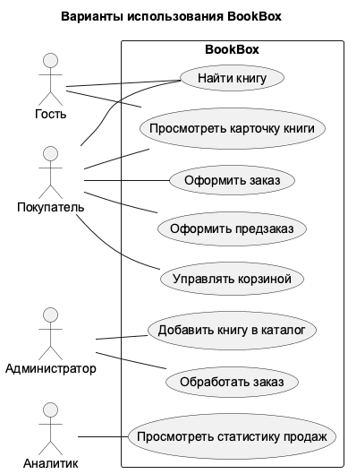

_Рисунок 1. Варианты использования BookBox. [Исходник PlantUML](images/lab3/use-cases.puml)._

Диаграмма задаёт границы системы и показывает, какие цели доступны каждой роли. Гость и покупатель могут искать книги и просматривать карточки. Покупатель может работать с корзиной, оформлять заказ и предзаказ. Администратор пополняет каталог и обрабатывает заказы, аналитик просматривает статистику продаж. Команда может использовать эту схему для согласования состава функций и доступа к ним. Основание — [матрица задач и ролей ЛР1](lab1.md#112-матрица-задача--роль-пользователя) и истории из раздела 1.3.

### 2.2. Диаграмма деятельности

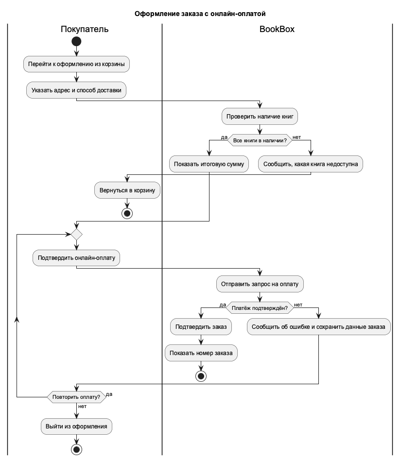

_Рисунок 2. Оформление заказа с онлайн-оплатой. [Исходник PlantUML](images/lab3/checkout-activity.puml)._

Сценарий начинается с перехода из корзины к оформлению. Покупатель указывает адрес и способ доставки, BookBox проверяет наличие книг и показывает итоговую сумму. Если книга закончилась, система сообщает об этом, и покупатель возвращается в корзину. После отказа платежа введённые данные сохраняются, и покупатель может повторить оплату или выйти из оформления. Номер подтверждённого заказа показывается после успешной оплаты. Дорожки показывают, где действие выполняет покупатель и где нужна реакция системы. Основание — [проверочные сценарии V1 и V2 из ЛР2](lab2.md#92-проверочные-сценарии).

### 2.3. Диаграмма классов

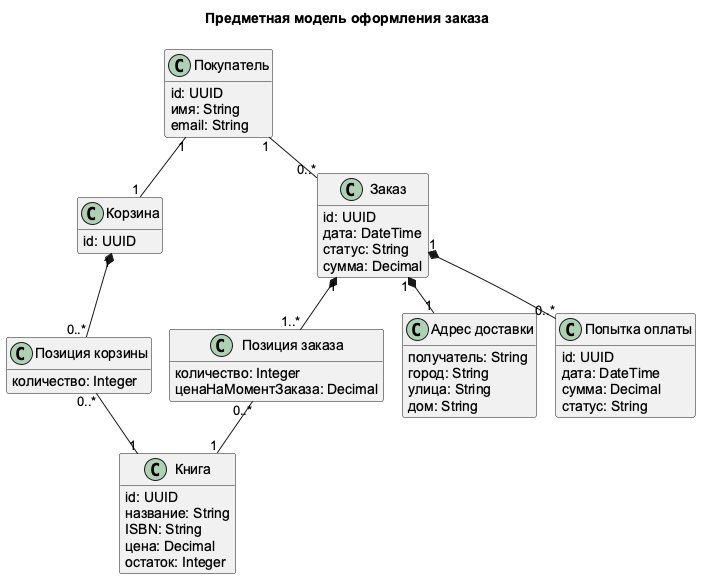

_Рисунок 3. Предметная модель оформления заказа. [Исходник PlantUML](images/lab3/order-classes.puml)._

Диаграмма фиксирует данные, необходимые для оформления заказа. У покупателя одна корзина и может быть несколько заказов. В корзине может не быть позиций, в оформляемом заказе есть хотя бы одна. Позиции ссылаются на книгу, а позиция заказа хранит цену на момент покупки, чтобы итог не зависел от будущих изменений каталога. Заказ хранит снимок адреса доставки и может иметь несколько попыток оплаты. Это позволяет сохранить реквизиты конкретного заказа и отличить повторную оплату от создания нового заказа. Основание — [объектная модель ЛР1](lab1.md#12-объектная-модель) и [уточнённые связи ЛР2](lab2.md#52-уточнённые-связи).

### Материалы для изучения

- [Документация PlantUML по диаграммам вариантов использования](https://plantuml.com/use-case-diagram)
- [Документация PlantUML по диаграммам деятельности](https://plantuml.com/activity-diagram-beta)
- [Документация PlantUML по диаграммам классов](https://plantuml.com/class-diagram)
- [Работа с GitHub Wiki через локальную копию](https://docs.github.com/en/communities/documenting-your-project-with-wikis/adding-or-editing-wiki-pages#adding-or-editing-wiki-pages-locally)

## 3. Спецификация системы на Mermaid

В спецификацию BookBox добавлены три диаграммы на Mermaid. Варианты использования и классы опираются на модели задания 2. Диаграмма последовательности показывает обмен сообщениями при оформлении заказа из того же сценария.

### 3.1. Диаграмма вариантов использования

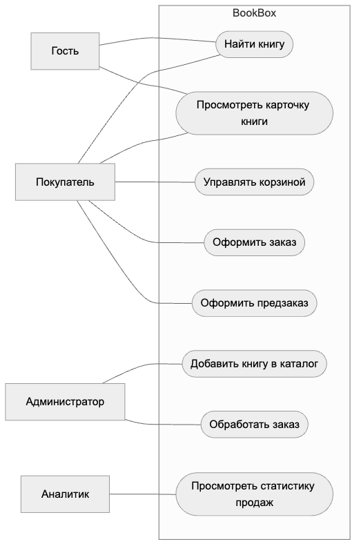

_Рисунок 4. Варианты использования BookBox на Mermaid. [Исходник Mermaid](images/lab3/use-cases-mermaid.mmd)._

Схема сохраняет акторов и связи из рисунка 1. Внутри границы BookBox показаны функции системы, а снаружи — четыре роли. Так можно сверить доступ гостей и покупателей к каталогу и отделить покупательские действия от работы администратора и аналитика.

### 3.2. Диаграмма последовательности

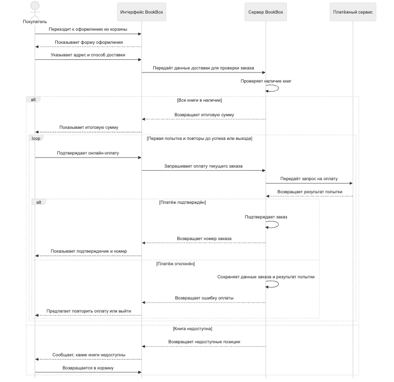

_Рисунок 5. Оформление заказа с онлайн-оплатой. [Исходник Mermaid](images/lab3/checkout-sequence-mermaid.mmd)._

Диаграмма развивает сценарий рисунка 2 и показывает обмен сообщениями между покупателем, интерфейсом BookBox, сервером и платёжным сервисом. Сервер проверяет наличие до оплаты. После отказа платежа покупатель может повторить оплату текущего заказа, а номер заказа появляется после успешного платежа. Если книги нет в наличии, покупатель возвращается в корзину.

### 3.3. Диаграмма классов

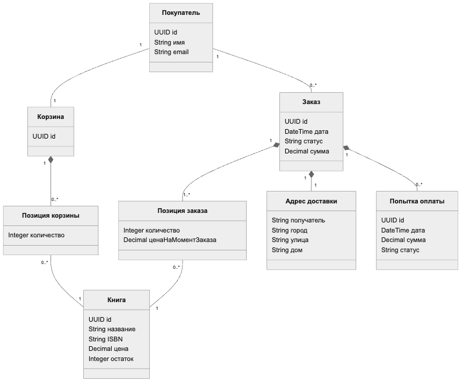

_Рисунок 6. Предметная модель оформления заказа на Mermaid. [Исходник Mermaid](images/lab3/order-classes-mermaid.mmd)._

Модель сохраняет классы, атрибуты и кратности из рисунка 3. Позиции корзины и заказа ссылаются на книги. Заказ хранит цену покупки в своих позициях и может содержать несколько попыток оплаты.

Исходники `.mmd` и экспортированные изображения лежат в `docs/images/lab3/`. В локальной Wiki те же исходники включены в страницу «Спецификация» как блоки `mermaid`. [Документация GitHub по Mermaid](https://docs.github.com/en/get-started/writing-on-github/working-with-advanced-formatting/creating-diagrams#creating-mermaid-diagrams).

## 4. Разработка спецификации

Требования уточнены по пользовательским историям ЛР3, объектным моделям ЛР1–ЛР2, раскадровкам ЛР2 и описаниям трёх приложений BookBox. Результат оформлен как техническая спецификация, сценарии и каталог диаграмм.

### 4.1. Материалы, промпты и применение навыка

Из материалов GetAnalyst использованы примеры MedAssistGA, библиотечного REST API, интеграционных User Stories и UML Sequence. Подготовлено 11 промптов, включая отдельный запрос для каждого требуемого типа диаграмм и запрос на техническую спецификацию. [Папка GetAnalyst](https://disk.yandex.ru/d/LUX0-q4ClFEC6A) · [Промпты BookBox](lab3/task4/prompts.md).

Навык `getanalyst-database-designer` применён к логической модели BookBox. По результатам проверки явно выделены позиции заказа и таблицы связей книг, предусмотрены сохранение цены на момент покупки и несколько попыток оплаты с отдельными идентификаторами. [Входные данные и результат применения навыка](lab3/task4/agent-skill.md).

### 4.2. User Stories и Use Case

Уточнены пять историй задания 1. Добавлены пять историй про повтор оплаты, изменение остатка, передачу заказа в доставку, уведомление о предзаказе и экспорт статистики. У каждой истории есть приоритет и проверяемые критерии приёмки. [Полный список историй](lab3/task4/user-stories.md).

| Use Case | Истории             | Сценарий                          |
| -------- | ------------------- | --------------------------------- |
| UC-01    | US-01               | Поиск учебника по названию и цене |
| UC-02    | US-02, US-06, US-07 | Оформление и онлайн-оплата заказа |
| UC-03    | US-03, US-09        | Предзаказ редкого издания         |
| UC-04    | US-04               | Добавление книги в каталог        |
| UC-05    | US-05, US-10        | Просмотр статистики продаж        |

Для каждого из пяти вариантов на рисунке 7 описаны предусловия, триггер, основной ход, альтернативы и результат. [Сценарии Use Case](lab3/task4/use-cases.md).

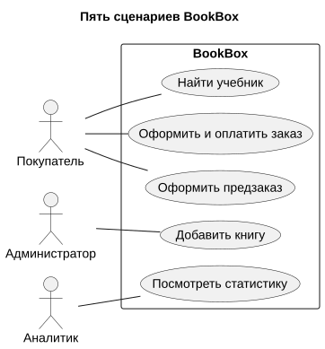

_Рисунок 7. Пять вариантов использования BookBox. [PlantUML](images/lab3/task4/use-cases.puml) · [Mermaid](images/lab3/task4/use-cases.mmd)._

### 4.3. Набор диаграмм

| Тип                    | Результат                                                                                            |
| ---------------------- | ---------------------------------------------------------------------------------------------------- |
| Варианты использования | 1 диаграмма и 5 сценариев для всех её вариантов                                                      |
| Деятельность           | 2 диаграммы — оформление заказа и предзаказ                                                          |
| Классы и объекты       | 5 диаграмм — 3 модели классов и 2 примера экземпляров                                                |
| Последовательность     | 5 диаграмм, по одной на каждый UC                                                                    |
| Архитектура            | 1 диаграмма компонентов, 1 пакетов и 1 развёртывания                                                 |
| Данные                 | 1 логическая ERD. Необходимость ORD будет определена после выбора способа отображения объектов в БД. |

[Каталог диаграмм с пояснениями и исходниками обоих форматов](lab3/task4/diagrams.md). Сценарии оформления и модель классов заказа переиспользуют материалы заданий 2–3. Архитектурные диаграммы показывают предлагаемые пакеты и размещение компонентов.

### 4.4. Техническая спецификация

[Спецификация BookBox](lab3/task4/specification.md) фиксирует границы системы, роли и доступ, десять функциональных требований, требования к интерфейсам, правила работы с данными и порядок проверки. Для решений, которые предстоит согласовать, указан статус проектного допущения или открытого вопроса.

В локальной Wiki подготовлены страницы «Спецификация — задание 4» и «Требования — задание 4». На них собраны диаграммы, истории, Use Case и техническая спецификация.

## 5. Проектирование BookBox методом EventStorming

Подготовлены три представления будущей системы. Big Picture показывает события от публикации книги до доставки и отчётности. Process Modeling уточняет UC-02, включая нехватку экземпляров и повтор онлайн-оплаты. Software Design группирует агрегаты, политики и модели чтения по контекстам и фиксирует связи между ними. Подробные правила, открытые вопросы и ссылки на исходники собраны в [спецификации EventStorming](lab3/task5/eventstorming.md).

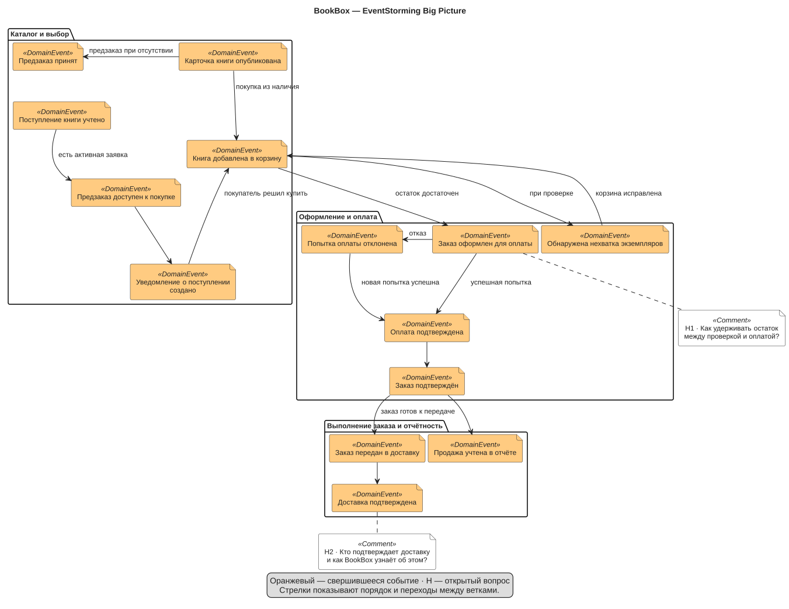

_Рисунок 23. Big Picture — обзор предметной области. [PlantUML](images/lab3/task5/big-picture.puml)._

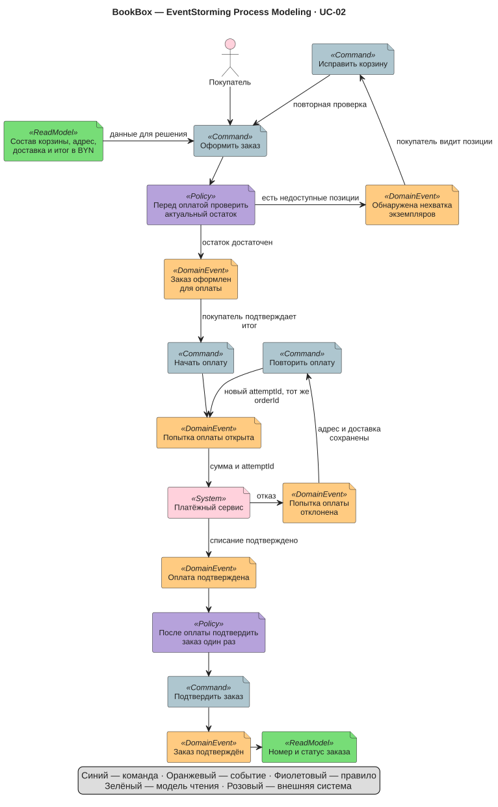

_Рисунок 24. Process Modeling — оформление и оплата заказа. [PlantUML](images/lab3/task5/process-modeling.puml)._

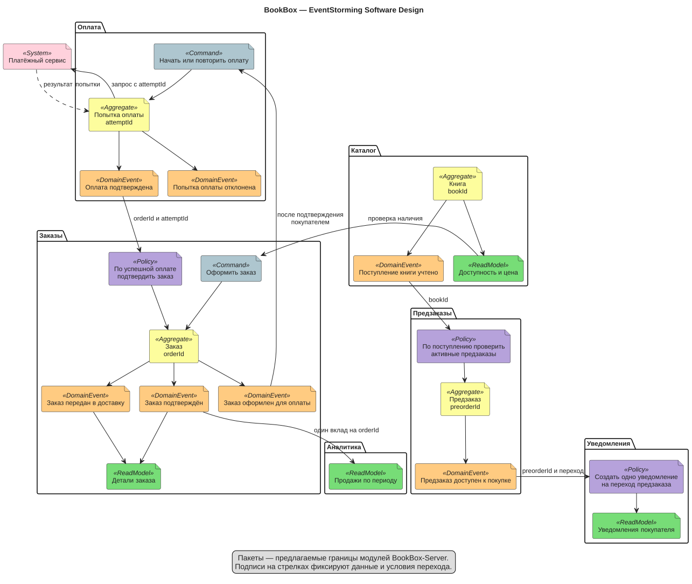

_Рисунок 25. Software Design — контексты, агрегаты и правила. [PlantUML](images/lab3/task5/software-design.puml)._

Переход от проверки остатка к успешной оплате требует согласовать механизм резерва. Для доставленного заказа нужно согласовать источник статуса доставки. В спецификации эти вопросы обозначены H1 и H2.

## 6. Проектирование BookBox методом Event Modeling

Четыре схемы показывают, как данные переходят от интерфейсов и команд к сохранённым событиям и моделям чтения. Они охватывают пять пользовательских сценариев задания 4 и показывают два автоматических процесса: подтверждение оплаченного заказа и уведомление о поступлении предзаказанной книги. [Спецификация Event Modeling со срезами и критериями приёмки](lab3/task6/event-modeling.md).

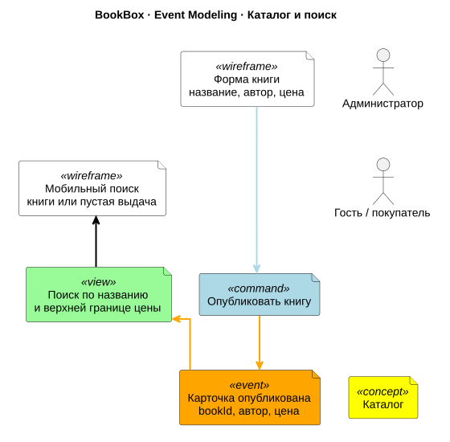

_Рисунок 26. Публикация карточки и мобильный поиск. [PlantUML](images/lab3/task6/catalog.puml)._

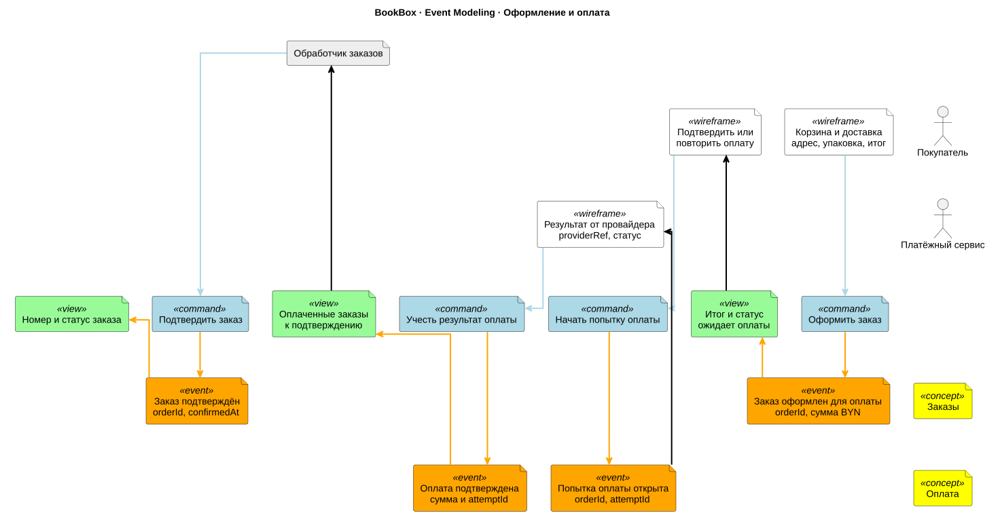

_Рисунок 27. Оформление, учёт платежа и подтверждение заказа. [PlantUML](images/lab3/task6/checkout-payment.puml)._

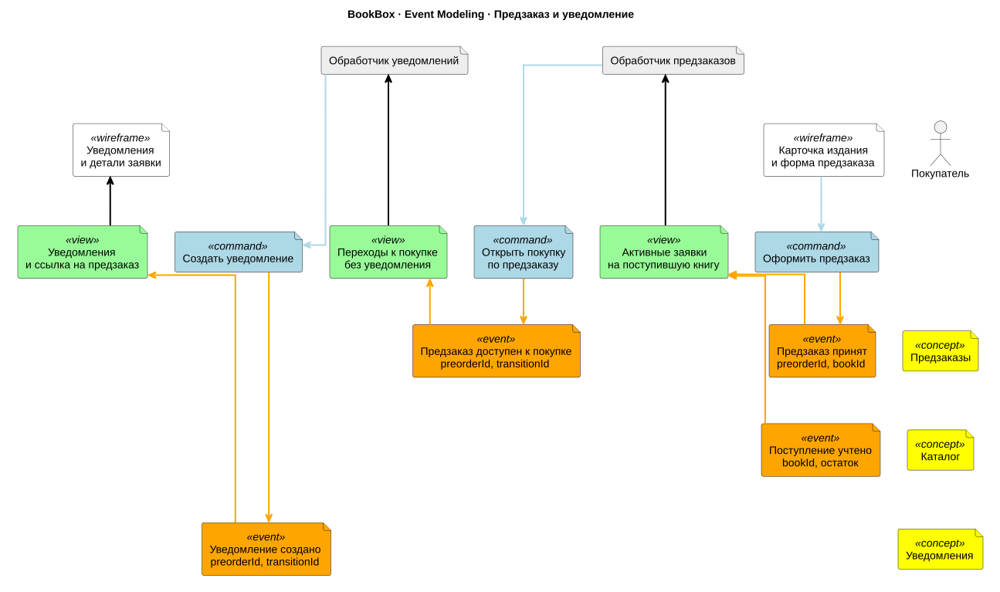

_Рисунок 28. Предзаказ и автоматическое уведомление о поступлении. [PlantUML](images/lab3/task6/preorder.puml)._

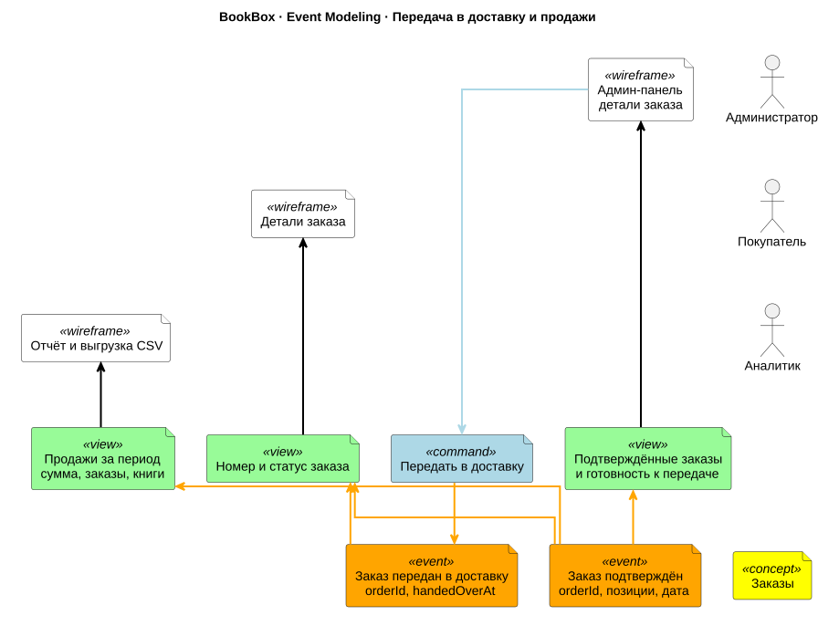

_Рисунок 29. Передача в доставку и отчёт по подтверждённым заказам. [PlantUML](images/lab3/task6/fulfillment-sales.puml)._

## 7. Описание архитектуры системы с использованием подхода C4 Model

C4 Model — это метод визуализации архитектуры программных систем на четырёх уровнях детализации: контекст, контейнеры, компоненты и код. Диаграммы разработаны с использованием библиотеки C4-PlantUML и опираются на материалы предыдущих лабораторных работ: спецификацию из задания 4, Event Storming из задания 5 и Event Modeling из задания 6.

### 7.1. Диаграмма контекста

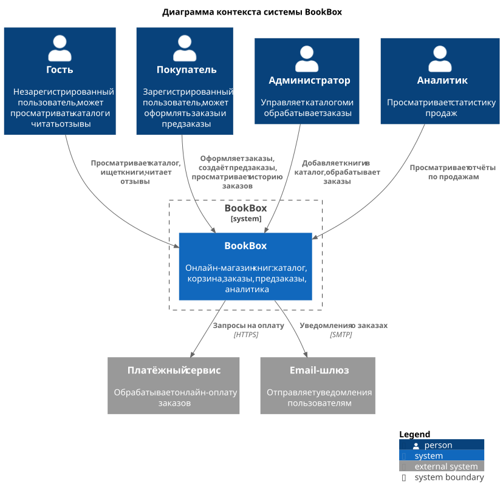

_Рисунок 30. Диаграмма контекста BookBox. [Исходник PlantUML](images/lab3/task7/context.puml)._

Диаграмма контекста показывает систему BookBox как единое целое и её взаимодействие с внешними участниками. Четыре типа пользователей взаимодействуют с системой: гости просматривают каталог, покупатели оформляют заказы, администраторы управляют каталогом и заказами, аналитики работают с отчётами. Две внешние системы — платёжный сервис и email-шлюз — обеспечивают проведение оплаты и отправку уведомлений.

### 7.2. Диаграмма контейнеров

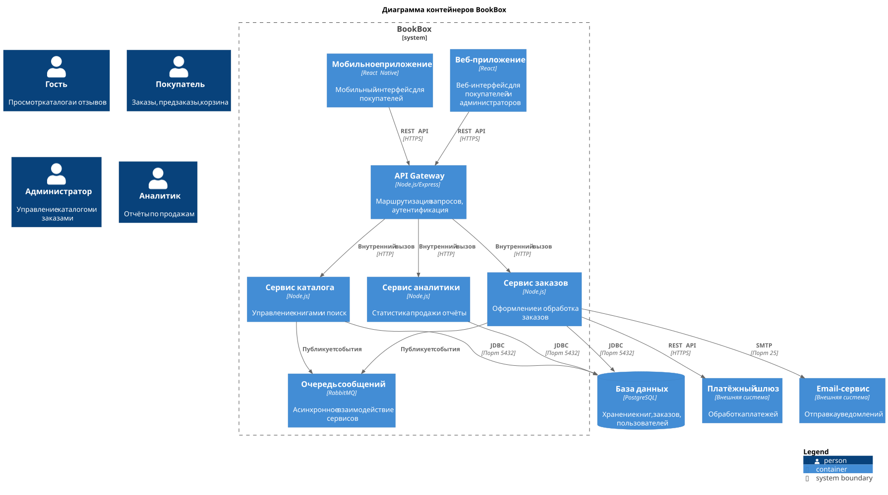

_Рисунок 31. Диаграмма контейнеров BookBox. [Исходник PlantUML](images/lab3/task7/container.puml)._

Диаграмма контейнеров показывает технологическую архитектуру системы. Веб-приложение на React и мобильное приложение на React Native обеспечивают пользовательские интерфейсы. API Gateway на Node.js/Express выполняет маршрутизацию запросов и аутентификацию. Три микросервиса — каталог, заказы и аналитика — реализуют бизнес-логику. База данных PostgreSQL хранит данные, RabbitMQ обеспечивает асинхронное взаимодействие между сервисами.

### 7.3. Диаграммы компонентов

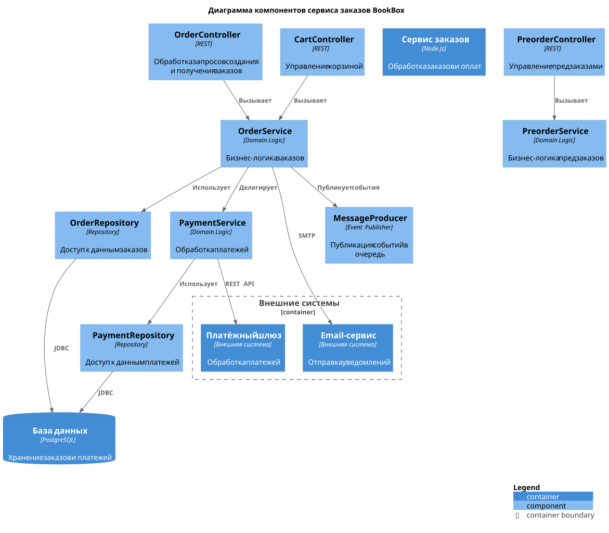

_Рисунок 32. Компоненты сервиса заказов. [Исходник PlantUML](images/lab3/task7/component-order.puml)._

Сервис заказов содержит контроллеры для работы с заказами, корзиной и предзаказами. Бизнес-логика выделена в отдельные сервисы: OrderService обрабатывает заказы, PaymentService взаимодействует с платёжным шлюзом, PreorderService управляет предзаказами. Репозитории обеспечивают доступ к данным, MessageProducer публикует события для асинхронного взаимодействия.

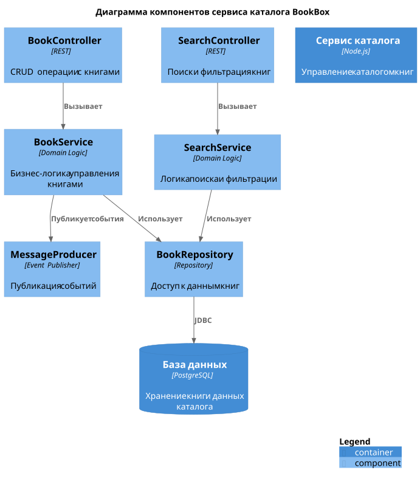

_Рисунок 33. Компоненты сервиса каталога. [Исходник PlantUML](images/lab3/task7/component-catalog.puml)._

Сервис каталога предоставляет функциональность для управления книгами и поиска. BookController обеспечивает CRUD-операции с книгами, SearchController — поиск и фильтрацию. BookService и SearchService содержат бизнес-логику, BookRepository обеспечивает доступ к данным.

### 7.4. Диаграмма развёртывания

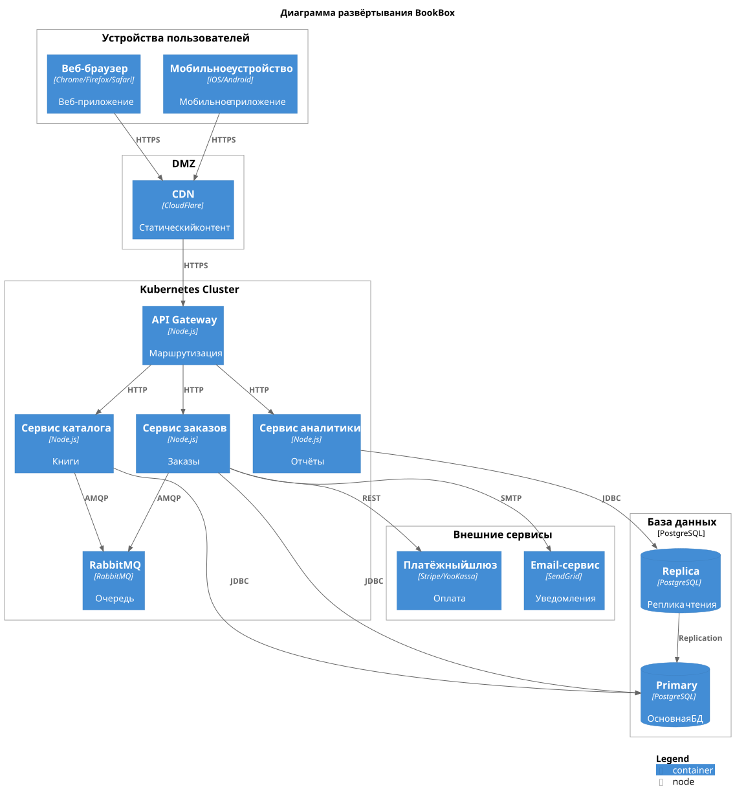

_Рисунок 34. Диаграмма развёртывания BookBox. [Исходник PlantUML](images/lab3/task7/deployment.puml)._

Диаграмма развёртывания показывает физическое размещение компонентов системы. Пользователи работают через веб-браузеры и мобильные устройства. Статический контент доставляется через CDN. Бэкенд размещается в Kubernetes-кластере с подами для API Gateway и микросервисов. База данных использует схему primary-replica с одной первичной нодой и репликой для чтения. Внешние сервисы (платёжный шлюз и email-сервис) подключаются из облачной инфраструктуры.

### Соответствие C4 и предыдущих заданий

| Уровень C4 | Результат из предыдущих заданий |
|------------|--------------------------------|
| Контекст | Матрица ролей из ЛР1, пользовательские истории из ЛР3 |
| Контейнеры | Диаграмма компонентов из ЛР4, Event Storming из ЛР5 |
| Компоненты | Диаграммы классов и последовательностей из ЛР4 |
| Развёртывание | Диаграмма развёртывания из ЛР4 |

## 8. Техническое задание на разработку приложения

На основе анализа требований, диаграмм и спецификаций, разработанных в заданиях 1–7, сформировано техническое задание (SRS) согласно структуре, определённой в srs.md. Полный текст технического задания представлен в [отдельном документе](lab3/task8/srs.md).

### 8.1. Структура SRS

Техническое задание включает следующие разделы:

1. **Введение** — назначение, границы проекта, ссылки на предыдущие документы
2. **Общее описание** — обзор продукта, классы пользователей, операционная среда
3. **Функции системы** — 11 функциональных требований (FR-01 – FR-11)
4. **Требования к данным** — логическая модель, словарь данных, отчёты
5. **Требования к внешним интерфейсам** — пользовательские интерфейсы, API, оборудование
6. **Атрибуты качества** — удобство использования, производительность, безопасность
7. **Требования по интернационализации** — русский язык, форматы дат и валют
8. **Приложения** — словарь терминов, модели анализа (диаграммы)

### 8.2. Ключевые требования

| ID | Требование | Описание |
|----|------------|----------|
| FR-01 | Поиск книги | Поиск по названию с фильтром по цене |
| FR-02 | Расширенный поиск | Поиск по автору, издательству, году |
| FR-03 | Предзаказ | Оформление предзаказа на недоступную книгу |
| FR-04 | Оформление заказа | Корзина, адрес доставки, подарочная упаковка |
| FR-05 | Проверка наличия | Резервирование книг перед оплатой |
| FR-06 | Онлайн-оплата | Интеграция с платёжным шлюзом |
| FR-07 | Добавление книги | CRUD-операции для администраторов |
| FR-08 | Управление остатками | Изменение количества в наличии |
| FR-09 | Обработка заказов | Передача в доставку |
| FR-10 | Статистика продаж | Отчёты за период |
| FR-11 | Экспорт отчёта | Выгрузка в CSV |

### 8.3. Нефункциональные требования

| Категория | Требование |
|-----------|------------|
| Производительность | 1000 одновременных пользователей, 500 RPS к API каталога |
| Безопасность | HTTPS, JWT-токены, хэширование паролей bcrypt |
| Доступность | WCAG 2.1 Level A, клавиатурная навигация |
| Надёжность | MTBF ≥ 720 часов, MTTR ≤ 30 минут |

### 8.4. Материалы

- [Полный текст SRS](lab3/task8/srs.md)
- [Диаграмма вариантов использования](images/lab3/use-cases.svg)
- [ERD](images/lab3/task4/erd.svg)
- [C4 диаграммы](images/lab3/task7/)

## Материалы для изучения

- [Официальный сайт C4 Model](https://c4model.com)
- [C4-PlantUML на GitHub](https://github.com/plantuml-stdlib/C4-PlantUML)
- [Статья «Аналитик и архитектура: UML-диаграммы для модели C4»](https://habr.com/ru/companies/ozon/articles/517082/)
- [Разработка ТЗ на информационную систему по ГОСТ и SRS](https://habr.com/ru/companies/ozon/articles/507820/)
