# Каталог диаграмм задания 4

Каждая модель доступна в PlantUML и Mermaid. Для вариантов использования, деятельности, пакетов, компонентов и развёртывания Mermaid передаёт структуру модели через `flowchart`. Представления объектов на Mermaid используют именованные экземпляры и связи в `classDiagram`. Диаграммы исходного отчёта переиспользованы, где модель уже есть.

## Варианты использования

### Рисунок 7. Пять вариантов использования BookBox

У каждого варианта есть отдельный сценарий UC-01–UC-05. Диаграмма показывает роли, которые инициируют эти сценарии.

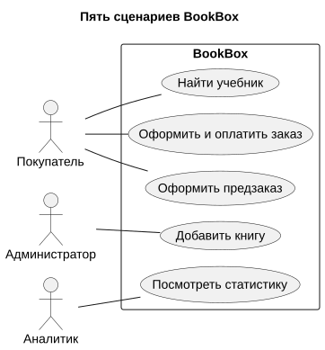

PlantUML ([исходник](../../images/lab3/task4/use-cases.puml), [SVG](../../images/lab3/task4/use-cases.svg)) · Mermaid ([исходник](../../images/lab3/task4/use-cases.mmd), [SVG](../../images/lab3/task4/use-cases-mermaid.svg)).

## Диаграммы деятельности

### Рисунок 8. Оформление заказа с онлайн-оплатой

Показывает проверку остатка, подтверждение, отказ и повтор оплаты. PlantUML-версия уже приведена на рисунке 2.


PlantUML ([исходник](../../images/lab3/checkout-activity.puml), [SVG](../../images/lab3/checkout-activity.svg)) · Mermaid ([исходник](../../images/lab3/task4/activity-checkout.mmd), [SVG](../../images/lab3/task4/activity-checkout-mermaid.svg)).

### Рисунок 9. Оформление предзаказа

Показывает повторную проверку доступности перед записью заявки и реакцию на изменение состояния книги.

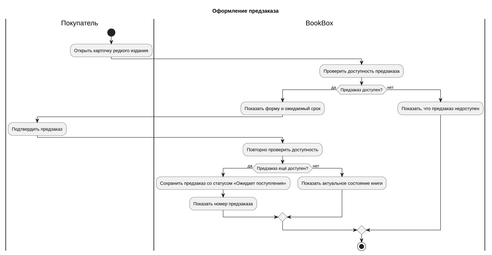

PlantUML ([исходник](../../images/lab3/task4/activity-preorder.puml), [SVG](../../images/lab3/task4/activity-preorder.svg)) · Mermaid ([исходник](../../images/lab3/task4/activity-preorder.mmd), [SVG](../../images/lab3/task4/activity-preorder-mermaid.svg)).

## Диаграммы классов и объектов

### Классы оформления заказа

Базовая модель заказа с корзиной, позициями, адресом и попытками оплаты. Повторное использование рисунков 3 и 6.

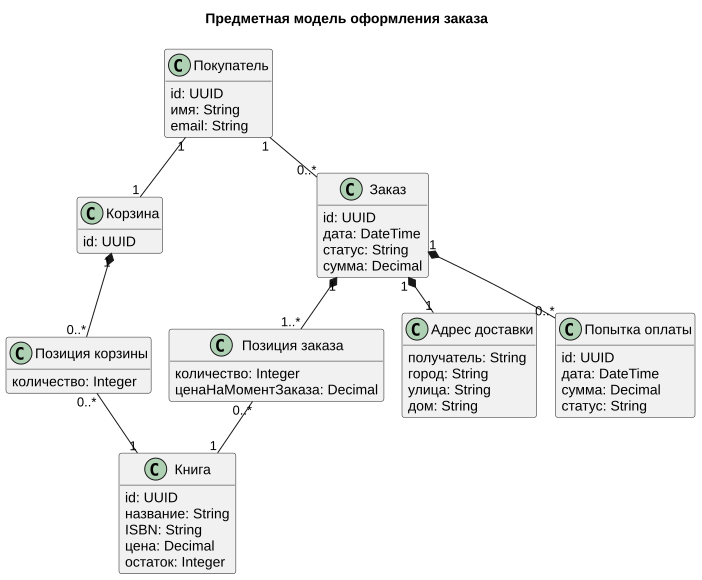

PlantUML ([исходник](../../images/lab3/order-classes.puml), [SVG](../../images/lab3/order-classes.svg)) · Mermaid ([исходник](../../images/lab3/order-classes-mermaid.mmd), [SVG](../../images/lab3/order-classes-mermaid.svg)).

### Рисунок 10. Классы каталога

Показывает атрибуты книги и кратности связей с автором, жанром и издательством.

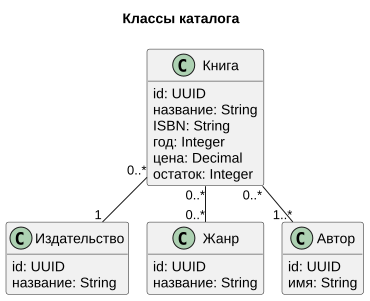

PlantUML ([исходник](../../images/lab3/task4/class-catalog.puml), [SVG](../../images/lab3/task4/class-catalog.svg)) · Mermaid ([исходник](../../images/lab3/task4/class-catalog.mmd), [SVG](../../images/lab3/task4/class-catalog-mermaid.svg)).

### Рисунок 11. Классы предзаказа

Показывает связь покупателя, книги, заявки и уведомлений, а также ожидаемый срок и статус.

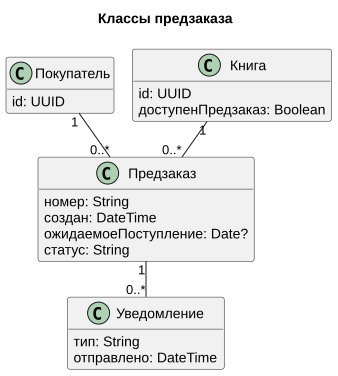

PlantUML ([исходник](../../images/lab3/task4/class-preorder.puml), [SVG](../../images/lab3/task4/class-preorder.svg)) · Mermaid ([исходник](../../images/lab3/task4/class-preorder.mmd), [SVG](../../images/lab3/task4/class-preorder-mermaid.svg)).

### Рисунок 12. Экземпляры оформленного заказа

Пример заказа с одной книгой, отказом первой попытки и успешной второй попыткой.

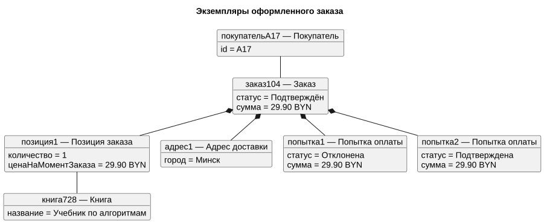

PlantUML ([исходник](../../images/lab3/task4/object-order.puml), [SVG](../../images/lab3/task4/object-order.svg)) · Mermaid ([исходник](../../images/lab3/task4/object-order.mmd), [SVG](../../images/lab3/task4/object-order-mermaid.svg)).

### Рисунок 13. Экземпляры предзаказа

Пример активной заявки на издание с пока неизвестной датой поступления.

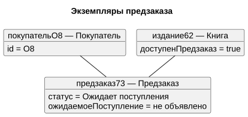

PlantUML ([исходник](../../images/lab3/task4/object-preorder.puml), [SVG](../../images/lab3/task4/object-preorder.svg)) · Mermaid ([исходник](../../images/lab3/task4/object-preorder.mmd), [SVG](../../images/lab3/task4/object-preorder-mermaid.svg)).

## Диаграммы последовательности

### Рисунок 14. Поиск учебника, UC-01

Обмен между мобильным клиентом, сервером и хранилищем с вариантом пустой выдачи.

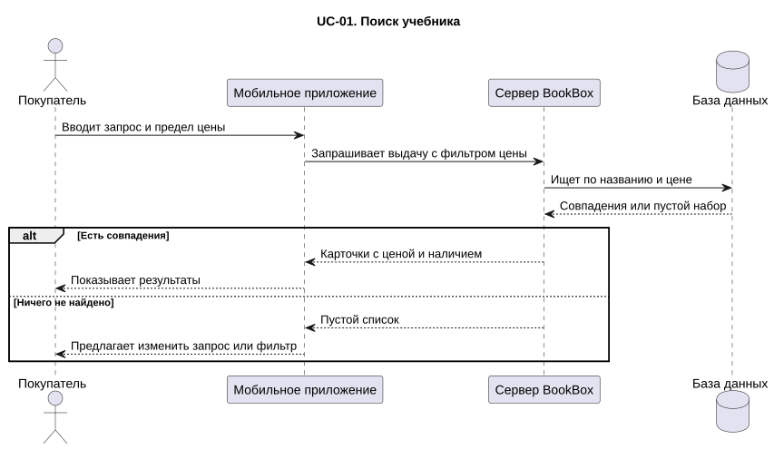

PlantUML ([исходник](../../images/lab3/task4/sequence-search.puml), [SVG](../../images/lab3/task4/sequence-search.svg)) · Mermaid ([исходник](../../images/lab3/task4/sequence-search.mmd), [SVG](../../images/lab3/task4/sequence-search-mermaid.svg)).

### Рисунок 15. Заказ с онлайн-оплатой, UC-02

Проверка остатков, сохранение попыток оплаты, обмен с провайдером и подтверждение заказа.

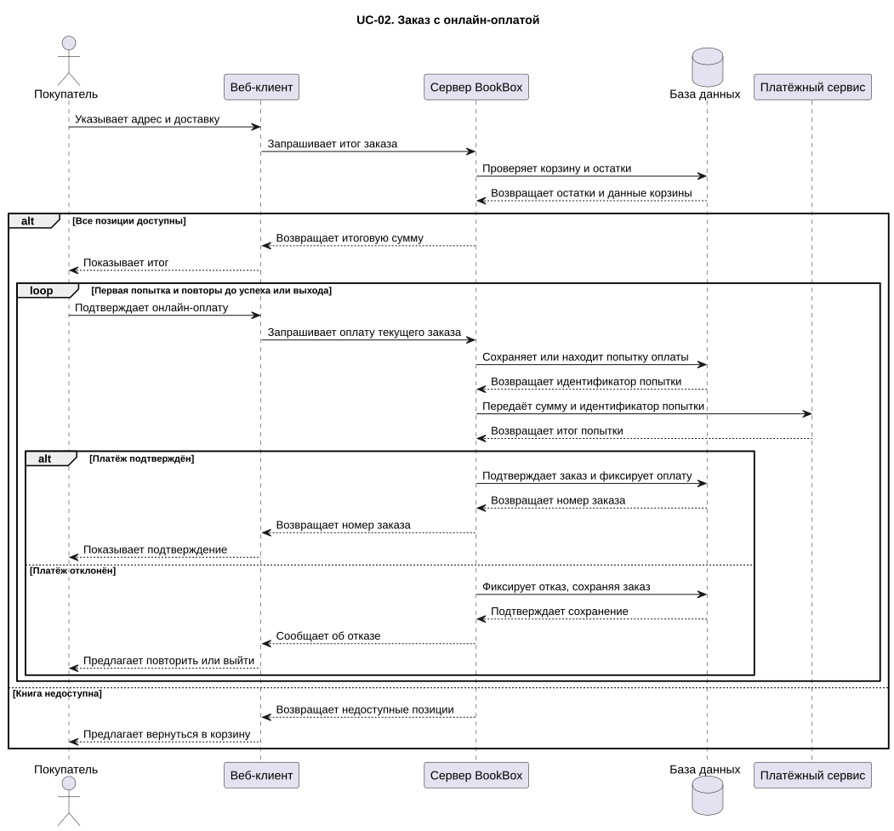

PlantUML ([исходник](../../images/lab3/task4/sequence-payment.puml), [SVG](../../images/lab3/task4/sequence-payment.svg)) · Mermaid ([исходник](../../images/lab3/task4/sequence-payment.mmd), [SVG](../../images/lab3/task4/sequence-payment-mermaid.svg)).

### Рисунок 16. Предзаказ издания, UC-03

Повторная проверка возможности предзаказа, ответ с номером заявки или отказ.

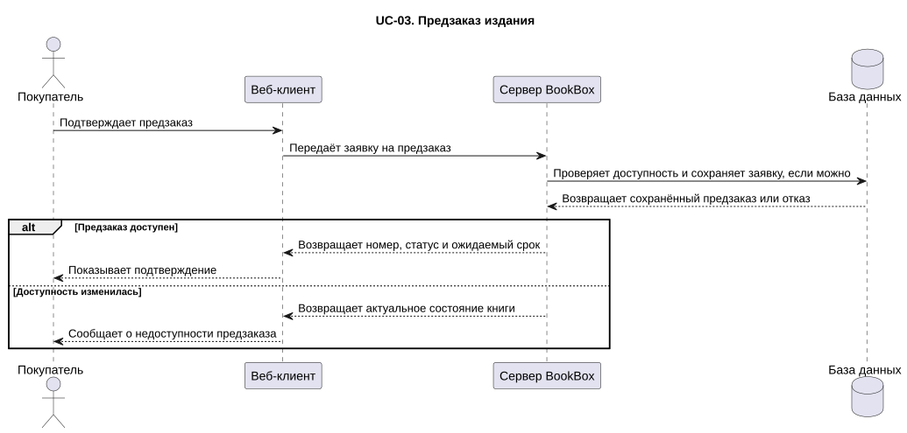

PlantUML ([исходник](../../images/lab3/task4/sequence-preorder.puml), [SVG](../../images/lab3/task4/sequence-preorder.svg)) · Mermaid ([исходник](../../images/lab3/task4/sequence-preorder.mmd), [SVG](../../images/lab3/task4/sequence-preorder-mermaid.svg)).

### Рисунок 17. Добавление книги, UC-04

Проверка доступа и полей формы, сохранение карточки и обработка ошибки.

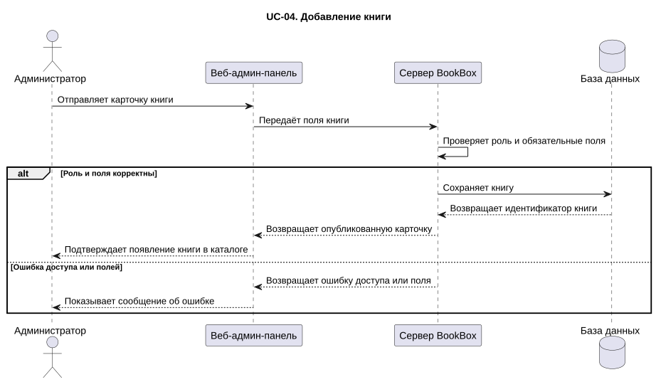

PlantUML ([исходник](../../images/lab3/task4/sequence-catalog.puml), [SVG](../../images/lab3/task4/sequence-catalog.svg)) · Mermaid ([исходник](../../images/lab3/task4/sequence-catalog.mmd), [SVG](../../images/lab3/task4/sequence-catalog-mermaid.svg)).

### Рисунок 18. Статистика продаж, UC-05

Проверка периода и прав, чтение агрегатов и отображение пустого результата.

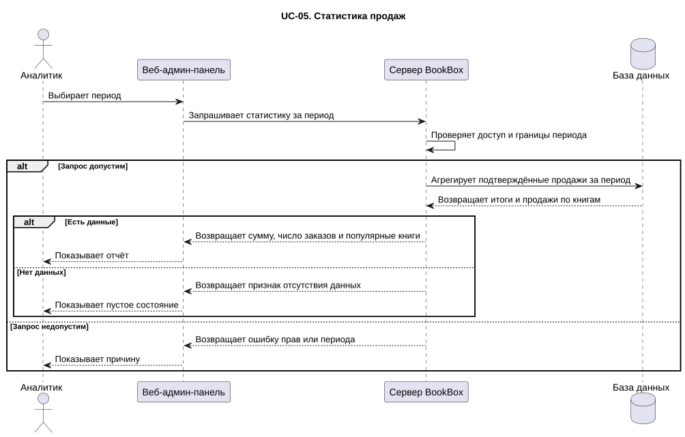

PlantUML ([исходник](../../images/lab3/task4/sequence-analytics.puml), [SVG](../../images/lab3/task4/sequence-analytics.svg)) · Mermaid ([исходник](../../images/lab3/task4/sequence-analytics.mmd), [SVG](../../images/lab3/task4/sequence-analytics-mermaid.svg)).

## Архитектурные диаграммы

### Рисунок 19. Компоненты BookBox

Веб- и мобильный клиенты, API, функции сервера, реляционная БД и внешний платёжный сервис.

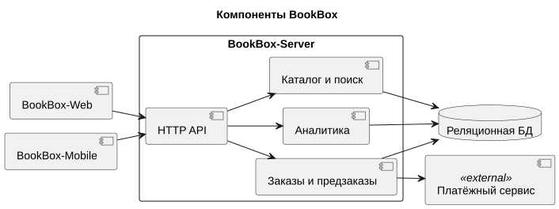

PlantUML ([исходник](../../images/lab3/task4/components.puml), [SVG](../../images/lab3/task4/components.svg)) · Mermaid ([исходник](../../images/lab3/task4/components.mmd), [SVG](../../images/lab3/task4/components-mermaid.svg)).

### Рисунок 20. Пакеты BookBox-Server

Предлагаемая структура кода сервера и зависимости между пакетами.

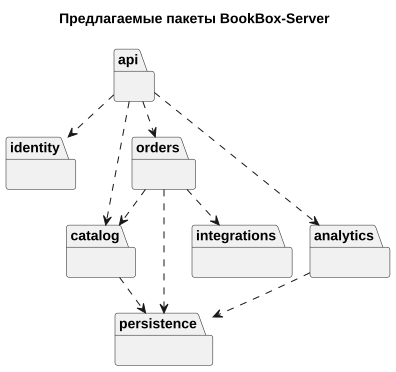

PlantUML ([исходник](../../images/lab3/task4/packages.puml), [SVG](../../images/lab3/task4/packages.svg)) · Mermaid ([исходник](../../images/lab3/task4/packages.mmd), [SVG](../../images/lab3/task4/packages-mermaid.svg)).

### Рисунок 21. Развёртывание BookBox

Целевая топология клиента, веб-хоста, сервера приложений, БД и платёжного провайдера.

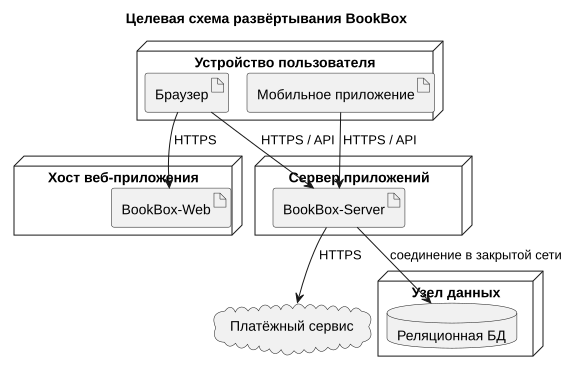

PlantUML ([исходник](../../images/lab3/task4/deployment.puml), [SVG](../../images/lab3/task4/deployment.svg)) · Mermaid ([исходник](../../images/lab3/task4/deployment.mmd), [SVG](../../images/lab3/task4/deployment-mermaid.svg)).

## Модель базы данных

### Рисунок 22. ERD каталога, заказов и предзаказов

Первичные и внешние ключи, таблицы связей, снимок адреса, цена покупки и история попыток оплаты.

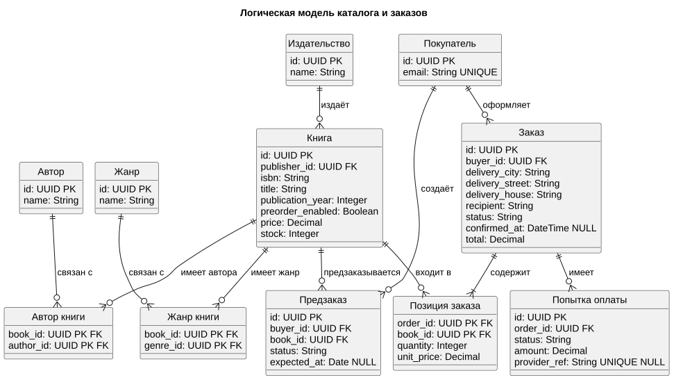

PlantUML ([исходник](../../images/lab3/task4/erd.puml), [SVG](../../images/lab3/task4/erd.svg)) · Mermaid ([исходник](../../images/lab3/task4/erd.mmd), [SVG](../../images/lab3/task4/erd-mermaid.svg)).
