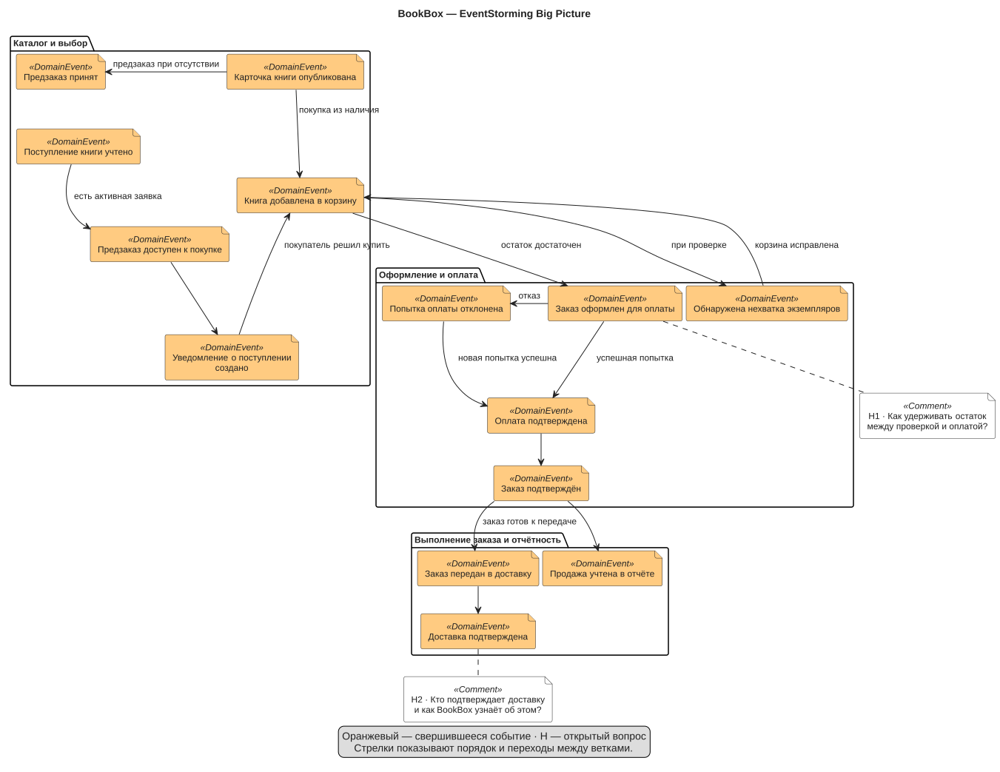
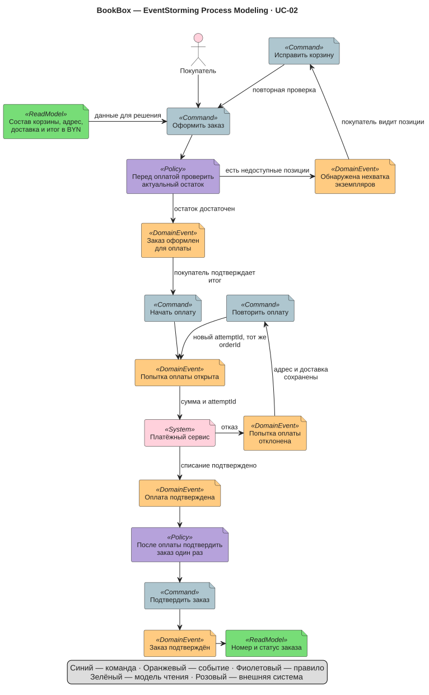
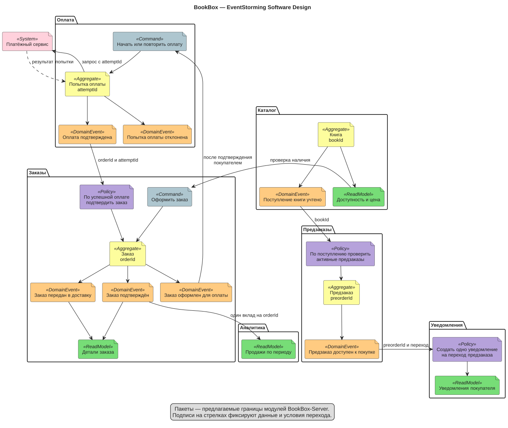

# BookBox — спецификация EventStorming

Лабораторная работа 3, задание 5. Модель построена по пользовательским историям и спецификации BookBox из заданий 1 и 4. Обзор охватывает каталог, покупку, предзаказ, доставку и отчётность. Оформление и онлайн-оплата одного заказа (UC-02) разобраны на уровне процесса. Границы модулей и правила обработки событий описаны на уровне проектирования.

## 1. Big Picture — обзор предметной области

[Исходник PlantUML](../../images/lab3/task5/big-picture.puml) · [Диаграмма в SVG](../../images/lab3/task5/big-picture.svg)

- **Каталог и выбор.** Администратор публикует карточку книги. Покупатель добавляет доступную книгу в корзину или оформляет предзаказ, когда издание временно отсутствует. Когда поступление учтено, активная заявка может перейти в состояние «Доступен к покупке». Покупатель получает уведомление и сам решает, оформлять ли покупку.
- **Оформление и оплата.** BookBox проверяет наличие до обращения к платёжному сервису. При нехватке покупатель исправляет корзину. Отказ платежа оставляет возможность повторить оплату того же заказа.
- **Выполнение и отчётность.** Подтверждённый заказ может быть передан в доставку, когда готов к передаче. Аналитика учитывает продажу за дату подтверждения заказа независимо от статуса доставки. Подтверждение доставки показано как следующий бизнес-этап, источник его статуса пока открыт (H2).

## 2. Process Modeling — оформление и онлайн-оплата

[Исходник PlantUML](../../images/lab3/task5/process-modeling.puml) · [Диаграмма в SVG](../../images/lab3/task5/process-modeling.svg)

Покупатель вошёл в систему, в корзине есть хотя бы одна книга. Он указывает адрес, способ доставки и при необходимости данные получателя и подарочную упаковку. BookBox рассчитывает итог в BYN и проверяет остаток. В деталях заказа покупатель видит его номер и статус.

| Условие | Действие и результат |
| --- | --- |
| Остатка хватает | BookBox оформляет заказ для оплаты. Покупатель подтверждает сумму. Система создаёт попытку и передаёт платёжному сервису итог и идентификатор попытки. |
| Остатка не хватает | BookBox показывает недоступные позиции и предлагает исправить корзину. До новой успешной проверки запрос на оплату не отправляется. |
| Платёж отклонён | Покупатель видит причину отказа и может повторить оплату с сохранёнными адресом, доставкой и составом заказа. Явный повтор создаёт новый `attemptId` для того же `orderId`. |
| Запрос той же попытки повторён | Повтор использует прежний `attemptId`. Повторное подтверждение платежа не создаёт второй заказ, повторную оплату или дублирующую запись о продаже. |
| Платёж подтверждён | BookBox подтверждает заказ один раз. Покупатель видит номер заказа, а продажа учитывается за дату его подтверждения. |

Сценарий уточняет UC-02 и FR-02–FR-04 из задания 4. Правило резерва между проверкой и списанием требует отдельного согласования (H1).

## 3. Software Design — границы и правила обработки

[Исходник PlantUML](../../images/lab3/task5/software-design.puml) · [Диаграмма в SVG](../../images/lab3/task5/software-design.svg)

Контексты предлагаются как логические модули BookBox-Server. Оформление и обработка результата оплаты разделены между контекстами «Заказы» и «Оплата». События связывают их с отчётностью и отдельным потоком предзаказа.

| Контекст | Ответственность и правила |
| --- | --- |
| Каталог | Агрегат «Книга» ведёт карточку и доступное количество, публикует событие «Поступление книги учтено». Модель чтения отдаёт доступность и цену для расчёта оформления. |
| Заказы | Агрегат «Заказ» хранит позиции, цены на момент покупки, адрес и итог. Подтверждение происходит один раз после успешной оплаты. Передачу в доставку можно записать только для подтверждённого заказа, готового к передаче. |
| Оплата | Агрегат «Попытка оплаты» связывает `attemptId` с `orderId` и хранит результат. Повтор той же операции использует тот же идентификатор. После отказа явный повтор начинает новую попытку. Подтверждённый заказ повторно оплатить нельзя. |
| Предзаказы | По событию поступления политика проверяет активные заявки на книгу. Агрегат «Предзаказ» отвечает за переход к состоянию «Доступен к покупке». |
| Уведомления | Политика создаёт одно уведомление на переход конкретного предзаказа. Повторная обработка этого перехода оставляет одну запись. |
| Аналитика | Модель чтения строит сводку по дате подтверждения. Каждый `orderId` учитывается один раз, количество экземпляров считается по позициям заказа. |

### Открытые вопросы

| ID | Что предстоит согласовать | На что влияет |
| --- | --- | --- |
| H1 | Когда начинается резервирование, каков его срок и когда остаток освобождается после отказа или тайм-аута? | Проверка наличия и границы операции между каталогом, заказами и оплатой. |
| H2 | Кто подтверждает доставку и каким способом этот статус попадает в BookBox? | Переход от передачи в доставку к завершению заказа. |

## Материалы и исходники

- Общая временная линия, команды, правила и границы контекстов. [Влад Хононов, глава об EventStorming](https://systems.education/wis_ddd_event_storming)
- Практические кейсы и определение границ по бизнес-событиям. [Доклад Сергея Баранова](https://www.youtube.com/watch?v=kJjuTuviZ-E) · [Материал о моделировании микросервисов](https://habr.com/ru/companies/oleg-bunin/articles/537862/)
- Применение метода для обсуждения процесса. [Материал Андрея Шапиро](https://ashapiro.ru/talks/tpost/hfphhlof91-event-storming-udachnoe-popolnenie-v-ars)
- Команды, агрегаты и события в PlantUML. Исходники подключают зафиксированную версию v13.0.0. [Пример Тибо Морена](https://dev.to/tmorin/enhancing-business-logic-with-plantuml-and-eventstorming-de0) · [Документация библиотеки](https://tmorin.github.io/plantuml-libs/eventstorming/)
