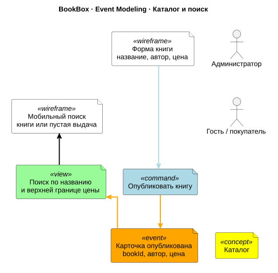
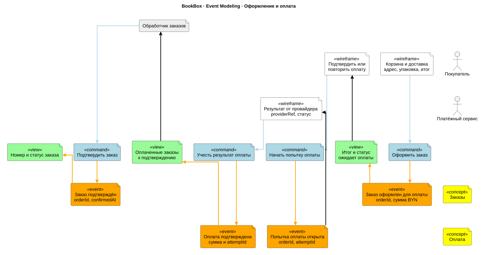
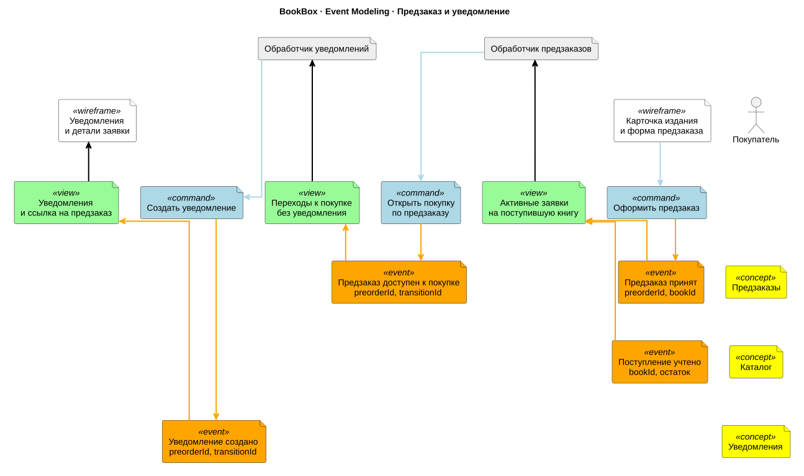
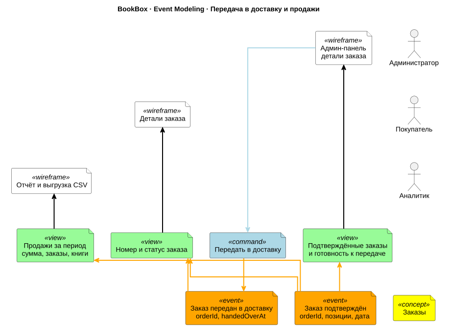

# BookBox — спецификация Event Modeling

Лабораторная работа 3, задание 6. Модель описывает движение данных между интерфейсами, командами, событиями и моделями чтения. Четыре схемы покрывают сценарии UC-01–UC-05 и требования FR-01–FR-10 задания 4. Названия контекстов сохранены из [спецификации EventStorming](../task5/eventstorming.md).

Белые карточки обозначают экраны и точки входа внешних систем, голубые — команды, оранжевые — факты, уже сохранённые системой, зелёные — модели чтения, серые — автоматические обработчики. Дорожки начинаются справа. Стрелки показывают, откуда поступают данные и кто инициирует действие. Чтение каталога, деталей заказа и статистики не меняет состояние заказа.

## 1. Каталог и поиск

[Исходник PlantUML](../../images/lab3/task6/catalog.puml) · [Диаграмма SVG](../../images/lab3/task6/catalog.svg)

Администратор заполняет форму. Команда «Опубликовать книгу» проверяет право управления каталогом, название, автора, издательство и цену. После успешного сохранения событие «Карточка опубликована» пополняет модель чтения каталога. Поиск применяет название и максимальную цену к актуальным данным о книге и показывает название, автора, цену и наличие. Отображение пустой выдачи оставляет фильтры доступными для изменения.

## 2. Оформление и оплата

[Исходник PlantUML](../../images/lab3/task6/checkout-payment.puml) · [Диаграмма SVG](../../images/lab3/task6/checkout-payment.svg)

BookBox проверяет состав корзины и актуальный остаток, сохраняет цену, доставку, адрес и выбранную упаковку и выводит итог в BYN. Покупатель подтверждает оплату. Система открывает попытку и отправляет провайдеру сумму и `attemptId`. Внешний результат сопоставляется с попыткой и переводится в событие BookBox. Подтверждённая оплата попадает в модель «Оплаченные заказы к подтверждению», по которой обработчик вызывает команду «Подтвердить заказ». Событие подтверждения обновляет детали заказа и служит источником статистики. Уже подтверждённый заказ исключается из списка к обработке.

Развилки дополняют основной путь на диаграмме. При нехватке система показывает проблемные позиции, даёт вернуться в корзину и не открывает попытку. При отказе провайдера сохраняется событие «Попытка оплаты отклонена». Экран показывает отказ и предлагает явно повторить оплату с новым `attemptId` для того же заказа. Сетевой повтор той же попытки сохраняет прежний идентификатор. Повторный полученный результат не изменяет уже завершённую попытку и не подтверждает заказ повторно.

## 3. Предзаказ и уведомление

[Исходник PlantUML](../../images/lab3/task6/preorder.puml) · [Диаграмма SVG](../../images/lab3/task6/preorder.svg)

При подтверждении формы BookBox повторно проверяет доступность предзаказа и сохраняет заявку. Заявка начинается со статуса «Ожидает поступления». Дата может быть неизвестна. Событие поступления книги вместе с данными об активной заявке формирует список для обработчика предзаказов. Тот открывает покупку по подходящей заявке. Другой обработчик находит переход без уведомления и создаёт уведомление, по которому покупатель открывает детали предзаказа. Ключ `preorderId + transitionId` позволяет повторно обработать переход без второй записи об уведомлении. После создания уведомления переход уходит из списка к обработке.

## 4. Передача в доставку и статистика

[Исходник PlantUML](../../images/lab3/task6/fulfillment-sales.puml) · [Диаграмма SVG](../../images/lab3/task6/fulfillment-sales.svg)

Один подтверждённый заказ используется в двух потоках. Администратор видит заказ и может передать его в доставку, когда он готов к передаче. Событие передачи обновляет статус в деталях. Аналитик с правом просмотра выбирает период, видит продажи за даты подтверждения заказов и выгружает эту же выборку в CSV. Число заказов считается по `orderId`, продажи по книгам — по позициям заказа. Корректный период без заказов показывает пустую сводку. Момент подтверждения доставки остаётся открытым вопросом H2.

## 5. Срезы и примеры приёмки

Каждый срез связывает действие пользователя или системы с сохраняемым фактом либо моделью чтения. Примеры описывают правила проектируемой системы.

| Срез и связь с требованиями | Дано | Когда | Тогда |
| --- | --- | --- | --- |
| Публикация книги (FR-07) | Администратор имеет права, в форме цена меньше нуля | Он отправляет форму | Поле отмечено ошибкой, событие публикации отсутствует, книга не появляется в поиске. |
| Поиск (FR-01) | Опубликованы две книги одного названия за 30 и 35 BYN | Пользователь ищет по названию с пределом 30 BYN | Выдача показывает первую книгу с автором, ценой и наличием. |
| Оформление (FR-02, FR-03) | В корзине две книги, для одной осталось меньше заказанного | Покупатель отправляет форму доставки | BookBox указывает проблемную позицию, разрешает исправить корзину и не отправляет запрос на оплату. |
| Оплата и повтор (FR-04) | Попытка A отклонена | Покупатель нажимает «Повторить оплату», попытка B проходит, провайдер повторяет ответ B | У заказа две попытки, один подтверждённый платеж и одно подтверждение заказа. |
| Предзаказ (FR-05) | Покупатель вошёл, предзаказ книги доступен | Он подтверждает заявку | Сохранён предзаказ с номером и статусом «Ожидает поступления». Дата показана при наличии. |
| Уведомление (FR-06) | У активной заявки после поступления записан переход к покупке | Обработчик дважды получает одну запись о переходе | Создано одно уведомление со ссылкой на заявку. |
| Передача в доставку (FR-08) | Заказ подтверждён и готов к передаче | Администратор дважды отправляет команду | Зафиксирована одна передача. В деталях покупатель видит обновлённый статус. |
| Отчёт и CSV (FR-09, FR-10) | В периоде подтверждены два заказа, один уже передан в доставку | Аналитик формирует сводку и CSV за этот период | Оба результата учитывают два заказа и одинаковые продажи по книгам. Доставка не добавляет заказ повторно. |

## 6. Данные и границы контекстов

| Кто сохраняет | Факт и ключевые данные | Кто читает |
| --- | --- | --- |
| Каталог | «Карточка опубликована» и изменения доступности хранят `bookId`, название, автора, цену и остаток. «Поступление учтено» содержит книгу и обновлённый остаток. | Модель поиска, проверка оформления и список заявок на поступившую книгу. |
| Заказы | «Заказ оформлен для оплаты» хранит `orderId`, состав с ценами, доставку и итог. «Заказ подтверждён» связывает заказ с успешной попыткой и датой `confirmedAt`. «Заказ передан в доставку» хранит момент передачи. | Оплата, детали и список заказов, аналитика подтверждённых продаж. |
| Оплата | События попытки содержат `attemptId`, `orderId`, сумму, валюту и состояние. Результат провайдера сопоставляется по идентификатору попытки и ссылке операции. | Экран оплаты и обработчик подтверждения заказа. |
| Предзаказы и уведомления | Заявка содержит `preorderId` и `bookId`. Переход к покупке и событие создания уведомления связываются по `preorderId + transitionId`. | Список активных заявок, список переходов к обработке, уведомления и детали предзаказа. |

В проекте открыты правила резерва остатков между проверкой и списанием (H1) и источник статуса доставленного заказа (H2). Спецификация фиксирует бизнес-события и данные, необходимые для их обработки. Способ хранения и доставки событий выбирается при реализации.

## Материалы и воспроизведение

- Временная шкала, команды, модели чтения, автоматизация и примеры срезов. [Адам Дымитрук, Event Modeling](https://eventmodeling.org/posts/what-is-event-modeling/) · [Шаблоны Event Modeling](https://eventmodeling.org/posts/event-modeling-cheatsheet/)
- Дорожки участников, команд, событий и моделей чтения. [Create an event model tutorial](https://docs.onote.com/onote-docs/Latest/models/create-event-model.html)
- Исходники используют зафиксированную ревизию библиотеки chilit-nl. Диаграммы собраны в PlantUML 1.2023.2 с Graphviz. [Event Modeling library for PlantUML](https://github.com/chilit-nl/plantuml-event-modeling/tree/1b31726ef8ba902ac24452806c3e87f049a1a00c)
