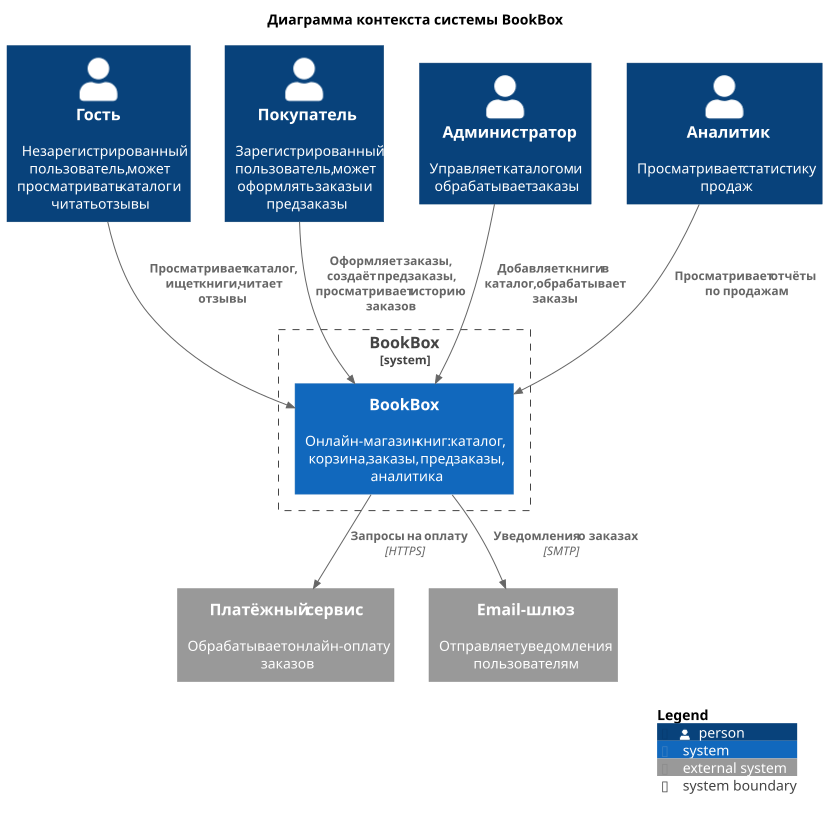
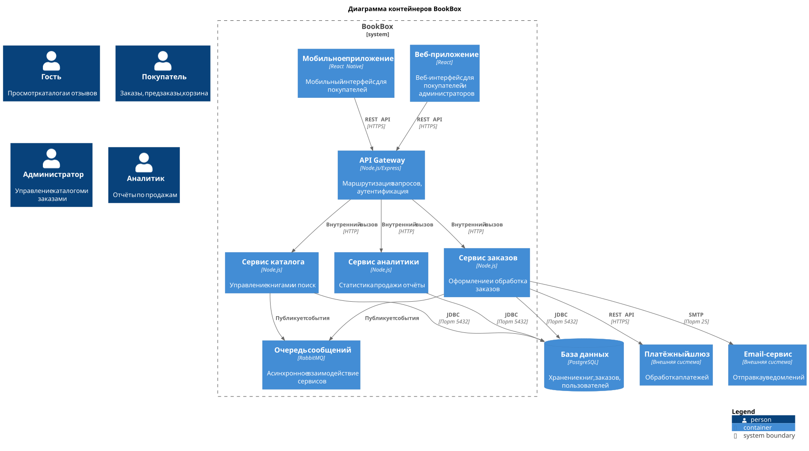
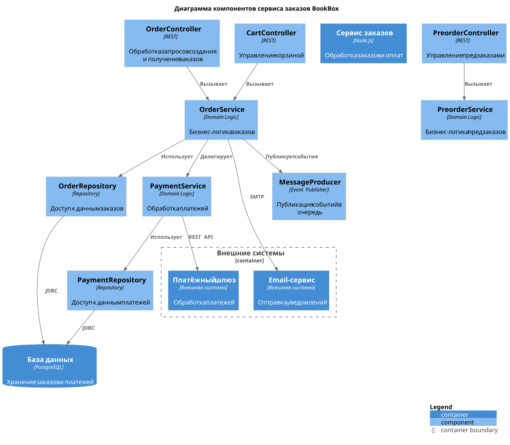
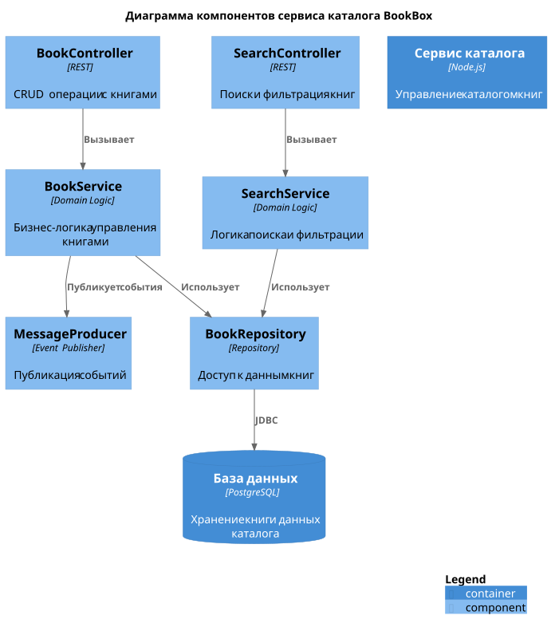
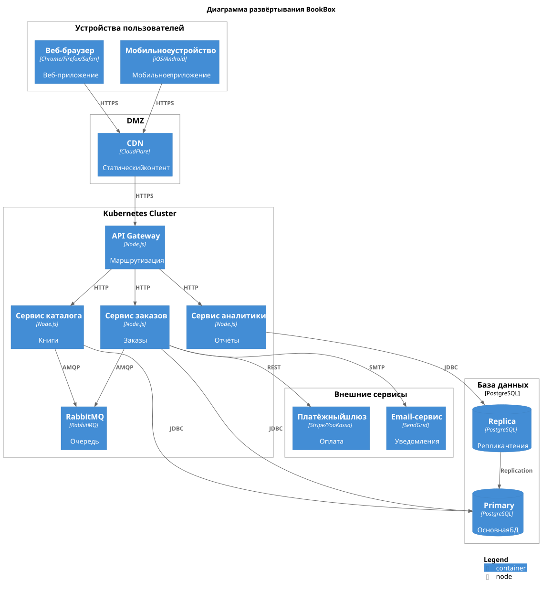

# Описание архитектуры BookBox с использованием C4 Model

## Введение

C4 Model — это метод визуализации архитектуры программных систем на четырёх уровнях детализации: контекст, контейнеры, компоненты и код. Каждый уровень отвечает на определённый вопрос: кто использует систему (Context), из чего она состоит (Container), как устроены отдельные части (Component), и как реализован код (Code).

В этом разделе представлены диаграммы C4 для системы BookBox, разработанные с использованием библиотеки C4-PlantUML. Диаграммы опираются на материалы предыдущих лабораторных работ: спецификацию из задания 4, Event Storming из задания 5 и Event Modeling из задания 6.

## 1. Диаграмма контекста (Context Diagram)

_Рисунок 1. Диаграмма контекста BookBox. [Исходник PlantUML](../../images/lab3/task7/context.puml)._

Диаграмма контекста показывает систему BookBox как единое целое и её взаимодействие с внешними участниками. Четыре типа пользователей взаимодействуют с системой: гости просматривают каталог, покупатели оформляют заказы, администраторы управляют каталогом и заказами, аналитики работают с отчётами. Две внешние системы — платёжный сервис и email-шлюз — обеспечивают проведение оплаты и отправку уведомлений.

Эта диаграмма полезна для согласования границ системы с заинтересованными сторонами и определения точек интеграции.

## 2. Диаграмма контейнеров (Container Diagram)

_Рисунок 2. Диаграмма контейнеров BookBox. [Исходник PlantUML](../../images/lab3/task7/container.puml)._

Диаграмма контейнеров показывает технологическую архитектуру системы. Веб-приложение на React и мобильное приложение на React Native обеспечивают пользовательские интерфейсы. API Gateway на Node.js/Express выполняет маршрутизацию запросов и аутентификацию. Три микросервиса — каталог, заказы и аналитика — реализуют бизнес-логику. База данных PostgreSQL хранит данные, RabbitMQ обеспечивает асинхронное взаимодействие между сервисами.

Разделение на микросервисы позволяет масштабировать компоненты независимо и обеспечивает устойчивость системы к отказам отдельных частей.

## 3. Диаграммы компонентов (Component Diagrams)

### 3.1. Сервис заказов

_Рисунок 3. Компоненты сервиса заказов. [Исходник PlantUML](../../images/lab3/task7/component-order.puml)._

Сервис заказов содержит контроллеры для работы с заказами, корзиной и предзаказами. Бизнес-логика выделена в отдельные сервисы: OrderService обрабатывает заказы, PaymentService взаимодействует с платёжным шлюзом, PreorderService управляет предзаказами. Репозитории обеспечивают доступ к данным, MessageProducer публикует события для асинхронного взаимодействия с другими сервисами.

### 3.2. Сервис каталога

_Рисунок 4. Компоненты сервиса каталога. [Исходник PlantUML](../../images/lab3/task7/component-catalog.puml)._

Сервис каталога предоставляет функциональность для управления книгами и поиска. BookController обеспечивает CRUD-операции с книгами, SearchController — поиск и фильтрацию. BookService и SearchService содержат бизнес-логику, BookRepository обеспечивает доступ к данным.

## 4. Диаграмма развёртывания (Deployment Diagram)

_Рисунок 5. Диаграмма развёртывания BookBox. [Исходник PlantUML](../../images/lab3/task7/deployment.puml)._

Диаграмма развёртывания показывает физическое размещение компонентов системы. Пользователи работают через веб-браузеры и мобильные устройства. Статический контент доставляется через CDN. Бэкенд размещается в Kubernetes-кластере с отдельными подами для веб-приложения, мобильного API, API Gateway и микросервисов. База данных использует схему primary-replica с одной первичной нодой и двумя репликами для чтения. Внешние сервисы (платёжный шлюз и email-сервис) подключаются из облачной инфраструктуры.

## Соответствие C4 и предыдущих заданий

| Уровень C4 | Результат из предыдущих заданий |
|------------|--------------------------------|
| Контекст | Матрица ролей из ЛР1, пользовательские истории из ЛР3 |
| Контейнеры | Диаграмма компонентов из ЛР4, Event Storming из ЛР5 |
| Компоненты | Диаграммы классов и последовательностей из ЛР4 |
| Развёртывание | Диаграмма развёртывания из ЛР4 |

## Материалы для изучения

- [Официальный сайт C4 Model](https://c4model.com)
- [C4-PlantUML на GitHub](https://github.com/plantuml-stdlib/C4-PlantUML)
- [Статья «Аналитик и архитектура: UML-диаграммы для модели C4»](https://habr.com/ru/companies/ozon/articles/517082/)