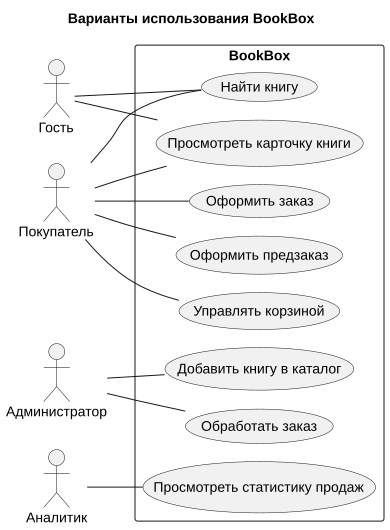
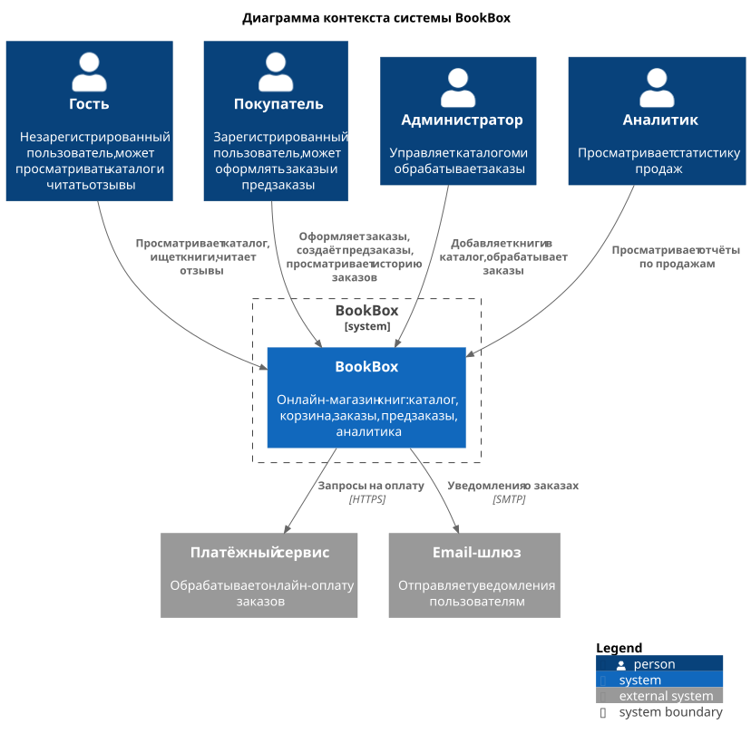
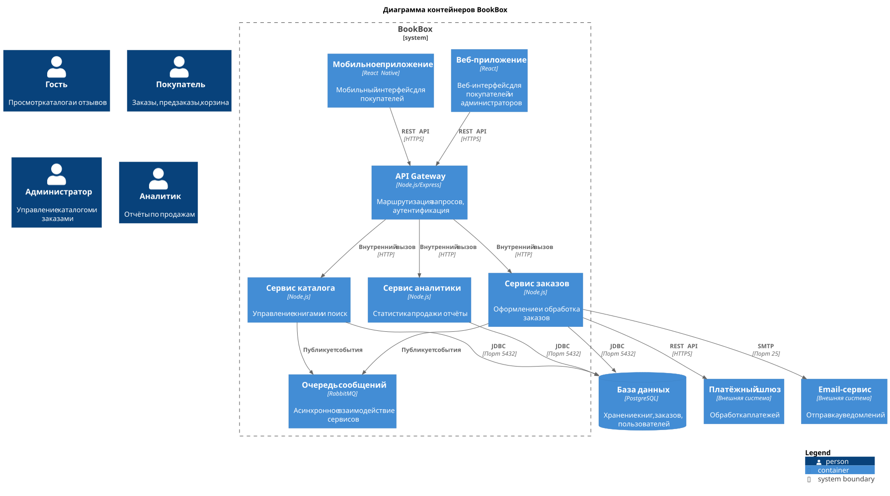
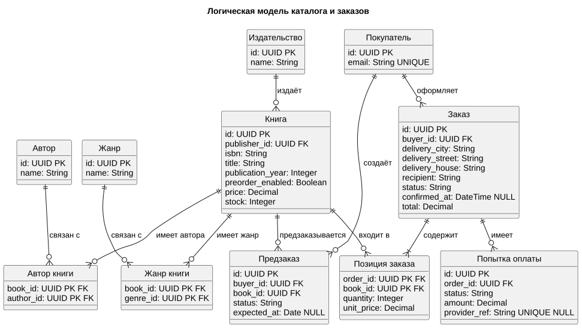
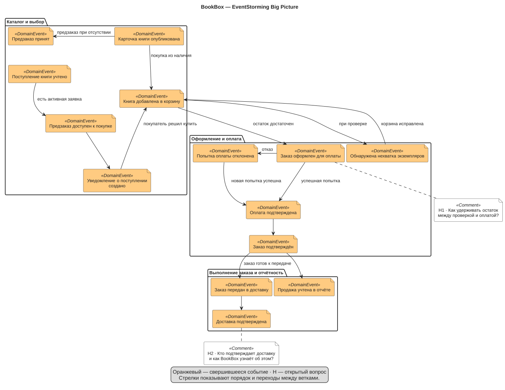

# Техническое задание на разработку системы BookBox

**Версия документа:** 1.0  
**Дата:** Ноябрь 2024  
**Авторы:** Назар Ращинский, Тимофей Карвацкий  

---

## 1. Введение

### 1.1. Назначение

Настоящий документ представляет собой спецификацию требований к программной системе BookBox — онлайн-магазину печатных и электронных книг. Документ определяет функциональные и нефункциональные требования, интерфейсы системы, архитектурные решения и критерии качества. Предназначен для команды разработки, тестировщиков, аналитиков и заинтересованных сторон.

### 1.2. Соглашения, принятые в документах

- **Функциональные требования** обозначаются префиксом FR (Functional Requirement) с порядковым номером.
- **Нефункциональные требования** обозначаются префиксом NFR (Non-Functional Requirement).
- **Роли пользователей**: Гость, Покупатель, Администратор, Аналитик.
- **Платформы**: веб-сайт, мобильное приложение (iOS/Android), веб-админ-панель.
- **Стандарты**: UML 2.5 для диаграмм, C4 Model для архитектурных представлений.
- **Валюта**: BYN (белорусский рубль) — используется в учебной модели.

### 1.3. Границы проекта

**В рамки проекта входит:**
- Веб-сайт BookBox с каталогом, корзиной, оформлением заказов и предзаказов
- Мобильное приложение для покупателей с основным функционалом покупки книг
- Веб-админ-панель для администраторов и аналитиков
- Микросервисная архитектура с API Gateway
- Интеграция с платёжным шлюзом и email-сервисом

**За пределами проекта:**
- Физическая доставка книг (выполняется внешней службой доставки)
- Издательские функции (контракты с авторами, типография)
- Офлайн-магазины и пункты самовывоза

### 1.4. Ссылки

| № | Документ | Расположение |
|---|----------|--------------|
| 1 | Пользовательские истории | lab3/task4/user-stories.md |
| 2 | Сценарии Use Case | lab3/task4/use-cases.md |
| 3 | Техническая спецификация | lab3/task4/specification.md |
| 4 | Event Storming | lab3/task5/eventstorming.md |
| 5 | Event Modeling | lab3/task6/event-modeling.md |
| 6 | C4 Model | lab3/task7/c4-model.md |
| 7 | Диаграмма вариантов использования | images/lab3/use-cases.svg |
| 8 | ERD | images/lab3/task4/erd.svg |

---

## 2. Общее описание

### 2.1. Общий взгляд на продукт

BookBox — это онлайн-магазин книг, предоставляющий пользователям возможность поиска, выбора и покупки печатных и электронных книг через веб-сайт и мобильное приложение. Система ориентирована на конечных покупателей, а также на сотрудников магазина, управляющих каталогом и анализирующих продажи.

Основные возможности:
- Просмотр каталога книг с поиском и фильтрацией
- Оформление заказов с онлайн-оплатой
- Предзаказ недоступных книг с уведомлением о поступлении
- Управление каталогом (добавление, редактирование книг)
- Просмотр статистики продаж и экспорт отчётов

### 2.2. Классы и характеристики пользователей

| Роль | Описание | Основные действия |
|------|----------|-------------------|
| Гость | Незарегистрированный пользователь | Просмотр каталога, поиск книг, чтение отзывов |
| Покупатель | Зарегистрированный пользователь | Оформление заказов, предзаказ, управление корзиной, просмотр истории заказов |
| Администратор | Сотрудник магазина | Добавление книг в каталог, обработка заказов, передача в доставку |
| Аналитик | Сотрудник магазина | Просмотр статистики продаж, экспорт отчётов |

**Характеристики пользователей:**
- Покупатели могут использовать как веб-сайт, так и мобильное приложение
- Администраторы и аналитики работают через веб-админ-панель
- Гости имеют ограниченный доступ без авторизации

### 2.3. Операционная среда

**Клиентская часть:**
- Веб-приложение: современные браузеры (Chrome 90+, Firefox 88+, Safari 14+, Edge 90+)
- Мобильное приложение: iOS 13+, Android 8+ (API 26+)

**Серверная часть:**
- Сервер приложений: Node.js 18+ (микросервисная архитектура)
- База данных: PostgreSQL 14+ (primary-replica схема)
- Очередь сообщений: RabbitMQ 3.11+
- Кеширование: Redis 7+
- CDN для статического контента

**Интеграции:**
- Платёжный шлюз: Stripe, YooKassa или аналог
- Email-сервис: SendGrid, AWS SES или аналог

### 2.4. Ограничения дизайна и реализации

- Система должна поддерживать одновременную работу не менее 1000 пользователей
- Время отклика страницы каталога не должно превышать 2 секунд
- База данных должна обеспечивать целостность транзакций заказов (ACID)
- Мобильное приложение должно работать в офлайн-режиме для просмотра ранее загруженных данных
- Веб-интерфейс должен быть адаптивным (от 375px до 1440px ширины экрана)
- Система должна соответствовать базовым требованиям доступности (WCAG 2.1 Level A)

### 2.5. Предположения и зависимости

- Предполагается, что платёжный шлюз предоставляет REST API для интеграции
- Предполагается, что email-сервис поддерживает отправку транзакционных писем
- Зависимость от внешней системы не должна блокировать работу системы при временном недоступе (реализуется повторная попытка и очередь)
- СУБД выбрана PostgreSQL как реляционная СУБД, обеспечивающая надёжность и производительность
- В учебной модели используется валюта BYN, но архитектура позволяет сменить валюту без изменения кода

---

## 3. Функции системы

### 3.1. Поиск и просмотр каталога книг

**FR-01 Поиск книги по названию и фильтрация по цене**

_Описание:_ Покупатель может искать книги по названию и ограничивать результаты по максимальной цене. Результаты отображаются в виде списка с названием, автором, ценой и информацией о наличии.

_Функциональные требования:_
- FR-01.1 Поисковая строка доступна на главной странице и в каталоге
- FR-01.2 Поиск возвращает книги, содержащие в названии введённый текст
- FR-01.3 Фильтр «Цена до» исключает из результатов книги дороже указанного значения
- FR-01.4 При пустом результате поиска отображается сообщение с предложением изменить запрос

### 3.2. Расширенный поиск и предзаказ

**FR-02 Расширенный поиск книги**

_Описание:_ Покупатель может искать книги по автору, издательству и году издания. Используется для поиска редких изданий.

_Функциональные требования:*
- FR-02.1 Расширенный поиск позволяет задать любую комбинацию параметров: автор, издательство, год издания
- FR-02.2 Выдача содержит книги, соответствующие всем указанным параметрам

**FR-03 Предзаказ книги**

_Описание:_ Покупатель может оформить предзаказ на книгу, временно недоступную для покупки. При поступлении книги покупатель получает уведомление.

_Функциональные требования:*
- FR-03.1 Для книги с признаком «доступен предзаказ» отображается действие «Предзаказ»
- FR-03.2 После оформления предзаказа система возвращает номер предзаказа и ожидаемую дату поступления (если известна)
- FR-03.3 При поступлении книги покупателю отправляется уведомление

### 3.3. Оформление заказа

**FR-04 Оформление заказа из корзины**

_Описание:_ Покупатель формирует заказ из книг в корзине, указывает адрес доставки, способ доставки и дополнительные опции.

_Функциональные требования:*
- FR-04.1 Покупатель может добавить книгу в корзину со страницы книги
- FR-04.2 В корзине отображаются все добавленные книги с возможностью изменить количество или удалить
- FR-04.3 При оформлении заказа можно включить подарочную упаковку
- FR-04.4 При оформлении заказа можно указать адрес получателя, отличный от адреса покупателя
- FR-04.5 До подтверждения заказа система показывает итоговую стоимость, включая доставку и упаковку
- FR-04.6 При подтверждении заказ получает статус «Ожидает оплаты»

**FR-05 Проверка наличия и резервирование**

_Описание:_ Перед оплатой система проверяет наличие книг в заказе.

_Функциональные требования:*
- FR-05.1 Система проверяет остаток каждой позиции заказа
- FR-05.2 При недостаточном количестве система уведомляет покупателя и предлагает вернуться к корзине
- FR-05.3 При подтверждении заказа остаток уменьшается на количество в заказе

**FR-06 Онлайн-оплата заказа**

_Описание:_ Покупатель оплачивает заказ через платёжный шлюз.

_Функциональные требования:*
- FR-06.1 Система инициирует платёж и перенаправляет покупателя на страницу платёжного шлюза
- FR-06.2 После успешной оплаты заказ получает статус «Подтверждён»
- FR-06.3 При отказе платежа система сохраняет данные заказа и позволяет повторить попытку
- FR-06.4 Заказ может иметь несколько попыток оплаты

### 3.4. Управление каталогом

**FR-07 Добавление книги в каталог**

_Описание:_ Администратор добавляет новую книгу в каталог через админ-панель.

_Функциональные требования:*
- FR-07.1 Только пользователь с ролью администратора может добавить книгу
- FR-07.2 Обязательные поля: название, автор, издательство, цена
- FR-07.3 При незаполненном обязательном поле система выводит сообщение об ошибке и не сохраняет книгу
- FR-07.4 После сохранения книга появляется в каталоге и доступна для поиска

**FR-08 Управление остатками**

_Описание:_ Администратор может изменять количество экземпляров книги в наличии.

_Функциональные требования:*
- FR-08.1 Администратор может изменить остаток книги через форму редактирования
- FR-08.2 При изменении остатка на ноль книга становится недоступна для покупки (но доступна для предзаказа, если это допустимо)

### 3.5. Обработка заказов

**FR-09 Обработка и передача в доставку**

_Описание:_ Администратор обрабатывает подтверждённые заказы и передаёт их в доставку.

_Функциональные требования:*
- FR-09.1 Администратор видит список подтверждённых заказов
- FR-09.2 Администратор может изменить статус заказа на «Передан в доставку»
- FR-09.3 При изменении статуса покупатель видит обновлённый статус в своём интерфейсе

### 3.6. Аналитика и отчётность

**FR-10 Просмотр статистики продаж**

_Описание:_ Аналитик просматривает отчёты о продажах за выбранный период.

_Функциональные требования:*
- FR-10.1 Пользователь с правом на аналитику может выбрать период отчёта
- FR-10.2 Отчёт содержит: сумму продаж, количество подтверждённых заказов, список популярных книг
- FR-10.3 При отсутствии данных за период отображается поясняющее сообщение

**FR-11 Экспорт отчёта**

_Описание:_ Аналитик может экспортировать данные отчёта в CSV-файл.

_Функциональные требования:*
- FR-11.1 Экспорт доступен для любого выбранного периода
- FR-11.2 Файл содержит заголовки и данные о продажах по книгам

---

## 4. Требования к данным

### 4.1. Логическая модель данных

Логическая модель данных отображает сущности, необходимые для функционирования BookBox. Полная ERD представлена в приложении Б и в файле [images/lab3/task4/erd.svg](../../images/lab3/task4/erd.svg).

Основные сущности:
- **Book** — книга в каталоге (id, title, author, publisher, year, price, stock, preorder_allowed)
- **User** — пользователь системы (id, email, name, role, password_hash, created_at)
- **Cart** — корзина покупателя (id, user_id, created_at, updated_at)
- **CartItem** — позиция в корзине (id, cart_id, book_id, quantity)
- **Order** — заказ (id, user_id, status, delivery_address, gift_wrap, total_amount, created_at)
- **OrderItem** — позиция заказа (id, order_id, book_id, quantity, unit_price)
- **PaymentAttempt** — попытка оплаты (id, order_id, external_id, status, amount, created_at)
- **Preorder** — предзаказ (id, user_id, book_id, status, expected_date, created_at)

### 4.2. Словарь данных

| Сущность | Атрибут | Тип | Описание |
|----------|---------|-----|----------|
| Book | id | UUID | Уникальный идентификатор |
| Book | title | VARCHAR(500) | Название книги |
| Book | author | VARCHAR(200) | Автор |
| Book | publisher | VARCHAR(200) | Издательство |
| Book | year | INTEGER | Год издания |
| Book | price | DECIMAL(10,2) | Цена в BYN |
| Book | stock | INTEGER | Количество в наличии |
| Book | preorder_allowed | BOOLEAN | Разрешён предзаказ |
| User | id | UUID | Уникальный идентификатор |
| User | email | VARCHAR(255) | Email (уникальный) |
| User | name | VARCHAR(200) | Имя пользователя |
| User | role | ENUM | guest, buyer, admin, analyst |
| Order | id | UUID | Уникальный идентификатор |
| Order | status | ENUM | pending_payment, confirmed, shipped, delivered, cancelled |
| Order | delivery_address | TEXT | Адрес доставки |
| Order | gift_wrap | BOOLEAN | Подарочная упаковка |
| Order | total_amount | DECIMAL(10,2) | Итоговая сумма |

### 4.3. Отчёты

Система формирует следующие отчёты:
- **Продажи за период**: сумма подтверждённых заказов, количество заказов, количество проданных экземпляров
- **Популярные книги**: список книг с количеством продаж за период, отсортированный по убыванию
- **Экспорт в CSV**: данные о продажах по книгам за выбранный период

### 4.4. Получение, целостность, хранение и утилизация данных

**Получение данных:**
- Пользователи вводят данные через веб- и мобильный интерфейс
- Администраторы вводят данные через админ-панель
- Внешние системы (платёжный шлюз) передают данные через API

**Целостность данных:**
- Все обязательные поля проверяются перед сохранением
- Остаток книги не может быть отрицательным
- Цена за единицу в позиции заказа фиксируется на момент оформления (не зависит от последующих изменений в каталоге)
- Транзакции заказов используют ACID-совместимую СУБД

**Хранение данных:**
- Персональные данные пользователей хранятся в зашифрованном виде
- История заказов сохраняется бессрочно
- Данные предзаказов сохраняются до выполнения или отмены
- Резервное копирование БД выполняется ежедневно

**Утилизация данных:**
- Пользователь может удалить свой аккаунт (мягкое удаление, данные анонимизируются)
- Заказы с истёкшим сроком хранения архивируются
- Предзаказы автоматически отменяются при отсутствии книги в течение 90 дней

---

## 5. Требования к внешним интерфейсам

### 5.1. Пользовательские интерфейсы

**Веб-сайт:**
- Главная страница с поисковой строкой и рекомендуемыми книгами
- Каталог с фильтрами и сортировкой
- Карточка книги с описанием, отзывами и кнопкой «В корзину»
- Корзина и оформление заказа
- Личный кабинет покупателя с историей заказов
- Адаптивный макет: ширина от 375px до 1440px

**Мобильное приложение:**
- Основные экраны: каталог, поиск, корзина, профиль
- Нижняя навигационная панель
- Крупные элементы управления для сенсорного ввода
- Push-уведомления (при согласии пользователя)

**Веб-админ-панель:**
- Управление каталогом (список, добавление, редактирование книг)
- Список заказов с фильтрацией по статусу
- Обработка заказов (передача в доставку)
- Отчёты по продажам

**Требования к доступности:**
- Все формы имеют видимые подписи полей
- Навигация доступна с клавиатуры
- Фокус видим при перемещении по элементам
- Сообщения об ошибках связаны с соответствующими полями

### 5.2. Интерфейсы ПО

**REST API (публичный):**

| Метод | Ресурс | Описание |
|-------|--------|----------|
| GET | /api/books | Список книг с фильтрами |
| GET | /api/books/:id | Карточка книги |
| GET | /api/cart | Корзина пользователя |
| POST | /api/cart/items | Добавить в корзину |
| DELETE | /api/cart/items/:id | Удалить из корзины |
| POST | /api/orders | Создать заказ |
| GET | /api/orders | Список заказов пользователя |
| GET | /api/orders/:id | Детали заказа |
| POST | /api/preorders | Создать предзаказ |
| POST | /api/auth/register | Регистрация |
| POST | /api/auth/login | Вход |

**Внутренние вызовы между сервисами:**
- API Gateway → Сервис каталога
- API Gateway → Сервис заказов
- API Gateway → Сервис аналитики
- Сервис заказов → Платёжный шлюз (внешний API)
- Сервис заказов → Email-сервис

### 5.3. Интерфейсы оборудования

- **Веб-серверы**: серверы для фронтенда и API Gateway
- **Серверы приложений**: узлы Kubernetes для микросервисов
- **Серверы базы данных**: primary + реплики для чтения
- **CDN**: доставка статических файлов (изображения книг, CSS, JS)

### 5.4. Коммуникационные интерфейсы

- **HTTPS**: взаимодействие клиентов с сервером (TLS 1.3)
- **HTTP**: внутренние вызовы между сервисами
- **AMQP**: очередь сообщений (RabbitMQ)
- **JDBC**: доступ к базе данных
- **SMTP**: отправка email-уведомлений

---

## 6. Атрибуты качества

### 6.1. Удобство использования

- **NFR-01** Время загрузки главной страницы не превышает 3 секунд при скорости интернета 10 Мбит/с
- **NFR-02** Поиск возвращает результаты не более чем за 2 секунды
- **NFR-03** Интерфейс корзины и оформления заказа понятен интуитивно
- **NFR-04** Мобильное приложение поддерживает системное масштабирование текста
- **NFR-05** Веб-интерфейс соответствует уровню доступности WCAG 2.1 Level A

### 6.2. Производительность

- **NFR-06** Система поддерживает не менее 1000 одновременных пользователей
- **NFR-07** Пиковая нагрузка: 500 запросов в секунду к API каталога
- **NFR-08** База данных обрабатывает транзакции заказов с временем отклика не более 100мс
- **NFR-09** При недоступности одной реплики БД система продолжает работу с минимальной деградацией

### 6.3. Безопасность

- **NFR-10** Пароли пользователей хэшируются с использованием bcrypt (cost 12)
- **NFR-11** API использует JWT-токены с сроком жизни 24 часа
- **NFR-12** Все внешние коммуникации осуществляются по HTTPS
- **NFR-13** Роль и права пользователя проверяются на каждом защищённом endpoint
- **NFR-14** Ввод данных валидируется на стороне клиента и сервера

### 6.4. Техника безопасности

- **NFR-15** Персональные данные хранятся в соответствии с требованиями законодательства
- **NFR-16** Логирование не содержит паролей, платёжных данных и персональной информации
- **NFR-17** Резервное копирование выполняется ежедневно с хранением копий 30 дней
- **NFR-18** Восстановление после сбоя должно занимать не более 4 часов

### 6.5. Надёжность и масштабируемость

- **NFR-19** Среднее время наработки на отказ (MTBF) не менее 720 часов
- **NFR-20** Время восстановления после отказа (MTTR) не более 30 минут
- **NFR-21** Горизонтальное масштабирование микросервисов без простоя системы

---

## 7. Требования по интернационализации и локализации

- **NFR-22** Система использует русский язык по умолчанию
- **NFR-23** Интерфейсные строки вынесены в отдельные файлы локализации
- **NFR-24** Формат даты: ДД.ММ.ГГГГ (русский стандарт)
- **NFR-25** Формат валюты: 1 234,56 BYN
- **NFR-26** Архитектура позволяет добавить дополнительные языки без изменения бизнес-логики

---

## 8. Остальные требования

- **NFR-27** Система должна быть задокументирована: API-документация (OpenAPI/Swagger), инструкции по развёртыванию, руководство администратора
- **NFR-28** Код покрывается автоматическими тестами не менее чем на 70%
- **NFR-29** Используется непрерывная интеграция (CI) с автоматическим запуском тестов и линтеров

---

## Приложение А. Словарь терминов

| Термин | Определение |
|--------|-------------|
| BookBox | Онлайн-магазин книг, разрабатываемая система |
| Гость | Незарегистрированный пользователь системы |
| Покупатель | Зарегистрированный пользователь с ролью buyer |
| Предзаказ | Заявка на покупку книги, временно недоступной |
| Корзина | Временный список книг, отобранных для покупки |
| Заказ | Оформленная покупка с подтверждённым статусом |
| Микросервис | Независимо развёртываемый компонент системы |
| API Gateway | Точка входа для всех клиентских запросов |
| Реплика БД | Копия базы данных для распределения нагрузки |

---

## Приложение Б. Модели анализа

В данном приложении представлены ключевые диаграммы, иллюстрирующие архитектуру и поведение системы.

### Б.1. Диаграмма вариантов использования

_Рисунок Б.1. Варианты использования BookBox._

### Б.2. Диаграмма контекста (C4)

_Рисунок Б.2. Контекст системы по C4 Model._

### Б.3. Диаграмма контейнеров (C4)

_Рисунок Б.3. Контейнеры системы по C4 Model._

### Б.4. ERD

_Рисунок Б.4. Логическая модель данных (ERD)._

### Б.5. Event Storming — Big Picture

_Рисунок Б.5. Big Picture Event Storming._

---

_Конец документа_