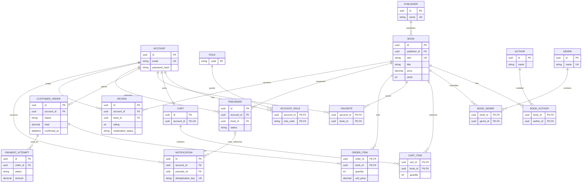

# ЛР4, задание 2. Логическая модель данных

## Назначение

Логическая модель уточняет предметную модель ЛР3 для API-сценариев каталога, аккаунта, корзины, заказов, оплаты, предзаказа, уведомлений, отзывов и аналитики. Она задаёт сущности и связи без привязки к конкретному ORM. Физическая реализация в текущем варианте рассчитана на PostgreSQL; выбор СУБД нужно согласовать с репозиторием сервера перед интеграцией.

## Сущности и связи

## Основные ограничения предметной модели

- У аккаунта уникальный email; права задаются связью аккаунта с ролями, поскольку один участник может совмещать роли покупателя, администратора и аналитика.
- Цена и сумма заказа хранятся точно, количество и остаток неотрицательны; количество позиции заказа положительно.
- Цена `ORDER_ITEM.unit_price` — снимок на момент заказа, не связанный с дальнейшим изменением цены книги.
- Заказ хранит снимок адреса доставки и получателя. У заказа может быть несколько попыток оплаты; повтор после отказа создаёт отдельную попытку.
- Отзывы связывают аккаунт и книгу. Публично доступно только состояние «опубликован»; модераторские состояния остаются административными.
- Ключ дедупликации уведомления защищает от повторного создания уведомления при повторной обработке одного события поступления.
- Наличие в каталоге хранится как целое число. Проверка остатка при оформлении и фиксация заказа должны выполняться транзакционно в реализации сервера.

## Отличие от упрощённой схемы ЛР3

В физической модели добавлены аккаунты и роли, корзина, избранное, отзывы и уведомления: без них нельзя поддержать заявленные в предыдущих лабораторных пользовательские сценарии API. Сущности платежа и позиций заказа сохранены и уточнены для повторных попыток и снимка цены. Адрес заказа хранится в самом заказе как исторический снимок.
