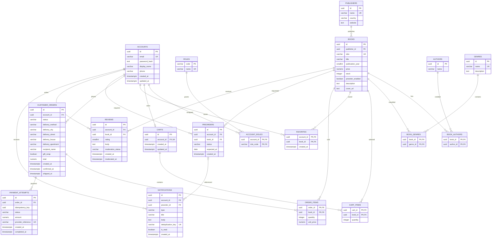

# Физическая ER-модель BookBox

Физическая схема рассчитана на PostgreSQL. Типы, ключи и ограничения диаграммы отражены в [SQL-файле](schema.sql); он является источником точных ограничений.

## Ограничения, важные для API

- Пара аккаунт–роль, корзина аккаунта, пара аккаунт–книга в избранном, пара заказ–книга и пара аккаунт–книга в отзывах имеют ограничения уникальности.
- Для платежей уникальна пара `order_id + idempotency_key`; это позволяет повторять один запрос без создания ещё одной попытки.
- Отзывы ограничены оценкой 1–5 и состояниями модерации `pending`, `published`, `rejected`.
- Статус заказа ограничен допустимыми значениями; оплаченный заказ обязан иметь `confirmed_at`, отправленный — `shipped_at`.
- Удаление книги запрещено, если она уже использована в заказе или предзаказе, чтобы сохранить историю.

Исходник диаграммы: [PlantUML](physical-model.puml). Физические типы, индексы и SQL-ограничения: [schema.sql](schema.sql).
