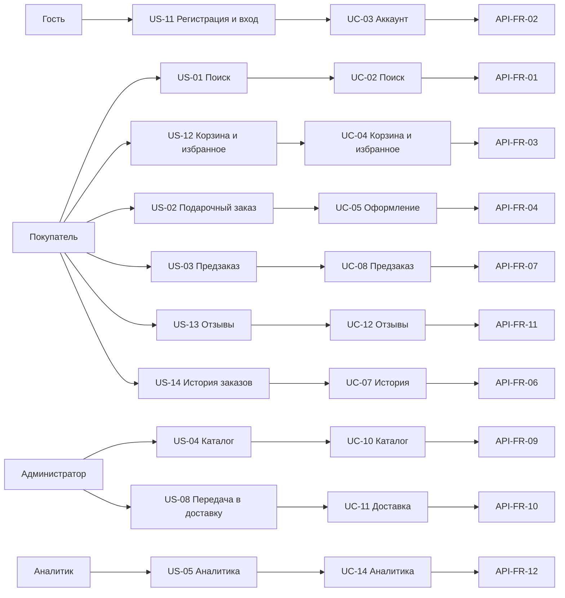

# ЛР4, задание 1. Модель требований и реестр вариантов использования

## Цель и границы

Эта модель связывает роли BookBox, пользовательские истории ЛР3 и варианты использования API. Она уточняет функциональные требования серверной части для веб- и мобильного клиентов, административной панели и аналитики. Истории US-01–US-10 переиспользуют материалы `docs/lab3/task4/user-stories.md`; дополнительные истории US-11–US-14 добавляют API-операции, явно нужные для регистрации, корзины и отзывов.

## Действующие лица

| Актор | Цель и доступ |
|---|---|
| Гость | Просматривать каталог и карточки книг, искать книги, регистрировать аккаунт |
| Покупатель | Управлять профилем, избранным и корзиной; оформлять заказы и предзаказы; читать и оставлять отзывы; видеть только свои заказы и уведомления |
| Администратор | Управлять каталогом, справочниками и состояниями заказов; модерировать отзывы |
| Аналитик | Просматривать агрегаты продаж и экспортировать отчёт при наличии соответствующего права |
| Платёжный провайдер | Возвращать результат конкретной попытки оплаты; не инициирует оплату самостоятельно |

## Истории, добавленные для покрытия API

| ID | Актор | История | Критерии API-приёмки |
|---|---|---|---|
| US-11 | Гость | Как гость, я хочу зарегистрироваться и войти, чтобы получить персональные функции магазина. | Email уникален; пароль не возвращается API; неверные учётные данные не раскрывают, существует ли аккаунт; приватные операции требуют аутентификации. |
| US-12 | Покупатель | Как покупатель, я хочу получать и изменять свою корзину и избранное, чтобы подготовить будущую покупку. | Клиент может получить текущее состояние, добавить/удалить книгу и изменить количество; нельзя изменить данные другого аккаунта; количество должно быть положительным. |
| US-13 | Покупатель | Как покупатель, я хочу читать отзывы и отправить отзыв о книге, чтобы поделиться опытом покупки. | Публичная выдача содержит только опубликованные отзывы; оценка от 1 до 5; повторный отзыв того же покупателя на ту же книгу отклоняется или обновляет существующий согласно выбранному правилу; модерация доступна только администратору. |
| US-14 | Покупатель | Как покупатель, я хочу читать историю заказов, детали и уведомления, чтобы понимать состояние покупок. | Покупатель видит только собственные данные; сервер возвращает актуальный статус и время изменения; отсутствующий или чужой ресурс не раскрывает данные. |

## Реестр требований API

| ID | Требование | Актор | Связанные истории | Use Case |
|---|---|---|---|---|
| API-FR-01 | Получать каталог и карточку книги; искать по тексту и метаданным; фильтровать по цене, жанру, издательству и наличию. | Гость, покупатель | US-01, US-03 | UC-01, UC-02 |
| API-FR-02 | Регистрировать аккаунт, аутентифицировать пользователя, возвращать и обновлять его профиль. | Гость, покупатель | US-11 | UC-03 |
| API-FR-03 | Читать и изменять избранное и корзину текущего покупателя. | Покупатель | US-12 | UC-04 |
| API-FR-04 | Создавать заказ из корзины с адресом, доставкой и данными подарочной упаковки; перед созданием проверять остатки и фиксировать цену позиции. | Покупатель | US-02, US-07 | UC-05 |
| API-FR-05 | Создавать попытку оплаты и принимать результат провайдера с идемпотентной обработкой повторов. | Покупатель, платёжный провайдер | US-06 | UC-06 |
| API-FR-06 | Возвращать покупателю список и детали только его заказов, включая актуальные статусы. | Покупатель | US-08, US-14 | UC-07 |
| API-FR-07 | Создавать и читать предзаказы на разрешённые к предзаказу книги. | Покупатель | US-03, US-09 | UC-08 |
| API-FR-08 | Возвращать список уведомлений текущего покупателя и отмечать уведомление прочитанным. | Покупатель | US-09, US-14 | UC-09 |
| API-FR-09 | Создавать книгу и менять её доступность/данные; проверять роль администратора и обязательные поля. | Администратор | US-04 | UC-10 |
| API-FR-10 | Передавать допустимый оплаченный заказ в доставку; повтор команды не должен создавать повторный переход. | Администратор | US-08 | UC-11 |
| API-FR-11 | Читать отзывы книги и отправлять отзыв на модерацию; публиковать или отклонять его с проверкой прав. | Гость, покупатель, администратор | US-13 | UC-12, UC-13 |
| API-FR-12 | Возвращать продажи за корректный период и выгружать тот же набор данных в CSV. | Аналитик | US-05, US-10 | UC-14 |

## Реестр вариантов использования

| ID | Название | Инициатор | Истории и требования | Результат |
|---|---|---|---|---|
| UC-01 | Просмотреть каталог и карточку книги | Гость / покупатель | US-01, API-FR-01 | Список или карточка доступных книг |
| UC-02 | Найти книгу и применить фильтры | Гость / покупатель | US-01, US-03, API-FR-01 | Отфильтрованная выдача или пустое состояние |
| UC-03 | Зарегистрироваться, войти и изменить профиль | Гость / покупатель | US-11, API-FR-02 | Аккаунт создан или профиль обновлён |
| UC-04 | Управлять корзиной и избранным | Покупатель | US-12, API-FR-03 | Персональная корзина/избранное обновлены |
| UC-05 | Оформить заказ и проверить наличие | Покупатель | US-02, US-07, API-FR-04 | Заказ сохранён для оплаты либо возвращён список недоступных позиций |
| UC-06 | Оплатить заказ или повторить оплату | Покупатель / провайдер | US-06, API-FR-05 | Попытка зафиксирована; успешный результат подтверждает заказ один раз |
| UC-07 | Посмотреть историю и детали заказов | Покупатель | US-08, US-14, API-FR-06 | Показаны только заказы текущего покупателя |
| UC-08 | Оформить предзаказ | Покупатель | US-03, US-09, API-FR-07 | Заявка создана, если книга допускает предзаказ |
| UC-09 | Просмотреть уведомления | Покупатель | US-09, US-14, API-FR-08 | Показаны персональные уведомления и состояние прочтения |
| UC-10 | Добавить или изменить книгу | Администратор | US-04, API-FR-09 | Изменение каталога сохранено после проверки прав и данных |
| UC-11 | Передать оплаченный заказ в доставку | Администратор | US-08, API-FR-10 | Статус заказа переведён в допустимое следующее состояние |
| UC-12 | Прочитать отзывы книги и отправить отзыв | Гость / покупатель | US-13, API-FR-11 | Опубликованные отзывы видны; новый отзыв ожидает модерации |
| UC-13 | Модерировать отзыв | Администратор | US-13, API-FR-11 | Отзыв опубликован или отклонён |
| UC-14 | Получить аналитику продаж и экспортировать CSV | Аналитик | US-05, US-10, API-FR-12 | Сводка и CSV используют одинаковый период и набор заказов |

## Примеры связей на диаграмме

Диаграмма показывает несколько основных цепочек. Полное покрытие всех историй, Use Case и API-требований зафиксировано в таблицах выше.

## Правила доступа и общие ограничения

- Публичными являются только чтение каталога, карточек и опубликованных отзывов.
- Любые персональные данные фильтруются на сервере по идентификатору текущего аккаунта; клиент не может передать чужой `user_id` для обхода этого ограничения.
- Операции каталога, обработки заказа, модерации и аналитики требуют соответствующей роли.
- Ошибки валидации должны указывать проблемное поле; повторные команды оплаты и передачи заказа должны быть безопасны к повтору.
- API использует JSON и HTTPS; конкретные маршруты, схемы тел и коды ответов описываются в задании 3.

## Источники

- [Истории ЛР3](../lab3/task4/user-stories.md)
- [Use Case ЛР3](../lab3/task4/use-cases.md)
- [Спецификация ЛР3](../lab3/task4/specification.md)
- [Event Modeling ЛР3](../lab3/task6/event-modeling.md)
- [CRUD-модель для управления каталогом товаров](https://getanalyst.ru/database/CRUD-2) — использована как проверка полноты операций для покупателя и администратора.
- [Курс по проектированию REST API GetAnalyst](https://getanalyst.ru/education/restapi) — структура требований и связь API-методов с HTTP.
